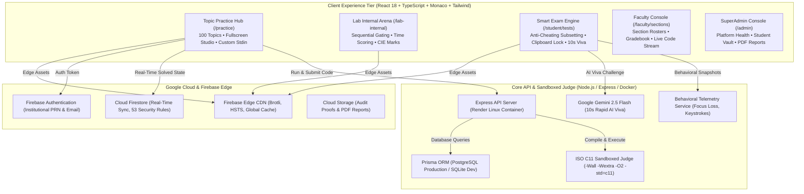

<p align="center">
  
</p>

<h1 align="center">LogicQ</h1>

<p align="center">
  <strong>Institutional-Grade C Programming Mastery, Sandboxed GCC 14 Judge & Continuous Internal Evaluation Platform</strong><br>
  <em>Engineered for Higher Education • ISO C11 Sandboxed Evaluation • Multi-Signal Anti-Cheating Telemetry • 10-Second AI Viva Voce • Apple-Grade Minimalist UX</em>
</p>

<p align="center">
  <a href="https://logicq-clanguage.web.app"></a>
  <a href="https://logicq-bitwiseclub.onrender.com/api/health"></a>
  <a href="https://github.com/pratikpt1304/LogicQ"></a>
  <a href="docs/SECURITY_RULES.md"></a>
  <a href="https://ai.google.dev"></a>
  <a href="SECURITY.md"></a>
</p>

---

## 📌 Executive Overview

**LogicQ** is a high-concurrency competitive programming, coursework progression, and institutional continuous evaluation platform designed from the ground up for university computer science and engineering departments (deployed for **Sanjivani University**, Integrated M.Tech / First Year Computer Science).

It integrates **Apple-grade minimalist human interface design** with **institutional-grade exam proctoring**, anti-collusion randomized question distribution, sandboxed GCC 14 compilation, and automated real-time grading with instantaneous feedback.

```text
┌──────────────────────────────────────────────────────────────────────────────────────────────┐
│                                     LOGICQ ECOSYSTEM                                         │
├──────────────────────────────────────────────┬───────────────────────────────────────────────┤
│        📘 CONCEPTUAL MASTERY ARENA           │        🛡️ PROCTORED LAB & EXAM SUITE          │
│                 (/practice)                  │      (/lab-internal & /student/tests)         │
├──────────────────────────────────────────────┼───────────────────────────────────────────────┤
│ • 100 Hand-Curated Progressive C Topics      │ • Anti-Cheating PRN Deterministic Subsetting  │
│ • 4 Core Modules (25 Topics Each)            │ • Adjacent Lab Seat Zero-Overlap Guarantee    │
│ • Sequential Question Unlock Gating          │ • 10-Second Rapid-Fire AI Viva Voce (Gemini)  │
│ • Interactive Syntax Reference System        │ • Fullscreen Enforcement & Incident Logging   │
│ • Custom Stdin & Real-Time GCC Verdicts      │ • Continuous CIE Evaluation (80 Questions)    │
│ • Portal-Powered True Fullscreen Studio      │ • Time-Based Scoring (10m / 20m / 30m)        │
│ • Zero Penalty, Unlimited Practice Attempts  │ • Tamper-Evident QR-Verifiable PDF Reports    │
└──────────────────────────────────────────────┴───────────────────────────────────────────────┘
```

---

## 🌟 Key Platform Capabilities

### 1. 🎓 Continuous Internal Evaluation (CIE 20-Mark Scale)
- **80 Progressive Coursework Experiments**: Divided into 4 sequential modules (20 questions per module).
- **Automated GCC 14 Evaluation**: Evaluates solutions against 2 visible test cases and 1 hidden stress test case.
- **Deterministic Scaling**:
  $$\text{CIE Score} = \frac{\text{Solved Questions}}{80} \times 20.0 = \text{Solved Questions} \times 0.25$$
- **Time-Based Scoring Policy**:
  - 🟢 **Easy Problems**: 10 Minutes limit
  - 🟡 **Medium Problems**: 20 Minutes limit
  - 🔴 **Hard Problems**: 30 Minutes limit
  - **On-Time Submission**: 100% Credit ($1.0\text{ M}$ Academic / $0.25\text{ M}$ CIE).
  - **Late Submission**: 50% Credit ($0.5\text{ M}$ Academic / $0.125\text{ M}$ CIE).

---

### 2. ⚡ 10-Second Rapid-Fire AI Viva Voce
- **Trigger**: Automatically engages on every second consecutive correct submission (#2, #4, #6...).
- **Powered by Gemini 2.5 Flash**: Analyzes the student's actual submitted C code and generates an ultra-concise 6–10 word comprehension question testing their direct recall (e.g., *"Which variable controls your loop iteration?"* or *"What value does main return?"*).
- **10-Second Strict Timer**: Animated countdown with auto-submission at $0\text{s}$.
- **Instant 1-2 Word Input**: Students answer directly in 1–2 words (`i`, `0`, `%d`, `sum`, `while`) and press `Enter` to submit.
- **Fail-Safe Deterministic Fallback**: Automatic multi-signal keyword analyzer ensures seamless operation even during high latency or offline events.

---

### 3. 🛡️ Multi-Signal Behavioral Proctoring
- **Anti-Collusion Subsetting**: Mathematical stride offset guarantees adjacent lab seats (Roll `1001`, `1002`, `1003`) never receive overlapping question sets.
- **Monaco Editor Sandbox**: Copy-paste bursts from outside sources are strictly intercepted and logged.
- **Focus Loss & Fullscreen Monitoring**: Tab switches and fullscreen exit transitions are tracked in real-time with full incident timestamps.
- **Dual-Part University Reports**:
  - **Part A**: Code correctness, GCC compiler accuracy, and on-time/late progression.
  - **Part B**: Behavioral proctoring trail, keystroke dynamics (CPM), and AI viva score.

---

### 4. 🍏 Apple-Grade Minimalist UI & System Epoch
- **Distraction-Free Workspace**: Monaco C11 IDE with collapsible execution dock, auto-saved drafts, and real-time syntax references.
- **System Launch Epoch**: Built-in global launch epoch (`logicq_clean_launch_2026_11_10_v2`) flushes stale browser local storage and sessions automatically across all devices.
- **Direct Student Deep-Dive Vault**: Admin modal for hardware device reset (max 2 devices: laptop & mobile), one-click PRN password reset, and full source code inspection.

---

## 🏛️ System Architecture



---

## 🛠️ Technology Stack

| Component | Technology | Version | Purpose |
| :--- | :--- | :---: | :--- |
| **Frontend Framework** | React | `18.3.1` | Reactive component architecture |
| **Type System** | TypeScript | `5.6.2` | Complete end-to-end type safety |
| **Build Tool** | Vite | `5.4.21` | Rollup bundle splitting and fast HMR |
| **Styling** | Tailwind CSS | `3.4.11` | Custom WCAG AA compliant theme variables |
| **Code Editor** | Monaco Editor | `0.57.0` | Browser-based ISO C11 IDE with syntax intelligence |
| **Spreadsheet Engine** | SheetJS (xlsx) | `0.18.5` | Client-side Excel question import and template generation |
| **Backend Framework** | Node.js / Express | `20.x` / `4.21.0` | High-throughput REST API and judge runner |
| **ORM & Database** | Prisma ORM | `5.22.0` | PostgreSQL (Production) / SQLite (Dev) |
| **Cloud Database** | Cloud Firestore | `v2` | Real-time state store with 53 security rules |
| **Cloud Hosting** | Firebase Hosting | `v15.x` | Global CDN, HTTP/2, custom security headers |
| **AI Viva Engine** | Gemini 2.5 Flash | `v1beta` | 10-second rapid conceptual code verification |
| **Compiler Toolchain** | GCC / MinGW-w64 | `14.2+` | Native ISO C11 compiler sandbox |
| **Testing Harness** | Vitest | `2.1.9` | Automated unit, E2E, and security tests |

---

## 📁 Clean Repository Structure

```text
LogicQ/
├── client/                                 # Frontend React 18 + TypeScript + Vite Application
│   ├── public/                             # PWA Manifest, Icons, and Assets
│   ├── src/
│   │   ├── api/                            # Axios client and fallback engine
│   │   ├── components/                     # Apple-grade UI components
│   │   │   ├── admin/                      # Admin analytics, reports, and deep-dive modal
│   │   │   ├── editor/                     # Monaco code editor dock
│   │   │   └── exam/                       # 10-second AI Viva Modal and exam components
│   │   ├── data/                           # Practice modules, topics, and problem banks
│   │   ├── pages/                          # Application routes and views
│   │   ├── services/                       # Firestore sync, PDF report generator, drafts
│   │   └── utils/                          # Question distributor and helper utilities
│   └── vite.config.ts                      # Bundler configuration
├── server/                                 # Backend Express API & Sandbox Judge
│   ├── prisma/                             # Database schema and migrations
│   ├── src/
│   │   ├── controllers/                    # Auth, Practice, Smart-Exam, Mini-Project
│   │   ├── judge/                          # GCC sandboxed compilation runners
│   │   ├── routes/                         # Express API route declarations
│   │   └── services/                       # AI Viva service, analytics, proctoring
│   └── tests/                              # Automated Vitest test suites
├── docs/                                   # Core architecture, specs, and security rules
│   ├── ARCHITECTURE.md                     # Platform architecture specification
│   ├── MASTER_SPEC.md                      # Academic examination master guidelines
│   ├── DEPLOYMENT.md                       # Deployment guide for Firebase & Render
│   └── SECURITY_RULES.md                   # Cloud Firestore security audit rules
├── scripts/                                # Maintenance and build guard scripts
│   ├── verify-no-localstorage-primary.mjs  # Zero-localStorage security build guard
│   ├── scan-secrets.mjs                    # Secret scanner
│   └── generate-pwa-icons.mjs              # Icon generation utility
├── firestore.rules                         # 53 Deny-by-default Firestore rules
├── storage.rules                           # Cloud Storage security rules
├── firebase.json                           # Firebase Hosting and Firestore configuration
└── package.json                            # Workspace configuration
```

---

## ⚡ Quickstart (Local Development)

### Prerequisites
- **Node.js**: `v20.x` or higher ([Download Node.js](https://nodejs.org/))
- **GCC / MinGW-w64**: Installed and available on `PATH` (`gcc --version`)
- **Git**: Version control CLI

### Setup Instructions

1. **Clone the Repository**:
   ```bash
   git clone https://github.com/pratikpt1304/LogicQ.git
   cd LogicQ
   ```

2. **Install Root & Workspace Dependencies**:
   ```bash
   npm install
   npm --prefix server install
   npm --prefix client install
   ```

3. **Configure Environment Variables**:
   ```bash
   cp .env.example .env
   cp .env.example server/.env
   ```

4. **Initialize Database & Prisma**:
   ```bash
   npm run db:push
   ```

5. **Start Development Servers**:
   ```bash
   npm run dev
   ```
   Open **[http://localhost:5173](http://localhost:5173)** in your browser.

---

## 🧪 Build Guards & Verification

Run the verification suite to ensure integrity:

```bash
# 1. Verify Build Guard (Ensures Zero LocalStorage Student PII Leaks)
npm --prefix client run build

# 2. Verify Firestore Security Rules
npx firebase-tools deploy --only firestore:rules --project logicq-clanguage

# 3. Deploy Frontend Hosting to Firebase Edge
npx firebase-tools deploy --only hosting --project logicq-clanguage
```

---

## 🌐 Production Deployments

- **Frontend Application (PWA v41)**: Deployed on **Firebase Hosting** with global edge CDN.
  - **Live Portal**: [https://logicq-clanguage.web.app](https://logicq-clanguage.web.app)
  - **Lab Internal (CIE Coursework)**: [https://logicq-clanguage.web.app/lab-internal](https://logicq-clanguage.web.app/lab-internal)
  - **Practice Arena (100 Topics)**: [https://logicq-clanguage.web.app/practice](https://logicq-clanguage.web.app/practice)
  - **Student Exam Hub**: [https://logicq-clanguage.web.app/student/tests](https://logicq-clanguage.web.app/student/tests)
  - **Learning Analytics**: [https://logicq-clanguage.web.app/analytics](https://logicq-clanguage.web.app/analytics)
  - **Faculty Sections Console**: [https://logicq-clanguage.web.app/faculty/sections](https://logicq-clanguage.web.app/faculty/sections)
- **Backend API & Judge Runtime**: Deployed on **Render.com** via Docker.
  - **Healthcheck**: [https://logicq-bitwiseclub.onrender.com/api/health](https://logicq-bitwiseclub.onrender.com/api/health)

---

## 📄 License & Maintainers

- **Copyright**: © 2026 LogicQ / Sanjivani University. All rights reserved.
- **Lead Architect & Developer**: Pratik Thorat ([@pratikpt1304](https://github.com/pratikpt1304))
- **Institutional Partner**: Sanjivani University Department of Computer Engineering
