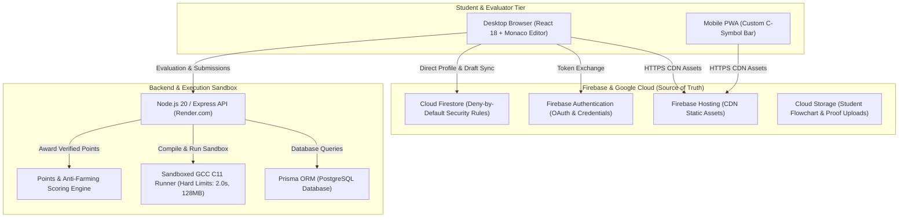

<p align="center">
  
</p>

# LogicQ

> **Enterprise-Grade Competitive C Programming & Structured Curriculum Platform for University Engineers**  
> *Engineered for Sanjivani University Undergraduate Engineering Programs (Sanjivani Group of Institutes)*

[](https://logicq-clanguage.web.app)
[](https://logicq-clanguage.web.app)
[](https://logicq-bitwiseclub.onrender.com)
[](docs/SECURITY_RULES.md)
[](#testing-and-scripts)
[](SECURITY.md)

---

## 📌 Executive Summary

**LogicQ** is a high-performance, security-hardened competitive programming and algorithmic thinking platform designed specifically for undergraduate engineering students mastering the **C programming language** (ISO C11 standard).

Unlike generic coding platforms that overwhelm beginners with thousands of disorganized algorithmic puzzles and distracting gamification, LogicQ is structured around **three educational pillars**:

1. **Daily Habit & Consistency Rhythm**: Exactly one challenge every 24 hours, synchronizing at **17:00 IST**, emphasizing steady daily practice with automatic streak freeze protection.
2. **4-Phase Structured Practice Curriculum**: 40 curated, vetted C programming challenges spanning 4 sequential modules—unlocking strictly on a 10-of-10 mastery rule. First solves award base points with automated anti-farming protection.
3. **Comprehensive Performance Analytics & Institutional Privacy**: Real-time LeetCode-style Practice Mastery Donut charts, 90-day streak heatmaps, and a college-wide Overall Standing leaderboard ranking students by combined points, streak consistency, and verified solves—while maintaining strict student PRN privacy and anti-surveillance guarantees.

---

## 🏛️ System Architecture

LogicQ utilizes a decoupled, resilient dual-channel architecture separating real-time cloud data synchronization from sandboxed ISO C11 compilation and execution:



---

## ✨ Key Platform Features

### 1. 📘 4-Phase Sequential Practice Curriculum
- **4 Structured Modules (40 Problems)**:
  - **Module 1**: Control Structures (Branching, Loops, Switch-Case, Iteration flow)
  - **Module 2**: Pointers and Functions (Addresses, Dereferencing, Pass-by-reference, Recursion)
  - **Module 3**: Arrays and Applications (1D/2D Arrays, Searching, Sorting, Matrix operations)
  - **Module 4**: Advanced Data Types & Dynamic Memory (`struct`, `union`, `enum`, `malloc`, `free`)
- **10-of-10 Sequential Mastery Rule**: Module $N+1$ unlocks only after all 10 problems in Module $N$ are solved.
- **Fair Points & Anti-Farming**:
  - First Accepted solve awards base points: **Easy (+10 PTS)**, **Medium (+20 PTS)**, **Hard (+30 PTS)**.
  - Repeat submissions on already-solved problems award **+0 PTS** to prevent farming.
  - Automatic historical backfill engine ensures past unrewarded solves are credited.
- **Per-Problem Active Timer**: Tracks genuine focus time (pauses automatically on browser tab blur or 2 minutes of idle time; permanently freezes upon solve).

### 2. ⚡ Daily 17:00 IST Challenge & Streak Engine
- **Single Active Question**: Exactly one daily challenge active from 17:00 IST to 17:00 IST (+10 min drain grace).
- **Streak Preservation (🔥)**: Increments daily on accepted solve before the 17:00 IST cutoff.
- **Auto Freeze Protection**: 1 automated freeze per rolling 7-day window protects student streaks against unforeseen academic disruptions or outages.
- **Admin Pause Days**: Institutional holidays and exams can be marked as pause days without breaking streaks.

### 3. 🌟 College Overall Standing & Daily Leaderboards
- **🌟 Overall Standing**: Ranks the entire university cohort by:
  $$\text{Total Points} \downarrow \;\longrightarrow\; \text{Current Streak} \downarrow \;\longrightarrow\; \text{Total Solved} \downarrow \;\longrightarrow\; \text{Join Timestamp} \uparrow$$
- **⚡ Daily Sprint**: Ranks solvers for the active daily challenge with live completion times.
- **Department & Academic Year Filters**: Filter standings across AIML, AIDS, CSE, Mechanical, Integrated B.Tech, and FY/SY/TY cohorts.
- **Pinned Student Row**: Quick visual reference pinning the logged-in student's personal standing at the bottom of the table.

### 4. 📊 Student Profile Analytics & Mastery Charts
- **LeetCode-Style Practice Donut Progress Ring**:
  - Interactive multi-color SVG circular progress ring showing `X / 40 Solved (%)` in center.
  - Three distinct color-coded arcs: **Easy 🟢 (`#46D9A0`)**, **Medium 🔵 (`#8B9BFF`)**, **Hard 🔴 (`#FF7A8A`)**.
  - Difficulty sub-counters: Easy (`X/16`), Medium (`X/16`), Hard (`X/8`).
  - Real-time telemetry: Cumulative active practice time and first-try solve accuracy.
- **Curriculum Module Progress Bars**: Visual status indicators (`Completed`, `In Progress`, `Locked`) across all 4 modules.
- **90-Day Challenge Streak Heatmap**: Calendar grid visualization mapping solved, frozen, paused, and missed daily challenge days.
- **30-Day Daily Rank Trend**: Interactive SVG trajectory graph displaying daily rank progression over the past month.

### 5. 🛡️ Sandboxed GCC C11 Judge & Beginner Diagnostics
- **Strict Resource Boundaries**: GCC C11 standard (`-Wall -Wextra -O2 -std=c11`), 2.0s maximum CPU execution time, 128 MB RAM, and 10 MB maximum output buffer.
- **Beginner-Friendly Compiler Explanations**: Intercepts complex raw GCC syntax, pointer dereferencing, and type mismatch errors, displaying constructive, plain-language guidance while preserving raw compiler logs.
- **Zero Information Leakage**: Hidden evaluation test inputs and outputs are verified strictly on the server and never exposed to the client.

### 6. 🔒 Academic Identity Verification & PII Protection
- **University PRN Format**: Strictly validates the 12-character canonical PRN (`^[0-9]{4}[A-Z]{3}[MF][0-9]{4}$`).
- **Atomic Registration**: PRNs are registered in an isolated, client-unwritable `prnIndex/{prn}` document preventing impersonation.
- **Anti-Surveillance Masking**: Student PRNs are masked as `••••••••1039` (8 bullets + last 4 digits). Other students can never inspect a peer's PRN or personal email.

---

## 🛠️ Technology Stack

| Layer | Technology | Version | Purpose |
| :--- | :--- | :---: | :--- |
| **Frontend Framework** | React | `18.3.1` | Component-based reactive UI |
| **Language** | TypeScript | `5.6.2` | Strict end-to-end type safety |
| **Styling & Theme** | Tailwind CSS | `3.4.11` | Custom cyber-dark design system |
| **Code Editor** | Monaco Editor | `0.57.0` | Browser-based ISO C11 editor |
| **Build System** | Vite | `5.4.21` | High-speed production bundling |
| **Backend API** | Node.js / Express | `20.x` / `4.21.0` | Secure REST API & auth middleware |
| **Database ORM** | Prisma ORM | `5.22.0` | SQLite (dev) / PostgreSQL (production) |
| **Cloud Document Store** | Cloud Firestore | `v2` | Primary state with deny-by-default rules |
| **Compilation Sandbox** | GCC Compiler | `13.2+` (C11) | Sandboxed isolated execution |
| **Testing Harness** | Vitest & Playwright | `2.1.9` / `1.64.1` | Unit, security rules, and e2e testing |

---

## 📁 Repository Directory Structure

```
LogicQ/
├── client/                     # Frontend Vite + React 18 SPA & PWA
│   ├── public/                 # Favicons, PWA manifests, brand icons
│   ├── src/
│   │   ├── api/                # API client with offline retry handling
│   │   ├── components/         # Monaco editor, Navbar, Workspace, Donut charts
│   │   ├── config/             # Academic, practice, and UI configuration
│   │   ├── context/            # Firebase AuthContext state machine
│   │   ├── pages/              # ProfilePage, LeaderboardPage, PracticePage, Admin
│   │   └── services/           # Firestore data & Google Drive backup
│   └── vite.config.ts          # Bundler configuration with COOP headers
├── server/                     # Backend Express API & Isolated Judge
│   ├── Dockerfile              # Production Dockerfile (GCC C11 + Node 20)
│   ├── prisma/                 # Prisma schema definitions & migrations
│   ├── src/
│   │   ├── config/             # Academic PRN rules, practice modules config
│   │   ├── controllers/        # Leaderboard, Practice, Problem, Submission, User
│   │   ├── judge/              # GCC C11 sandbox runners & diagnostics mapper
│   │   ├── middleware/         # Auth JWT, rate limits, role guards
│   │   ├── routes/             # Express API route endpoints
│   │   └── services/           # Scoring, backfill, daily finalization, streaks
│   └── tests/                  # Automated Vitest test suite (scoring, rules, judge)
├── docs/                       # Specifications, security rules & audit reports
├── firestore.rules             # Production Firestore deny-by-default security rules
├── storage.rules               # Cloud Storage security rules for flowchart proofs
├── firebase.json               # Firebase Hosting configuration & COOP headers
├── render.yaml                 # Render Blueprint configuration for backend API
└── package.json                # Monorepo workspace configuration
```

---

## 🚀 Getting Started (Local Development)

### Prerequisites
- **Node.js**: `v20.x` or higher ([Download Node.js](https://nodejs.org/)).
- **GCC / MinGW**: Required for local C compilation (`gcc --version`).
- **Git**: Version control CLI.
- **Firebase CLI**: `npm install -g firebase-tools` (or bundled `npx firebase-tools`).

### Quickstart Installation

1. **Clone the Repository**:
   ```bash
   git clone https://github.com/pratikpt1304/LogicQ.git
   cd LogicQ
   ```

2. **Install Dependencies**:
   ```bash
   npm install
   npm --prefix server install
   npm --prefix client install
   ```

3. **Configure Environment Variables**:
   ```bash
   cp .env.example .env
   cp .env.example server/.env
   ```

4. **Initialize Local Database**:
   ```bash
   npm run db:push
   npm run db:seed
   ```

5. **Start Development Servers**:
   ```bash
   npm run dev
   ```
   Open **[http://localhost:5173](http://localhost:5173)** in your browser.

---

## 🧪 Testing & Verification Suites

Execute comprehensive automated verification across all layers:

```bash
# Run server unit & scoring tests
npm test

# Run isolated scoring & practice module verification
npm --prefix server test tests/scoring.test.ts

# Run Firestore deny-by-default security rules verification
npm --prefix server test tests/firestore-security-rules.test.ts

# Run end-to-end browser tests
npx playwright test
```

---

## 🌐 Live Deployments & Operations

- **Frontend Application**: Hosted on **Firebase Hosting** with global CDN caching and automatic SSL.
  - **URL**: [https://logicq-clanguage.web.app](https://logicq-clanguage.web.app)
  - **Deploy Command**: `npm --prefix client run build && npx firebase-tools deploy --only hosting`
- **Backend API & Judge Sandbox**: Hosted on **Render.com** (Docker container with native GCC 13 C11 runtime).
  - **URL**: [https://logicq-bitwiseclub.onrender.com](https://logicq-bitwiseclub.onrender.com)
  - **Deploy Mechanism**: Automatic continuous deployment on push to GitHub `main` branch.
- **Database & Security Rules**: **Google Cloud Firestore**.
  - **Deploy Command**: `npx firebase-tools deploy --only firestore:rules`

---

## 📚 Architectural Documentation

Comprehensive architectural blueprints and specifications are maintained in `/docs`:

- [SECURITY_RULES.md](docs/SECURITY_RULES.md): Complete Firestore security rules architecture and test cases.
- [MASTER_SPEC.md](docs/MASTER_SPEC.md): Master specification for daily competition cycles and practice tracks.
- [PRACTICE_TIMER_REPORT.md](docs/PRACTICE_TIMER_REPORT.md): Practice active timer architecture and audit reports.
- [SECURITY.md](SECURITY.md): Vulnerability disclosure policies and security perimeter boundaries.

---

## 📄 License & Maintainers

- **Copyright**: © 2026 LogicQ / Sanjivani University. All rights reserved.
- **Lead Architect & Maintainer**: Pratik Thorat ([@pratikpt1304](https://github.com/pratikpt1304))
- **Institution**: Sanjivani University Undergraduate Engineering Programs
