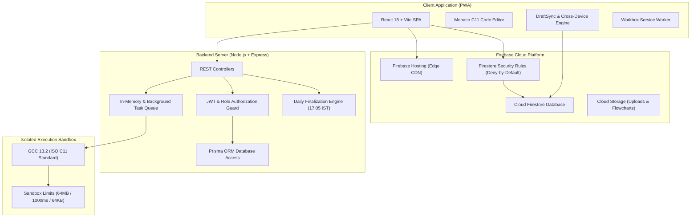

<p align="center">
  
</p>

<h1 align="center">LogicQ</h1>

<p align="center">
  <strong>The Ultimate Daily C Programming & Competitive Logic Platform for Engineering Students</strong><br />
  <em>Engineered with precision for Sanjivani University Undergraduate Engineering Programs</em>
</p>

<p align="center">
  <a href="https://logicq-clanguage.web.app"></a>
  <a href="https://github.com/pratikpt1304/LogicQ"></a>
  
  
  
  
  
  
  
</p>

---

## 📌 Table of Contents

- [1. Executive Summary & Vision](#1-executive-summary--vision)
- [2. Platform Highlights & Key Features](#2-platform-highlights--key-features)
- [3. Core Architectural Pillars](#3-core-architectural-pillars)
  - [🕒 Pure Daily Competition Engine (17:00 IST)](#-pure-daily-competition-engine-1700-ist)
  - [📚 Syllabus Practice Curriculum (40 Challenges)](#-syllabus-practice-curriculum-40-challenges)
  - [🔄 Cross-Device Synchronization & Multi-Session](#-cross-device-synchronization--multi-session)
  - [🛡️ Strict 3-Role Security & Blind Review Matrix](#️-strict-3-role-security--blind-review-matrix)
  - [🔒 PRN Academic Identity & Privacy Shield](#-prn-academic-identity--privacy-shield)
  - [⏸️ Safe System Pause & Resilience Architecture](#️-safe-system-pause--resilience-architecture)
  - [📊 Operations Command & Daily Results Center](#-operations-command--daily-results-center)
- [4. Visual Gallery](#4-visual-gallery)
- [5. System Architecture & Lifecycle](#5-system-architecture--lifecycle)
- [6. Textbook Content Governance](#6-textbook-content-governance)
- [7. Repository Structure](#7-repository-structure)
- [8. Getting Started & Local Development](#8-getting-started--local-development)
- [9. Quality Assurance & Automated Testing](#9-quality-assurance--automated-testing)
- [10. Cloud Deployment & Production Operations](#10-cloud-deployment--production-operations)
- [11. Security, Audit Trails & Compliance](#11-security-audit-trails--compliance)
- [12. License & Credits](#12-license--credits)

---

## 1. Executive Summary & Vision

**LogicQ** is a high-performance campus competitive programming and algorithmic thinking platform built ground-up for undergraduate engineering students mastering the **C programming language** (ISO C11 standard).

### The Problem in Engineering Education
Traditional algorithmic platforms present beginners with overwhelming catalogs of thousands of unstructured problems, confusing difficulty tags, and distracting gamification widgets (contests, badges, chat rooms). Students frequently succumb to tutorial paralysis, search online for solutions, or miss mastering foundational memory management, pointer arithmetic, and algorithmic structuring.

### The LogicQ Philosophy
1. **Single Focused Daily Problem**: Exactly **ONE** daily challenge is active at any time. There is no endless backlog or overwhelming problem list.
2. **Fixed Daily Rhythm**: The daily challenge unlocks at **17:00 IST (Asia/Kolkata)** and locks at the next **17:00 IST**.
3. **Dual Submission Pathways**:
   - **Track A (Auto-Judged Code)**: Real-time C code editing in Monaco Editor with instant sandboxed GCC C11 compilation and execution against private test suites.
   - **Track B (Flowchart & Handwritten Solution Upload)**: Upload diagrammatic solutions, state machines, or handwritten logic proofs (PDF/image) for blinded grading by trained faculty checkers.
4. **Foundational Practice Curriculum**: A 4-module sequential syllabus track allowing students to master Control Structures, Pointers & Functions, Arrays & Applications, and Advanced Data Types at their own pace.
5. **Authoritative Literature Foundation**: Problem statements are carefully derived and adapted from Yashwant Kanetkar's landmark textbook ***Test Your C Skills***.

---

## 2. Platform Highlights & Key Features

- ⚡ **Pure Daily Competition**: 24-hour competition cycle running 17:00 IST to 17:00 IST server-time with automated daily finalization at 17:05 IST (10-minute grace window).
- 🏆 **6-Tier Deterministic Leaderboard**: Real-time flick-free daily ranks computed via Accepted Time $\rightarrow$ Wrong Attempts $\rightarrow$ Current Streak $\rightarrow$ Total Points $\rightarrow$ Total Solved $\rightarrow$ Stable UID.
- 📱 **Installable Offline-Ready PWA**: Fully functional Progressive Web App featuring an ergonomic mobile C programming keyboard strip (`{`, `}`, `(`, `)`, `->`, `*`, `&`, `;`, `Tab`).
- 🔄 **Real-Time Cross-Device Sync**: Server-backed draft auto-saving with device labeling, conflict detection prompts, multi-session persistence, and account-wide preference sync.
- 🌓 **Adaptive Contrast Themes**: WCAG AA compliant Light (`#F4F6FB`) and Dark (`#0C0F1F`) themes with dedicated syntax themes for the embedded Monaco Editor.
- 🛡️ **Blinded Academic Review**: Checkers grade uploaded flowcharts without seeing student names, PRNs, departments, or emails via an anonymized cryptographic token (`SUB-XXXX`).
- 🎯 **Anti-Squatting PRN Security**: Validates 12-character university PRNs (`^[0-9]{4}[A-Z]{3}[MF][0-9]{4}$`), isolates PII in private Firestore collections, and enforces rolling 30-day self-service edit limits.

---

## 3. Core Architectural Pillars

### 🕒 Pure Daily Competition Engine (17:00 IST)
- **Single Question Window**: Active challenge runs from `17:00:00 IST` to `16:59:59 IST` next day. Ended problems return `410 Gone`; future problems return `404 Not Found`.
- **Automated Daily Finalization**: Runs at `17:05 IST` daily, granting a 10-minute grace period for submissions started before `17:00:00 IST`. Results freeze permanently at `17:10 IST`.
- **Rolling 7-Day Streak Freeze**: Protects student streaks with 1 automated freeze per rolling 7-day period. Institutional holidays are designated as Admin Pause Days.
- **Percentile Gating**: Requires $\ge 10$ unique daily solvers to calculate Top $X\%$ percentiles, preventing misleading early-bird scores.

### 📚 Syllabus Practice Curriculum (40 Challenges)
Alongside the daily challenge, LogicQ provides an always-accessible curriculum track covering the university C programming syllabus:
1. **Module 1 — Control Structures**: 10 Problems (4 Easy • 4 Med • 2 Hard) — *Unlocked by default*.
2. **Module 2 — Pointers & Functions**: 10 Problems (4 Easy • 4 Med • 2 Hard) — *Unlocked upon solving 7 of Module 1*.
3. **Module 3 — Array & Its Applications**: 10 Problems (4 Easy • 4 Med • 2 Hard) — *Unlocked upon solving 7 of Module 2*.
4. **Module 4 — Advanced Data Types & Dynamic Memory**: 10 Problems (4 Easy • 4 Med • 2 Hard) — *Unlocked upon solving 7 of Module 3*.

### 🔄 Cross-Device Synchronization & Multi-Session
- **Cloud-Synced Editor Drafts**: Unsaved code drafts automatically synchronize to Firestore (`users/{userId}/drafts/{problemId}`) with an ISO timestamp and device label (`Laptop`, `Phone`, `Browser`).
- **Conflict Resolution Modal**: If draft revisions conflict across simultaneous devices, students are presented with side-by-side timestamps, device origins, and a diff chooser.
- **Multi-Device Sessions**: Logging in on a secondary device preserves the primary device session. Students can review and revoke active sessions via the Session Manager or execute `/api/auth/logout-all`.
- **Preference Persistence**: Theme preferences (`light`, `dark`, `system`) and custom compiler preferences follow the user account across devices.

### 🛡️ Strict 3-Role Security & Blind Review Matrix
To prevent privilege escalation and administrative ambiguity, LogicQ supports exactly three roles:

| Privilege / Action | `STUDENT` | `CHECKER` | `ADMIN` |
| :--- | :---: | :---: | :---: |
| Solve Daily Challenge & Run GCC C11 Judge | ✅ (Current Day Only) | ❌ | ✅ |
| Upload Handwritten Flowchart/Code (Track B) | ✅ | ❌ | ✅ |
| Access Practice Curriculum (`/practice`) | ✅ (Unlocked Modules) | ❌ | ✅ (Full Pool) |
| View Daily Campus Leaderboard & Archive | ✅ | ❌ | ✅ |
| Access Blind Review Queue (`/checker/reviews`) | ❌ | ✅ | ✅ |
| Grade Submissions with Mathematical Rubric | ❌ | ✅ | ✅ |
| Inspect Student Activity Dossier & CSV Export | ❌ | ❌ | ✅ |
| Operations Command & Daily Finalization Engine | ❌ | ❌ | ✅ |
| System Pause / Resume Controller | ❌ | ❌ | ✅ (Audited, Re-auth) |
| Author Practice Modules & Daily Challenges | ❌ | ❌ | ✅ |
| User Roster Moderation (PRN Edits, Ban/Unban) | ❌ | ❌ | ✅ ($\ge 2$ Admins Invariant) |

### 🔒 PRN Academic Identity & Privacy Shield
- **12-Character Alphanumeric Format**: Strictly validates `^[0-9]{4}[A-Z]{3}[MF][0-9]{4}$` (e.g., `2024BITM1039`).
- **Cryptographic PII Masking**: Public endpoints display masked identifiers (`••••••••1039`) and student display names. Full PRNs and institutional emails are never leaked to peers.
- **Atomic Reservation Index**: PRNs are bound inside a private transaction to `prnIndex/{prn}`, eliminating race conditions or identity duplicate attacks.
- **Rolling 30-Day Cooldown**: Students can self-correct their PRN once every 30 days with password re-authentication.

### ⏸️ Safe System Pause & Resilience Architecture
- **Global Circuit Breaker (`dailyChallengePaused`)**: Stored in system config and checked before any daily lifecycle action.
- **Neutral User State**: When paused, students see a calm status message (*"Daily challenges are not live yet. We will announce the start."*). No timers, countdowns, streaks, or penalties run.
- **Audited Admin Resume**: Re-enabling the daily pool requires admin password re-authentication, an audit reason, and verification that $\ge 14$ validated questions are pre-scheduled.

### 📊 Operations Command & Daily Results Center
The dedicated **Daily Results** administrative console gives platform operators full control:
- **Live Solvers Board**: Real-time top 20 rankings, wrong attempts count, and timestamps for today's active challenge.
- **Finalization Run History**: Complete execution logs detailing duration (ms), solvers finalized, summaries written, and outcome status.
- **Idempotent Re-run & Publish**: Manually trigger or recalculate daily finalization safely with mandatory password re-auth.
- **Append-Only Corrections Ledger**: Record and audit grade adjustments, dispute reconciliations, and manual score overrides.
- **Calendar Pause Manager**: Set institutional holidays and exam days to safeguard student streaks.

---

## 4. Visual Gallery

| Landing Page | Authentication & PRN Verification |
| :---: | :---: |
|  |  |

| Daily Challenge Workspace | Campus Daily Leaderboard |
| :---: | :---: |
|  |  |

| Administrative Operations Command | Mobile Ergonomic C Keyboard Bar |
| :---: | :---: |
|  |  |

---

## 5. System Architecture & Lifecycle



---

## 6. Textbook Content Governance

All coding problems and competitive logic questions in LogicQ are sourced and adapted exclusively from:
> **Primary Source:** *Test Your C Skills*  
> **Author:** Yashwant Kanetkar  
> **Master Reference:** [`/docs/CONTENT_PIPELINE.md`](docs/CONTENT_PIPELINE.md) & [`/docs/CONTENT_RIGHTS.md`](docs/CONTENT_RIGHTS.md)

### Strict Pedagogical Guidelines:
1. **Original Algorithmic Rewordings**: Statements are rewritten with strict input/output schemas to prevent rote-memorization.
2. **Deterministic Standard I/O**: Every problem is strictly standard input (`stdin`) and standard output (`stdout`) driven. No non-standard libraries (`conio.h`, `turbo-c`) are permitted.
3. **Citation Masking**: Author names, book references, and exercise numbers are strictly quarantined to administrative metadata (`sourceRefJson`) and stripped from student payloads.

---

## 7. Repository Structure

```
LogicQ/
├── client/                     # Vite React 18 TypeScript frontend
│   ├── public/                 # Static assets, PWA manifest, service worker
│   │   ├── brand/              # SVG brand marks and vectors
│   │   ├── icons/              # PWA app icons (192px, 512px, maskable)
│   │   ├── manifest.webmanifest# Progressive Web App manifest
│   │   ├── offline.html        # Network offline fallback shell
│   │   └── sw.js               # Service worker lifecycle
│   └── src/
│       ├── components/         # Modular UI components & Monaco wrapper
│       ├── context/            # AuthContext, ThemeContext, SocketContext
│       ├── pages/              # Challenge, Practice, Leaderboard, Admin, Checker
│       ├── services/           # DraftSync, Storage, API clients
│       └── types/              # Comprehensive TypeScript interfaces
├── server/                     # Node.js 20 Express backend
│   ├── prisma/                 # Prisma database schema and migrations
│   ├── src/
│   │   ├── config/             # Academic, roles, and platform constants
│   │   ├── controllers/        # Admin, Checker, Problem, Submission, User
│   │   ├── middleware/         # Role guards, session validators, rate limiters
│   │   ├── queue/              # Submission processing queue factory
│   │   ├── services/           # C11 judge engine, streak manager, finalizer
│   │   └── utils/              # IST timekeeper, JWT generator, PRN validator
│   └── tests/                  # Vitest automated integration & security suites
├── docs/                       # Authoritative platform documentation
│   ├── MASTER_SPEC.md          # Master functional blueprint
│   ├── DAILY_SYSTEM.md         # Pure daily competition lifecycle
│   ├── SECURITY_RULES.md       # Firestore security rules specification
│   ├── CROSS_DEVICE_AUDIT.md   # Cross-device synchronization matrix
│   ├── DEPLOY_PLAN.md          # Production deployment guide
│   └── ROLLBACK.md             # Emergency rollback procedures
├── firestore.rules             # Cloud Firestore deny-by-default rules
├── storage.rules               # Cloud Storage security perimeter
├── firebase.json               # Firebase Hosting CDN & HTTP headers
├── package.json                # Root workspace configuration
└── README.md                   # Platform documentation
```

---

## 8. Getting Started & Local Development

### Prerequisites
- **Node.js**: `>= 20.10.0 LTS`
- **npm**: `>= 10.2.0`
- **GCC**: `gcc >= 11.0` (MinGW-w64 on Windows, native GCC on Linux / macOS)
- **Git**: Installed and configured

### Step-by-Step Installation

```bash
# 1. Clone the repository
git clone https://github.com/pratikpt1304/LogicQ.git
cd LogicQ

# 2. Install dependencies across workspaces
npm install

# 3. Configure environment variables
cp .env.example .env

# 4. Synchronize database schema and seed questions
npm run db:push
npm run db:seed

# 5. Start development servers concurrently
npm run dev
```

The application will be accessible at:
- **Client (Frontend)**: `http://localhost:5173`
- **Server (Backend API)**: `http://localhost:5000`

---

## 9. Quality Assurance & Automated Testing

LogicQ enforces mandatory quality gates before any code is approved:

```bash
# 1. Execute backend integration & security tests
npm --prefix server test

# 2. Execute Admin Daily Results test suite
npx --prefix server vitest run tests/admin-daily-results.test.ts

# 3. Verify Firestore Security Rules tests
npx --prefix server vitest run tests/firestore-security-rules.test.ts

# 4. Compile frontend TypeScript and Vite production bundle
npm --prefix client run build

# 5. Run bundle leak audit
node scripts/check-bundle.mjs
```

---

## 10. Cloud Deployment & Production Operations

### Production Environment
- **Live URL**: [https://logicq-clanguage.web.app](https://logicq-clanguage.web.app)
- **Firebase Project ID**: `logicq-clanguage`

### Deployment Commands
```bash
# 1. Compile production client assets
npm --prefix client run build

# 2. Deploy Cloud Firestore Security Rules
npx firebase-tools deploy --only firestore:rules --project logicq-clanguage

# 3. Deploy Cloud Storage Security Rules
npx firebase-tools deploy --only storage --project logicq-clanguage

# 4. Deploy Firebase Hosting
npx firebase-tools deploy --only hosting --project logicq-clanguage
```

### Emergency Rollback Runbook
If an anomaly occurs post-deployment:
```bash
# Rollback Firebase Hosting to the previous release
npx firebase-tools hosting:rollback --project logicq-clanguage
```

---

## 11. Security, Audit Trails & Compliance

- **Deny-by-Default Security Rules**: Every Firestore document path defaults to `allow read, write: if false;` unless explicitly matched and authorized.
- **Immutable Audit Ledger**: Sensitive operations (PRN changes, admin finalization overrides, bans, score adjustments) write append-only records to `admin_audit_logs`.
- **C11 Sandboxed Execution**: Strict execution timeouts (1000ms), memory limits (64MB), and process isolation protect host infrastructure.
- **Strict Role Isolation**: Administrative endpoints enforce role-based middleware (`requireRole('ADMIN')`), barring students and checkers.

For vulnerability disclosure, please refer to [`SECURITY.md`](SECURITY.md).

---

## 12. License & Credits

- **License**: All Rights Reserved © 2026 LogicQ / Sanjivani University.
- **Pedagogical Literature**: Coding challenges adapted from *Test Your C Skills* by Yashwant Kanetkar.
- **Engineering & Maintainers**: Pratik & the LogicQ Core Engineering Team.
