<p align="center">
  
</p>

<h1 align="center">LogicQ</h1>

<p align="center">
  <strong>AI-Resistant Smart Programming Practice & Institutional Assessment Platform for Higher Education</strong><br>
  <em>Engineered for Undergraduate Engineering Programs • ISO C11 Sandboxed Compilation • Sanjivani University</em>
</p>

<p align="center">
  <a href="https://logicq-clanguage.web.app"></a>
  <a href="https://logicq-bitwiseclub.onrender.com/api/health"></a>
  <a href="docs/SECURITY_RULES.md"></a>
  <a href="docs/assessment/GAP_ANALYSIS.md"></a>
  <a href="#-testing--verification-suites"></a>
  <a href="SECURITY.md"></a>
</p>

---

## 📌 Executive Summary

**LogicQ** is an enterprise-grade competitive programming, curriculum mastery, and institutional continuous assessment platform. Engineered specifically for undergraduate engineering universities, LogicQ provides a robust, copy-resistant, and behavior-aware ecosystem designed to evaluate genuine student programming competency while insulating foundational learning from high-stakes exam pressure.

LogicQ operates on a strict **Two-Product Architectural Separation**:
1. **📘 Practice Mode (Learning-First Habit & Mastery)**: Unlimited attempts, hint unlocks after sustained effort, compiler diagnostic guidance, 10-of-10 sequential module gating, daily 17:00 IST challenges, and streak protection.
2. **🛡️ Assessment Mode (AI-Resistant Institutional Examination)**: 100-mark modular assessments, strict 1:1:1 identity binding (PRN $\leftrightarrow$ Email OTP), section-based roster management, zero-reattempt locks on successful solve, 2 visible + 1 hidden test cases, deterministic time-based scoring, silent proctoring telemetry, code-specific AI viva voce verification, individual-activation mini-projects, and dual-score reporting (Academic Score $X/100$ vs Integrity Score $Y/100$).

---

## 🏛️ System Architecture

```mermaid
flowchart TD
    subgraph ClientLayer ["Student & Faculty Tier (React 18 + TypeScript + Monaco + Tailwind)"]
        StudentUI["Student Client (/practice, /challenge, /student/tests, /analytics)"]
        FacultyUI["Faculty Dashboard (/faculty/sections, /faculty/tests, /faculty/analytics)"]
        AdminUI["Institutional SuperAdmin Console (/admin)"]
    end

    subgraph FirebaseLayer ["Firebase & Google Cloud Platform"]
        Hosting["Firebase Hosting (CDN Edge Caching, Brotli, HSTS, CSP)"]
        Auth["Firebase Authentication & Token Exchange"]
        Firestore["Cloud Firestore (Deny-by-Default Security Rules & Realtime Sync)"]
        Storage["Cloud Storage (Flowchart Proofs & Visual Audit Trail)"]
    end

    subgraph BackendLayer ["High-Performance Node.js / Express API Runtime"]
        APIServer["Express REST API (Render Docker Container)"]
        PrismaORM["Prisma ORM (SQLite Dev / PostgreSQL Production)"]
        IdentityService["1:1:1 PRN + Dual OTP Verification Service"]
        ExamEngine["Smart Exam Engine (Time Scoring & Zero-Reattempt Locks)"]
        TelemetryService["Silent Telemetry Collector (Bursts, Evolution, Ratios)"]
        VivaEngine["AI Viva Voce Engine (2nd Successive Solve Trigger)"]
        MiniProjectService["Integrated Mini-Project 20-Mark Rubric Engine"]
        AutoHealService["Resilient Section & Roster Auto-Healing Engine"]
    end

    subgraph JudgeSandbox ["Sandboxed ISO C11 Execution Sandbox"]
        GCCRunner["Local GCC C11 Compiler (-Wall -Wextra -O2 -std=c11)"]
        WinJobSandbox["Windows Job Object Runner (Hard Limits: 2.0s CPU, 128MB RAM)"]
        POSIXRunner["POSIX Fork/Exec Sandbox with Strict Resource Limits"]
    end

    StudentUI -->|HTTPS CDN Assets| Hosting
    FacultyUI -->|HTTPS CDN Assets| Hosting
    AdminUI -->|HTTPS CDN Assets| Hosting

    StudentUI -->|Token Exchange| Auth
    StudentUI -->|Direct Profile & Draft Sync| Firestore
    StudentUI -->|Proctored Submissions & Telemetry| APIServer
    FacultyUI -->|Section Roster & Test Builder| APIServer

    APIServer -->|Database Queries| PrismaORM
    APIServer -->|Enrollment & OTP Binding| IdentityService
    APIServer -->|Compile & Run Requests| GCCRunner
    GCCRunner -->|Isolate Execution| WinJobSandbox
    GCCRunner -->|POSIX Fallback| POSIXRunner
    APIServer -->|Timing & Lock Rules| ExamEngine
    APIServer -->|Behavioral Signals| TelemetryService
    APIServer -->|Trigger 60s Viva| VivaEngine
    APIServer -->|Grade Rubrics| MiniProjectService
    APIServer -->|Verify Baseline State| AutoHealService
```



---

## 🌟 The Two Operating Modes

| Feature | 📘 Practice Mode (`/practice`) | 🛡️ Assessment Mode (`/student/tests`) |
| :--- | :--- | :--- |
| **Primary Goal** | Habit formation, conceptual mastery, daily challenge | Formal institutional evaluation, grading, accreditation |
| **Attempts Allowed** | **Unlimited** (encourages trial, error, debugging) | **Zero reattempt** once question is successfully solved |
| **Scoring Model** | Difficulty Points (+10 Easy, +20 Medium, +30 Hard) | **Time-Based Marks** (1.0 in-time, 0.5 late, 0.0 incorrect) |
| **Hints & Guidance** | Unlocks after sustained failure threshold | **Strictly blocked**; zero hints provided |
| **Test Cases** | 2 Visible sample test cases | **2 Visible + 1 Server-Side Hidden Test Case** |
| **Copy/Paste** | Permitted for learning & drafting | **Blocked** where technically feasible; paste events logged |
| **Identity Binding** | Verified university PRN allowlist | **Mandatory 1:1:1 PRN $\leftrightarrow$ Email OTP** |
| **Behavioral Telemetry** | Active focus timer only (anti-idle) | Full telemetry (bursts, edit-to-execution, emergence curve) |
| **AI Viva Voce** | None | **Mandatory 1-minute viva** on every 2nd successive correct solve |
| **Mini-Project** | Optional self-paced projects | **20-Mark Integrated Mini-Project** (individual faculty activation) |
| **Final Output** | LeetCode-style Donut charts, 90-day streak heatmaps | **Dual-Score Report** (Academic $X/100$, Integrity $Y/100$, PDF audit) |

---

## ✨ Key Platform Features & Modules

### 1. 🛡️ Institutional Assessment Framework
- **100-Mark Continuous Assessment Model**:
  - **4 Modular Sections × 20 Questions**: $80 \text{ Marks}$ evaluated via deterministic time-scoring.
  - **1 Integrated Mini-Project**: $20 \text{ Marks}$ assessed across a 4-competency rubric.
- **Time-Based Scoring Formula**:
  $$\text{Expected Reference Time} = \frac{\text{Expected Min} + \text{Expected Max}}{2}$$
  $$\text{Academic Mark} = \begin{cases} 1.0 & \text{if Verdict is ACCEPTED and } \text{Actual Time} \le \text{Expected Max} \\ 0.5 & \text{if Verdict is ACCEPTED and } \text{Actual Time} > \text{Expected Max} \\ 0.0 & \text{if Verdict is not ACCEPTED} \end{cases}$$
- **2 Visible + 1 Hidden Test Case**: Visible test cases provide interactive debugging feedback; the hidden test case executes server-side with zero input/output leakage to guarantee genuine algorithmic logic.
- **Strict Separation of Marks & Integrity**: Academic Scores ($X/100$) and Integrity Scores ($Y/100$) are **never combined by default**. A student with a 95/100 academic score and a flagged session are represented transparently for faculty review.

### 2. 👥 Academic Sections & Streamlined Roster Management
- **One-Click Section Sharing**:
  - **Join Code Pill**: Immediate 1-click clipboard copy (`LQ-IMTC`).
  - **Direct Join Link**: 1-click URL sharing for instant access.
  - **WhatsApp & QR Integration**: Instant mobile dispatch and classroom projector QR code generation.
- **Modernized Roster Table**:
  - Full student profile with name, avatar, and PRN roll number in monospace font.
  - Status indicator: Clean green **`ENROLLED`** badge.
  - Real-time student coding performance: live points (`240 pts`) and active streak indicators (`🔥 3d`).
  - Student removal/drop action with instant confirmation dialog.
- **Auto-Healing Section Persistence**:
  - Guaranteed baseline persistence across PostgreSQL, Cloud Firestore, and client fallback cache.
  - Prevents sections from vanishing during database wake-up or multi-faculty logins.

### 3. 🔐 Pre-Registration Gate & OTP Authentication
- **Strict Identity Binding**: One PRN belongs to exactly one verified college email. Unregistered users cannot sign in or self-register unless invited or pre-enrolled by faculty.
- **Secure Email OTP Authentication**: 6-digit cryptographic verification delivered via Resend / Google Apps Script dispatchers.
- **Dedicated Walkthrough Accounts**: Hardened developer walkthrough accounts (`faculty@logicq.io` and `student@logicq.io`) with strict allowlist isolation. Master bypass codes are completely disabled for any standard student or faculty account.

### 4. 🧠 Smart Exam Engine & Proctored Telemetry
- **Environment & Input Restrictions**: Text selection, context menu right-clicks, copy, paste, and drag-and-drop are restricted within the exam coding workspace.
- **Comprehensive Behavioral Metrics**:
  - **Active Work Ratio**: Genuine interaction time vs total question duration.
  - **Code-Burst Detection**: Monitors instantaneous code insertion size against total submission size ($>\!60\%$ triggers an audit flag).
  - **Edit-to-Execution Ratio**: Number of code edits between compilation runs.
  - **Solution Emergence Curve**: Incremental code progression over time.
- **5-Tier Calibrated Integrity Risk Classification**:
  $$\text{Normal (0–20)} \quad\vert\quad \text{Low Risk (21–40)} \quad\vert\quad \text{Moderate Risk (41–60)} \quad\vert\quad \text{High Risk (61–80)} \quad\vert\quad \text{Critical Risk (81–100)}$$

### 5. 🎙️ AI Viva Voce Engine
- **Deterministic 2nd Successive Solve Trigger**: When a student solves two questions correctly in a row (#2, #4, #6, ...), the AI Viva Voce modal immediately interrupts the workflow.
- **Code-Specific Oral/Written Prompts**: Questions are generated dynamically from the student's *actual submitted C code* (probing specific variable choices, pointer arithmetic, loop bounds, and edge-case handling).
- **Strict 60-Second Timer**: Mandatory submission or automated timeout logging.
- **Faculty Review & Human Override**: Course faculty can inspect the recorded viva response alongside the student's source code and override the assessment status.

### 6. 🧩 Integrated Mini-Project Framework
- **20-Mark Structured Rubric**:
  - Section 1 Competency (Control Structures): 5 Marks
  - Section 2 Competency (Pointers & Functions): 5 Marks
  - Section 3 Competency (Arrays & Data Structures): 5 Marks
  - Section 4 Competency (Dynamic Memory & Structs): 5 Marks
- **Strict Anti-Bulk Activation Rule**: Mini-projects are initially `INACTIVE`. Bulk activation ("Select All", batch scripts) is strictly banned. Faculty must inspect each student's eligibility and activate on an individual student-by-student basis.

### 7. 📘 5-Module Sequential Practice Curriculum (`/practice`)
- **Curated Modules (20 Questions per Module)**:
  - **Module 1**: Control Structures (Branching, Loops, Switch-Case, Iteration flow)
  - **Module 2**: Pointers and Functions (Addresses, Dereferencing, Pass-by-reference, Recursion)
  - **Module 3**: Arrays and Applications (1D/2D Arrays, Searching, Sorting, Matrix operations)
  - **Module 4**: Advanced Data Types & Dynamic Memory (`struct`, `union`, `enum`, `malloc`, `free`)
  - **Module 5**: Competitive Mastery & Capstone Arena (Bitwise algorithms, System C, High-efficiency logic)
- **Sequential Mastery Rule**: Module $N+1$ unlocks only after all questions in Module $N$ are solved.
- **Fair Points & Anti-Farming**: Base points awarded on first Accepted solve (+10 Easy, +20 Medium, +30 Hard). Repeat submissions award +0 PTS.

### 8. ⚡ Daily 17:00 IST Challenge & Streak Engine (`/challenge`)
- **Single Active Question**: Exactly one daily challenge active from 17:00 IST to 17:00 IST (+10 min drain grace).
- **Streak Consistency (🔥)**: Increments daily upon accepted solve before cutoff.
- **Auto-Freeze Protection**: 1 automated freeze per rolling 7-day window protects student streaks against unforeseen disruptions.

---

## 🛠️ Technology Stack

| Layer | Technology | Version | Description |
| :--- | :--- | :---: | :--- |
| **Frontend Framework** | React | `18.3.1` | Component-based reactive UI |
| **Language** | TypeScript | `5.6.2` | Strict end-to-end type safety |
| **Styling & Design** | Tailwind CSS | `3.4.11` | Custom WCAG AAA cyber-dark & high-contrast design system |
| **Code Editor** | Monaco Editor | `0.57.0` | Browser-based ISO C11 syntax-highlighted editor |
| **Client Bundler** | Vite | `5.4.21` | High-speed production build system |
| **Backend API** | Node.js / Express | `20.x` / `4.21.0` | REST API, role-based auth middleware, rate-limiters |
| **Database ORM** | Prisma ORM | `5.22.0` | SQLite (dev) / PostgreSQL (production) |
| **Cloud Document Store** | Google Cloud Firestore | `v2` | Real-time state store with 52 verified deny-by-default rules |
| **Cloud Hosting** | Firebase Hosting | `v15.x` | Global edge CDN, custom headers (COOP, CSP, HSTS) |
| **C11 Compilation Sandbox** | GCC Compiler | `13.2+` (C11) | Native MinGW-w64 / Linux GCC sandbox runner |
| **Process Sandbox (Win32)**| Windows Job Object | Native | Memory caps (128MB), CPU limits (2.0s), output truncation protection |
| **Testing Harness** | Vitest & Playwright | `2.1.9` / `1.64.1` | Automated lifecycle, security rules, and proctoring test suites |

---

## 📁 Repository Directory Structure

```
LogicQ/
├── client/                                 # Frontend Vite + React 18 SPA & PWA
│   ├── public/                             # Favicons, PWA manifest, brand SVGs, icons
│   ├── src/
│   │   ├── api/                            # Axios API client with fallback retry engine
│   │   ├── components/                     # Monaco editor, Navbar, Workspace, Donut charts
│   │   ├── config/                         # Academic PRN rules, practice configs, brand tokens
│   │   ├── context/                        # AuthContext state machine & role guards
│   │   ├── pages/
│   │   │   ├── analytics/                  # StudentDashboardAnalyticsPage (Dual-Score + PDF Audit)
│   │   │   ├── exam/                       # StudentTestListPage, StudentExamWorkspacePage
│   │   │   ├── faculty/                    # SectionManagementPage, TestBuilderPage
│   │   │   ├── admin/                      # AdminDashboardPage, ProblemManager
│   │   │   ├── LeaderboardPage.tsx         # University Overall & Daily Sprint Leaderboard
│   │   │   └── PracticeModulesPage.tsx     # 5-Module Sequential Practice Curriculum
│   │   └── services/                       # FirestoreDataService & RealtimeSyncService
│   └── vite.config.ts                      # Bundler configuration
├── server/                                 # Backend Express API & Sandboxed Judge
│   ├── prisma/                             # Prisma schema definitions & migrations
│   ├── src/
│   │   ├── config/                         # Academic PRN regex, features config, practice config
│   │   ├── controllers/
│   │   │   ├── auth.controller.ts          # Email OTP, student registration, JWT tokens
│   │   │   ├── section.controller.ts       # Section creation, student roster, join codes
│   │   │   ├── exam.controller.ts          # Exam attempts, time-scoring, zero-reattempt lock
│   │   │   ├── viva.controller.ts          # AI viva trigger, 60s countdown, faculty override
│   │   │   ├── mini-project.controller.ts  # Mini-project activation, 20-mark rubric grading
│   │   │   ├── analytics.controller.ts     # Dual-score computation, PDF reports, ERP CSV export
│   │   │   └── practice.controller.ts      # 5-module sequential gating controller
│   │   ├── judge/                          # GCC C11 sandbox runners & Win32 Job Object runner
│   │   │   ├── local-gcc.judge.ts          # Local MinGW/GCC C11 compile-and-run executor
│   │   │   ├── win-sandbox-runner.c        # Native C Win32 Job Object sandbox source
│   │   │   └── win-sandbox-runner.exe      # Compiled Windows Job Object binary
│   │   ├── middleware/                     # JWT verification, RBAC guards (Student/Faculty/Admin)
│   │   ├── routes/                         # Express REST API endpoints
│   │   └── services/                       # SectionService, OtpService, Telemetry ingestion
│   └── tests/                              # Automated Vitest test suites
│       ├── firestore-security-rules.test.ts# 52 Firestore security rule tests
│       ├── e2e-institutional-lifecycle.test.ts # Complete Sections 1–66 lifecycle verification
│       ├── smart-exam-engine.test.ts       # Time scoring, reattempt lock, integrity telemetry
│       ├── viva-and-mini-project.test.ts   # 2nd successive viva & 20-mark mini-project rubric
│       └── practice-modules.test.ts        # 5-module practice sequential gating tests
├── docs/                                   # Specifications, architecture, and security reports
│   ├── assessment/                         # Master Product Specification Adaptation
│   │   ├── GAP_ANALYSIS.md                 # Sections 1–66 exhaustive gap analysis
│   │   ├── ASSESSMENT_MODE_MVP.md          # Trimmed MVP architecture & specifications
│   │   └── PRIVACY_FAIRNESS.md             # DPDP Act, PII separation & fairness guidelines
│   └── SECURITY_RULES.md                   # Cloud Firestore security rules specification
├── firestore.rules                         # Production deny-by-default Firestore rules
├── storage.rules                           # Cloud Storage security rules for student proofs
├── firebase.json                           # Firebase Hosting & Firestore deploy configuration
└── package.json                            # Root monorepo configuration
```

---

## 🚀 Getting Started (Local Development)

### Prerequisites
- **Node.js**: `v20.x` or higher ([Download Node.js](https://nodejs.org/)).
- **GCC / MinGW-w64**: Required for local ISO C11 compilation (`gcc --version`).
- **Git**: Version control CLI.
- **Firebase CLI**: `npm install -g firebase-tools` (or bundled `npx.cmd firebase-tools`).

### Quickstart Installation

1. **Clone the Repository**:
   ```bash
   git clone https://github.com/pratikpt1304/LogicQ.git
   cd LogicQ
   ```

2. **Install Dependencies**:
   ```bash
   npm install
   npm --prefix server install
   npm --prefix client install
   ```

3. **Configure Environment Variables**:
   ```bash
   cp .env.example .env
   cp .env.example server/.env
   ```

4. **Initialize Local Database & Seed**:
   ```bash
   npm run db:push
   npm run db:seed
   ```

5. **Start Development Servers**:
   ```bash
   npm run dev
   ```
   Open **[http://localhost:5173](http://localhost:5173)** in your browser.

---

## 🧪 Testing & Verification Suites

Execute automated verification across all institutional assessment, practice, and security rule layers:

```bash
# 1. Run Firestore Security Rules Suite (52 tests passed)
npm --prefix server test tests/firestore-security-rules.test.ts

# 2. Run End-to-End Institutional Platform Lifecycle Verification (Sections 1–66)
npm --prefix server test tests/e2e-institutional-lifecycle.test.ts

# 3. Run Smart Exam Engine, Time Scoring & Zero-Reattempt Locking
npm --prefix server test tests/smart-exam-engine.test.ts

# 4. Run AI Viva Engine & Integrated Mini-Project Rubric Suite
npm --prefix server test tests/viva-and-mini-project.test.ts

# 5. Run Practice Curriculum & 5-Module Sequential Gating Suite
npm --prefix server test tests/practice-modules.test.ts

# 6. Run Client Build Guard (Verifies zero primary localStorage student data leaks)
npm --prefix client run build

# 7. Run Server Production Build
npm --prefix server run build
```

---

## 🌐 Live Deployments & Cloud Operations

- **Frontend Application**: Hosted on **Firebase Hosting** with global edge CDN caching and automated SSL.
  - **Live URL**: [https://logicq-clanguage.web.app](https://logicq-clanguage.web.app)
  - **Deploy Command**:
    ```bash
    npm --prefix client run build
    npx.cmd firebase-tools deploy --only hosting
    ```
- **Backend API & Judge Sandbox**: Hosted on **Render.com** (Docker container running native GCC 13 C11 compiler).
  - **Live API Endpoint**: [https://logicq-bitwiseclub.onrender.com](https://logicq-bitwiseclub.onrender.com)
  - **Deployment Mechanism**: Automatic continuous deployment on push to GitHub `main` branch.
- **Database & Security Rules**: **Google Cloud Firestore**.
  - **Deploy Command**:
    ```bash
    npx.cmd firebase-tools deploy --only firestore:rules
    ```

---

## 📄 License & Maintainers

- **Copyright**: © 2026 LogicQ / Sanjivani University. All rights reserved.
- **Lead Architect & Maintainer**: Pratik Thorat ([@pratikpt1304](https://github.com/pratikpt1304))
- **Institution**: Sanjivani University Undergraduate Engineering Programs
