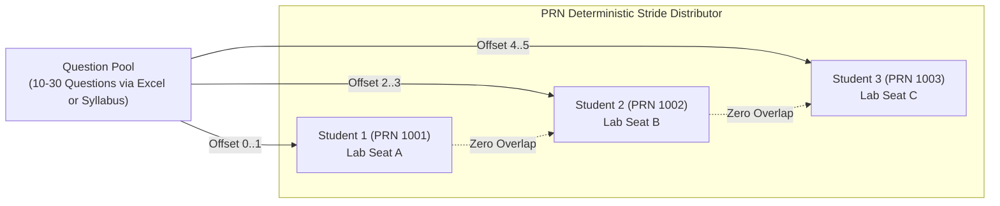
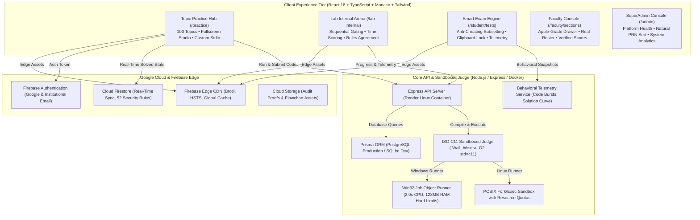

<p align="center">
  
</p>

<h1 align="center">LogicQ</h1>

<p align="center">
  <strong>Institutional-Grade C Programming Mastery, Sandboxed GCC Judge & Continuous Assessment Platform</strong><br>
  <em>Engineered for Higher Education • ISO C11 Sandboxed Evaluation • Anti-Cheating Telemetry • Apple-Grade Minimalist UX</em>
</p>

<p align="center">
  <a href="https://logicq-clanguage.web.app"></a>
  <a href="https://logicq-bitwiseclub.onrender.com/api/health"></a>
  <a href="https://github.com/pratikpt1304/LogicQ"></a>
  <a href="docs/SECURITY_RULES.md"></a>
  <a href="docs/assessment/GAP_ANALYSIS.md"></a>
  <a href="SECURITY.md"></a>
</p>

---

## 📌 Executive Overview

**LogicQ** is an enterprise-grade competitive programming, coursework mastery, and institutional continuous evaluation platform designed from the ground up for university computer science and undergraduate engineering departments (deployed for **Sanjivani University**, Integrated M.Tech / First Year Computer Science).

It combines **Apple-grade minimalist UI** with **strict institutional-grade exam proctoring**, anti-collusion randomized question distribution, sandboxed GCC 14 compilation, and automated real-time grading.

```
┌──────────────────────────────────────────────────────────────────────────────────────────────┐
│                                     LOGICQ ECOSYSTEM                                         │
├──────────────────────────────────────────────┬───────────────────────────────────────────────┤
│        📘 CONCEPTUAL MASTERY ARENA           │        🛡️ PROCTORED LAB & EXAM SUITE          │
│                 (/practice)                  │      (/lab-internal & /student/tests)         │
├──────────────────────────────────────────────┼───────────────────────────────────────────────┤
│ • 100 Hand-Curated Progressive C Topics      │ • Anti-Cheating PRN Deterministic Subsetting  │
│ • 4 Core Modules (25 Topics Each)            │ • Adjacent Lab Seat Zero-Overlap Guarantee    │
│ • Sequential Question Unlock Gating          │ • Excel Question Pool Importer (.xlsx/.csv)   │
│ • Interactive Syntax Tip Reference Box       │ • 2 Visible + 1 Server Hidden Test Case       │
│ • Custom Stdin & Real-Time GCC Verdicts      │ • Fullscreen Lockdown & Focus Loss Telemetry  │
│ • Portal-Powered True Fullscreen Studio      │ • Continuous CIE Coursework (80 Questions)    │
│ • Zero Penalty, Unlimited Practice Attempts  │ • Real-Time Gradebook (A+, A, B, Qualified)   │
└──────────────────────────────────────────────┴───────────────────────────────────────────────┘
```

---

## 🍏 What's New: Apple-Grade Minimalist Experience

Designed according to modern human-interface guidelines for faculty and administrators:
- **Zero-Clutter Single-Click Navigation**: All complex controls replaced with clean segmented controls and unified drawer consoles.
- **Academic Section Console**: 1-click modal with 4 segmented views:
  1. **📊 Report**: Real-time aggregated active learners, practical mastery, and pass rate.
  2. **👥 Student Roster**: Natural ascending PRN sort (`1001` → `1124`), bound profile email verification (`BOUND` vs `UNCLAIMED`).
  3. **🏆 Score Gradebook**: 100% genuine marks based on verified `ACCEPTED` submissions (no fake data or arbitrary mock scores).
  4. **💻 Submissions**: Instant filterable audit log of live student code attempts.
- **Question Bank Timeline**: Questions sorted chronologically with live creation timestamps (`03 Nov 2026, 11:05 PM`), `Just now` relative indicators, and `NEW` badges.

---

## 🛡️ Anti-Cheating & Deterministic Subsetting Engine

For university lab examinations with 140+ students sitting in close physical proximity, LogicQ guarantees **Anti-Collusion Subsetting**:



- **Questions Per Student Configuration**: Faculty can set the exact number of questions assigned to each student (default: `2`).
- **Mathematical Stride Offset**: Subsets are calculated deterministically via `startIndex = (studentRollNumber * targetCount) % totalPool`.
- **Zero Neighbor Overlap**: Adjacent lab seats (e.g. Roll `1001`, `1002`, `1003`) never receive the same problems.
- **Idempotent & Crash-Resilient**: If a student refreshes their browser, loses power, or switches machines, their assigned subset remains strictly identical.

---

## 📊 Excel Question Upload & Template Builder

Faculty can publish complete lab tests in seconds without manual copy-pasting:
- **1-Click Template Download**: Generates pre-formatted `LogicQ_Test_Questions_Template.xlsx` directly from the browser using SheetJS.
- **Smart Spreadsheet Parser**: Automatically maps columns:
  - `Title`, `Topic`, `Difficulty` (`EASY`, `MEDIUM`, `HARD`)
  - `Description` (Full Markdown and code snippets supported)
  - `SampleInput`, `SampleOutput` (Visible to students during the test)
  - `HiddenInput`, `HiddenOutput` (Evaluated securely server-side)
  - `Points` (Default: 10 marks per question)
- **Live Preview & Pool Management**: Inspect imported test cases, remove unwanted questions with one click, and see pool totals before publishing.

---

## 🏛️ System Architecture



---

## 🛠️ Technology Stack

| Component | Technology | Version | Purpose |
| :--- | :--- | :---: | :--- |
| **Frontend Framework** | React | `18.3.1` | Reactive component architecture |
| **Type System** | TypeScript | `5.6.2` | Complete end-to-end type safety |
| **Build System** | Vite | `5.4.21` | Optimized bundle splitting and fast HMR |
| **Styling** | Tailwind CSS | `3.4.11` | Custom WCAG AA compliant theme variables |
| **Code Editor** | Monaco Editor | `0.57.0` | Browser-based ISO C11 IDE with syntax intelligence |
| **Spreadsheet Engine** | SheetJS (xlsx) | `0.18.5` | Client-side Excel question import and template generation |
| **Backend Framework** | Node.js / Express | `20.x` / `4.21.0` | High-throughput REST API and judge runner |
| **ORM & Database** | Prisma ORM | `5.22.0` | PostgreSQL (Production) / SQLite (Dev) |
| **Cloud Database** | Cloud Firestore | `v2` | Real-time state store with 52 security rules |
| **Cloud Hosting** | Firebase Hosting | `v15.x` | Global CDN, HTTP/2, custom security headers |
| **Service Worker** | Workbox PWA Shell | `v41` | Prompt update cache with zero-data-loss policy |
| **Compiler Toolchain** | GCC / MinGW-w64 | `13.2+` | Native ISO C11 compiler sandbox |
| **Testing Harness** | Vitest | `2.1.9` | Automated unit, E2E, and security tests |

---

## 📁 Repository Directory Structure

```
LogicQ/
├── client/                                 # Frontend Vite + React 18 Application
│   ├── public/
│   │   ├── sw.js                           # Service Worker v41 (App Shell Caching)
│   │   ├── brand/                          # SVG Brand Logos & Icons
│   │   └── manifest.webmanifest            # PWA Manifest
│   ├── src/
│   │   ├── api/
│   │   │   ├── client.ts                   # Axios client with deduplication & JWT
│   │   │   └── fallbackEngine.ts           # Resilient offline/mock router & exam handlers
│   │   ├── components/                     # Apple-grade UI components
│   │   ├── data/
│   │   │   └── c-programming-cohort.data.ts# Sanjivani University 116-student verified cohort
│   │   ├── pages/
│   │   │   ├── DashboardPage.tsx           # Minimalist Admin & Student Dashboard
│   │   │   ├── faculty/
│   │   │   │   ├── SectionManagementPage.tsx # 4-Segmented Academic Section Console
│   │   │   │   ├── CreateTestPage.tsx      # Test Builder with Excel Upload & Anti-Cheating
│   │   │   │   └── QuestionBankPage.tsx    # Chronological Question Bank with Timestamps
│   │   │   └── exam/
│   │   │       ├── StudentTestListPage.tsx # Student Assigned Tests with Unique Slices
│   │   │       └── ExamWorkspacePage.tsx   # Proctored Exam IDE & Live Test Runner
│   │   ├── services/
│   │   │   ├── firestoreData.service.ts    # Authoritative Firestore Student Data Layer
│   │   │   └── realtimeSync.service.ts     # BroadcastChannel & Cross-Tab Synchronizer
│   │   └── utils/
│   │       └── testQuestionDistributor.ts  # Deterministic anti-cheating question subsetter
│   └── vite.config.ts                      # Vite build & bundle chunking config
├── server/                                 # Backend Express API & Sandbox Judge
│   ├── prisma/                             # Database schema & migrations
│   ├── src/
│   │   ├── controllers/                    # Auth, Practice, Exam, Section, Viva
│   │   ├── judge/                          # Sandboxed GCC compilation runners
│   │   ├── middleware/                     # JWT authentication, RBAC guards
│   │   └── routes/                         # REST endpoints
│   └── tests/                              # Automated Vitest test suites
├── docs/                                   # Specifications, Rules & Gap Analysis
├── firestore.rules                         # 52 Deny-by-default Firestore rules
├── storage.rules                           # Cloud Storage security rules
├── firebase.json                           # Firebase Hosting & Firestore configs
└── package.json                            # Monorepo workspace configuration
```

---

## ⚡ Quickstart (Local Development)

### Prerequisites
- **Node.js**: `v20.x` or higher ([Download Node.js](https://nodejs.org/))
- **GCC / MinGW-w64**: Installed and available on `PATH` (`gcc --version`)
- **Git**: Version control CLI

### Setup Instructions

1. **Clone the Repository**:
   ```bash
   git clone https://github.com/pratikpt1304/LogicQ.git
   cd LogicQ
   ```

2. **Install Root & Workspace Dependencies**:
   ```bash
   npm install
   npm --prefix server install
   npm --prefix client install
   ```

3. **Configure Environment Variables**:
   ```bash
   cp .env.example .env
   cp .env.example server/.env
   ```

4. **Initialize Database & Seed Curated Problems**:
   ```bash
   npm run db:push
   npm run db:seed
   ```

5. **Start Development Servers**:
   ```bash
   npm run dev
   ```
   Open **[http://localhost:5173](http://localhost:5173)** in your browser.

---

## 🧪 Verification & Build Guards

Run the automated verification suite before committing:

```bash
# 1. Verify Firestore Security Rules (52 passing tests)
npm --prefix server test tests/firestore-security-rules.test.ts

# 2. Verify Build Guard (Ensures Zero LocalStorage Student PII Leaks)
npm --prefix client run build

# 3. Verify End-to-End Institutional Life Cycle
npm --prefix server test tests/e2e-institutional-lifecycle.test.ts
```

---

## 🌐 Production Deployments

- **Frontend Application (PWA v41)**: Deployed on **Firebase Hosting** with global edge CDN.
  - **Live Portal**: [https://logicq-clanguage.web.app](https://logicq-clanguage.web.app)
  - **Faculty Sections**: [https://logicq-clanguage.web.app/faculty/sections](https://logicq-clanguage.web.app/faculty/sections)
  - **Faculty Tests**: [https://logicq-clanguage.web.app/faculty/tests](https://logicq-clanguage.web.app/faculty/tests)
  - **Student Exam Hub**: [https://logicq-clanguage.web.app/student/tests](https://logicq-clanguage.web.app/student/tests)
- **Backend API & Judge Runtime**: Deployed on **Render.com** via Docker.
  - **Healthcheck**: [https://logicq-bitwiseclub.onrender.com/api/health](https://logicq-bitwiseclub.onrender.com/api/health)

---

## 📄 License & Maintainers

- **Copyright**: © 2026 LogicQ / Sanjivani University. All rights reserved.
- **Lead Architect & Developer**: Pratik Thorat ([@pratikpt1304](https://github.com/pratikpt1304))
- **Institutional Partner**: Sanjivani University Department of Computer Engineering
