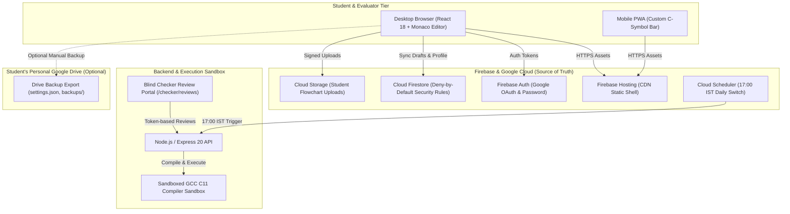

<p align="center">
  
</p>

# LogicQ

> **Daily C programming challenge and practice platform for engineering students**  
> *Engineered for Sanjivani University Undergraduate Engineering Programs*

[](https://logicq-clanguage.web.app)
[](https://logicq-clanguage.web.app)
[](#testing-and-scripts)
[](#testing-and-scripts)
[](SECURITY.md)

---

## 📌 Overview

**LogicQ** is a dedicated campus competitive programming and algorithmic thinking platform designed specifically for undergraduate engineering students mastering the **C programming language** (ISO C11 standard).

Unlike broad algorithmic websites that present beginners with thousands of unstructured problems and noisy gamification, LogicQ focuses on three core educational pillars:
1. **Daily Focused Habit**: Exactly one challenge per day, synchronizing at **17:00 IST**, emphasizing steady consistency over speed hacking.
2. **Sequential Syllabus Practice**: 4 structured topic modules (40 vetted problems) spanning Control Structures to Dynamic Memory, unlocking on a strict 10-of-10 mastery rule.
3. **Multi-Faceted Feedback**: Real-time sandboxed C11 compiler feedback for code, paired with blinded faculty review for uploaded handwritten logic and flowcharts.

---

## 🖼️ UI Previews & Screenshots

All screenshots are captured using **clean test environments with fake data only** (no real student names, PRNs, personal info, browser tabs, or external notifications). High-resolution compressed images are located in [`docs/screenshots/readme/`](docs/screenshots/readme/):

| View | Description | Screenshot Link |
| :--- | :--- | :---: |
| **Landing Page** | Public portal highlighting syllabus tracks and daily rhythm | [01_landing.png](docs/screenshots/readme/01_landing.png) |
| **Sign In** | Clean authentication with Google OAuth & credentials | [02_login.png](docs/screenshots/readme/02_login.png) |
| **Profile Completion** | University PRN validation (`^[0-9]{4}[A-Z]{3}[MF][0-9]{4}$`) & division | [03_profile_completion.png](docs/screenshots/readme/03_profile_completion.png) |
| **Daily Challenge & Editor** | Monaco C11 workspace, compilation console & mobile toolbar | [04_daily_challenge.png](docs/screenshots/readme/04_daily_challenge.png) |
| **Daily Leaderboard** | Consistency-ordered board (Streak $\rightarrow$ Solved $\rightarrow$ Stable ID) | [05_leaderboard.png](docs/screenshots/readme/05_leaderboard.png) |
| **Admin Operations** | Centralized dashboard for user status, pause control & reviews | [06_admin_dashboard.png](docs/screenshots/readme/06_admin_dashboard.png) |
| **Mobile PWA View** | Ergonomic C symbol helper toolbar on 360px viewport | [07_mobile_view.png](docs/screenshots/readme/07_mobile_view.png) |

---

## ✨ Features Matching Reality

- **🕒 Daily Challenge at 17:00 IST (Single Visible Question)**: Challenges run on a 24-hour cycle (17:00 IST to 17:00 IST) with a 10-minute drain grace. Past and future challenges return 410/404 to students.  
  *(Current Status: Strictly **PAUSED** (`dailyChallengePaused = true`) while problem statements undergo final faculty curriculum verification).*
- **⚡ Real Sandboxed C11 Judge**: GCC 13.2+ engine (`-Wall -Wextra -O2 -std=c11`) with strict 1.0s CPU and 128 MB RAM sandboxes blocking fork bombs, infinite loops, and file exfiltration. Hidden test cases are never sent to the browser.
- **📚 Practice Modules with 10-of-10 Unlock**: 4 curriculum modules (Control Structures, Pointers & Functions, Arrays & Applications, Advanced Data Types & Dynamic Memory) with 10 published questions each (4 Easy, 4 Medium, 2 Hard). Module $N+1$ unlocks strictly after solving all 10 problems in Module $N$ (`practiceUnlockThreshold = 10`).
- **📝 Uploaded Solutions & Blind Checker Review**: Students can upload flowcharts or handwritten proofs (up to 3 files, 5 MB each, PDF/PNG/JPEG). Faculty checkers evaluate submissions via anonymized tokens (`SUB-XXXX`) with a formula-driven rubric (Logic 50%, Flowchart 30%, Clarity 20%) and a 30-minute decision edit window.
- **🏆 Consistency Daily Rank & Daily Results**: Daily leaderboard ordered by Current Streak $\rightarrow$ Total Solved $\rightarrow$ Stable UID. Speed and attempt penalties are eliminated. Percentile ranking appears only with at least 10 solvers.
- **🔥 Streaks with Freeze & Pause Days**: 1 automated freeze per rolling 7-day window protects student streaks against accidental misses. Institutional holidays are designated as Admin Pause Days.
- **📊 Performance Charts**: Visual breakdown of solve distribution by difficulty (Easy, Medium, Hard) and submission accuracy trends over time.
- **🛡️ Admin Operations Dashboard**: 11 operational control centers for managing student records, checker workloads, daily challenge pause states, practice modules, and security audit logs.
- **☁️ Optional Google Drive Backup**: Purely optional history backup export via narrow `drive.file` scope. Login, daily challenges, practice, and code judging function 100% on Firebase alone without Google Drive permissions.
- **📱 Installable Progressive Web App (PWA)**: Web App Manifest, offline shell precaching, and a dedicated mobile C programming keyboard strip (`{`, `}`, `(`, `)`, `->`, `*`, `&`, `;`, `Tab`).
- **🌓 Adaptive Contrast Themes**: WCAG AA compliant Light (`#F4F6FB`) and Dark (`#0C0F1F`) design tokens with custom syntax highlighting in the embedded Monaco Editor.
- **🚫 Removed Legacy Features**: Arena contests, Archive browsing, and Badges were permanently removed from routes, UI, and database rules to keep students focused entirely on syllabus learning.

---

## ⚙️ How It Works

1. **Student Logs In**: Authenticates via Google OAuth (with `Cross-Origin-Opener-Policy: same-origin-allow-popups` preventing window warnings) or verified email credentials.
2. **PRN Verification**: First-time users validate their 12-character alphanumeric university PRN (`^[0-9]{4}[A-Z]{3}[MF][0-9]{4}$`), locked permanently into an atomic unique index (`prnIndex/{prn}`).
3. **Practice Track Mastery**: Students work through the 4 syllabus modules at their own pace. Code is judged against public sample tests and private evaluation tests. Solving all 10 problems unlocks the next module.
4. **Daily Rhythm**: At 17:00 IST, today's daily challenge unlocks. Students have 24 hours to submit their C code or upload flowcharts.
5. **Finalization**: At 17:05 IST, the daily leaderboard freezes permanently. Ranks are awarded based on streak consistency, and streaks increment.

---

## 👥 User Roles Matrix

| Role | Permissions & Operational Scope |
| :--- | :--- |
| **`student`** | Access dashboard, solve active daily challenge, work on unlocked Practice modules, submit C code, upload flowcharts, view own daily results and consistency rank. PII and PRN remain private. |
| **`checker`** | Access blind grading portal (`/checker/reviews`), review assigned student flowchart submissions identified only by token `SUB-XXXX`, grade according to formula rubric within 48-hour SLA. Zero access to student names, emails, or PRNs. |
| **`admin`** | Access all 11 admin consoles, manage checker queues and assignments, toggle system pause switch, inspect security audit logs, manage practice curriculum. Minimum 2 administrators invariant enforced; admin self-demotion blocked. |

---

## 🏛️ System Architecture



### Data Partitioning: Firebase vs. Optional Drive

- **Firebase (Authoritative Source of Truth)**: Accounts, university PRN mapping, roles, profile preferences, problems and private test suites, submissions, verdicts, points, streaks, daily results, practice progress, uploaded flowcharts, session audit logs, and cloud drafts.
- **Student's Google Drive (Optional Convenience Only)**: Personal exported backup of solved history, notes, and local editor settings. Zero core platform features require or depend on Google Drive.

---

## 🛠️ Tech Stack

| Domain | Technology | Version | Purpose |
| :--- | :--- | :---: | :--- |
| **Frontend Framework** | React | `18.3.1` | Reactive user interface & component state |
| **Language** | TypeScript | `5.6.2` | End-to-end static typing across client and server |
| **Styling** | Tailwind CSS | `3.4.11` | Custom theme tokens (`#0C0F1F`, `#141932`, `#46D9A0`) |
| **Code Editor** | Monaco Editor | `0.57.0` | Browser-based C editor bundled locally without CDNs |
| **Build Tool** | Vite | `5.4.21` | High-speed production bundling with chunk optimization |
| **Backend Runtime** | Node.js / Express | `20.x` / `4.21.0` | REST API, security middleware, and business logic |
| **Database ORM** | Prisma ORM | `5.19.1` | SQLite (dev) / PostgreSQL (prod) schema management |
| **Cloud Document Store** | Cloud Firestore | `v2` | Primary cloud document store with deny-by-default rules |
| **Cloud Object Storage**| Cloud Storage | `v2` | Student flowchart uploads with strict mime-type validation |
| **Compilation Sandbox** | GCC Compiler | `13.2+` (C11) | Sandboxed ISO C11 compilation and execution engine |
| **Testing Engines** | Vitest & Playwright | `2.1.9` / `1.57.3` | Unit, integration, security rules, and e2e testing |

---

## 🔒 Security Architecture

LogicQ is engineered with a strict **defense-in-depth, deny-by-default security model**. While no platform is completely invulnerable, LogicQ enforces rigorous protections against common web and evaluation exploits:

- **Deny by Default**: All database and storage rules deny access unless explicitly permitted by affirmative conditions.
- **PII Isolation**: University PRNs, student emails, and private submission histories are inaccessible to peer students. Public profile mirrors (`publicProfiles/{userId}`) expose only non-PII metrics.
- **Anti-Squatting PRN Lock**: University PRNs are claimed atomically via private transaction documents (`prnIndex/{prn}`). Released PRNs are protected by a 30-day anti-squatting hold.
- **Blinded Academic Review**: Checkers evaluate submissions labeled only with cryptographic tokens (`SUB-XXXX`). Checkers cannot see student identities, and students cannot view checker identities.
- **Sandboxed GCC Execution**: C program compilation and execution run in restricted sandboxes with tight CPU (1.0s) and memory (128 MB) boundaries, preventing recursive exhaustion and malicious syscalls.
- **Defensive Headers & COOP**: All responses serve HSTS, `nosniff`, `X-Frame-Options: DENY`, strict-origin referrer policies, and `Cross-Origin-Opener-Policy: same-origin-allow-popups` ensuring clean Google OAuth popup flows without window leakage.
- **Immutable Session Events**: Security events (`session_events/{eventId}`) record audit trails for all logins, logouts, idle timeouts, and token revocations.

*For complete vulnerability disclosure procedures and detailed threat boundaries, refer to [SECURITY.md](SECURITY.md).*

---

## 📁 Project Structure

```
LogicQ/
├── client/                     # Frontend Vite + React 18 Application
│   ├── public/                 # Static assets, brand logos, PWA manifest
│   ├── src/
│   │   ├── api/                # API client & offline fallback engine
│   │   ├── components/         # Common UI badges, modals, Monaco editor
│   │   ├── config/             # Academic, practice, and Firebase configurations
│   │   ├── context/            # Authentication & session lifecycle providers
│   │   ├── pages/              # Dashboard, Challenge, Practice, Admin, Checker
│   │   ├── services/           # Firestore data & Google Drive backup services
│   │   └── types/              # TypeScript interface definitions
│   └── vite.config.ts          # Vite bundler configuration with COOP headers
├── server/                     # Backend Express API & Code Judge Engine
│   ├── prisma/                 # Prisma schema definition & database seeds
│   ├── src/
│   │   ├── config/             # Practice modules & academic configurations
│   │   ├── controllers/        # Auth, Practice, Problem, Submission, User
│   │   ├── judges/             # Local GCC and sandboxed C11 execution runners
│   │   ├── middleware/         # Auth JWT, role authorization, rate limiting
│   │   ├── routes/             # REST route declarations
│   │   └── services/           # Badge, integrity, streak, and config services
│   └── tests/                  # Vitest suite (193 automated unit & security tests)
├── tests-e2e/                  # Playwright end-to-end tests (clean browser context)
├── docs/                       # Architectural specifications & deployment plans
├── firestore.rules             # Compiled Firestore deny-by-default security rules
├── storage.rules               # Cloud Storage security rules with mime-type checking
├── firebase.json               # Firebase Hosting headers, rewrites, and COOP settings
└── package.json                # Monorepo workspaces & root execution scripts
```

---

## 🚀 Getting Started (Windows-First)

### Prerequisites
- **Node.js**: `v20.x` or higher installed ([Download Node.js](https://nodejs.org/)).
- **GCC / MinGW**: Required for local C11 code judging (e.g. `gcc --version` must return `13.x` or compatible). On Windows, install via [w64devkit](https://github.com/skeeto/w64devkit/releases) or MinGW-w64.
- **Git**: Version control CLI.
- **Firebase CLI**: `npm install -g firebase-tools` (run `firebase login` to authenticate).

### Step-by-Step Setup

1. **Clone the Repository**:
   ```powershell
   git clone https://github.com/pratikpt1304/LogicQ.git
   cd LogicQ
   ```

2. **Install Dependencies**:
   ```powershell
   npm.cmd install
   npm.cmd --prefix server install
   npm.cmd --prefix client install
   ```

3. **Configure Environment Variables**:
   ```powershell
   Copy-Item .env.example .env
   Copy-Item .env.example server/.env
   ```

4. **Initialize Local Database**:
   ```powershell
   npm.cmd run db:push
   npm.cmd run db:seed
   ```

5. **Start Local Development Server**:
   ```powershell
   npm.cmd run dev
   ```
   Open your browser at **[http://localhost:5173](http://localhost:5173)**.

6. **Execute Automated Test Suites**:
   ```powershell
   # Run all 193 server & security rule tests
   npm.cmd test

   # Run Playwright cross-browser e2e tests
   npx.cmd playwright test
   ```

---

## 🔐 Environment Variables

| Variable Name |
| :--- |
| `NODE_ENV` |
| `PORT` |
| `CLIENT_URL` |
| `DATABASE_URL` |
| `JWT_ACCESS_SECRET` |
| `JWT_REFRESH_SECRET` |
| `JWT_ACCESS_EXPIRES_IN` |
| `JWT_REFRESH_EXPIRES_IN` |
| `ADMIN_USERNAME` |
| `ADMIN_EMAIL` |
| `ADMIN_PASSWORD` |
| `ADMIN_FULLNAME` |
| `JUDGE_TYPE` |
| `GCC_PATH` |
| `JUDGE0_URL` |
| `JUDGE0_KEY` |
| `JUDGE0_HOST` |
| `REDIS_URL` |
| `MAIL_PROVIDER` |
| `SMTP_HOST` |
| `SMTP_PORT` |
| `SMTP_USER` |
| `SMTP_PASS` |
| `MAIL_FROM` |
| `VITE_API_URL` |
| `VITE_FIREBASE_API_KEY` |
| `VITE_FIREBASE_AUTH_DOMAIN` |
| `VITE_FIREBASE_PROJECT_ID` |
| `VITE_FIREBASE_STORAGE_BUCKET` |
| `VITE_FIREBASE_MESSAGING_SENDER_ID` |
| `VITE_FIREBASE_APP_ID` |
| `VITE_FIREBASE_MEASUREMENT_ID` |

---

## 📜 Testing & Available Scripts

| Script | Location | Purpose |
| :--- | :--- | :--- |
| `npm run dev` | Root | Starts both backend API (port 5000) and frontend client (port 5173) concurrently. |
| `npm run dev:server` | Root | Starts the backend Express server with TypeScript hot reloading (`tsx watch`). |
| `npm run dev:client` | Root | Starts the Vite React frontend with Hot Module Replacement (HMR). |
| `npm run build` | Root | Compiles Prisma client, builds TypeScript backend, and bundles production client. |
| `npm test` | Root | Runs the complete server Vitest suite (193 tests covering rules, judge, and roles). |
| `npx playwright test` | Root | Runs end-to-end clean-context tests in Chromium, Firefox, WebKit, and Mobile Safari. |
| `npm run db:push` | Root | Synchronizes Prisma schema definitions with the local SQLite database. |
| `npm run db:seed` | Root | Seeds initial administrator accounts and 40 Practice problems. |
| `npm run verify-integrity` | Root | Verifies PRN uniqueness, role constraints, and data consistency. |
| `npm run setup` | Root | Complete automated bootstrap: installs dependencies, pushes schema, and seeds data. |

---

## 🚀 Cloud Deployment & Operations

### Deployment Order
Deployment must proceed sequentially through staging verification before production:
1. **Gate 1**: GitHub audit, secret scanning, clean branch, small conventional commits, PR review.
2. **Gate 2 (Staging)**: Deploy rules and hosting to staging environment / preview channel, take database export snapshot, run full test suite with fake data.
3. **Gate 3 (Production)**:
   - Deploy Firestore indexes and security rules (`firestore.rules`).
   - Deploy Storage security rules (`storage.rules`).
   - Deploy Cloud Functions & Cloud Scheduler (with `maxInstances: 10`).
   - Run idempotent data migrations (`migrate-prn-format.ts`).
   - Deploy Firebase Hosting last (`client/dist`).

### Blaze Plan & Budget Reminder
- **Estimated Cost**: Less than **\$0.76 – \$1.86 / month** (~₹65 – ₹160 INR / month) for 500 engineering students.
- **Budget Alert**: Set a hard budget alert at **₹500 INR ($6.00 USD) / month** in the Google Cloud Billing Console.
- **Concurrency Cap**: Configure `maxInstances: 10` on Cloud Run / Cloud Functions to eliminate unexpected auto-scaling spikes.

---

## 📚 Documentation Index

The following authoritative specifications in `/docs` define the platform standards:

- [MASTER_SPEC.md](docs/MASTER_SPEC.md): Complete consolidated platform specifications, role definitions, and daily cycle rules.
- [DATA_ARCHITECTURE.md](docs/DATA_ARCHITECTURE.md): Authoritative architectural division between Firebase and optional Google Drive.
- [DRIVE_INTEGRATION.md](docs/DRIVE_INTEGRATION.md): Technical specification for optional Google Drive backup export and failure mode handling.
- [LEARNING_FIRST.md](docs/LEARNING_FIRST.md): Pedagogical scaffolding, consistency-first daily ranking, and compiler error guidance.
- [PILOT_PLAN.md](docs/PILOT_PLAN.md): 14-day campus pilot framework, success metrics, and consent protocol.
- [SECURITY_RULES.md](docs/SECURITY_RULES.md): Complete Firestore and Storage security rules documentation and test vectors.
- [DEPLOY_PLAN.md](docs/DEPLOY_PLAN.md): Pre-release test verification matrix, Blaze plan cost breakdown, and 5-minute rollback plan.
- [CROSS_ORIGIN_OPENER_POLICY.md](docs/CROSS_ORIGIN_OPENER_POLICY.md): COOP configuration details and browser extension error isolation note.

---

## 🗺️ Roadmap & Next Steps

- [ ] **Pedagogical Tiered Hints**: Progressive hints for daily challenges unlocked after 2 and 4 failed attempts (conceptual pointers without leaking solutions).
- [ ] **Plain-Language Compiler Diagnostics**: Automatic translation of cryptic GCC compiler messages into friendly student guidance.
- [ ] **Day-After Challenge Review**: Unlocking ended daily challenges in read-only review mode with editorial explanations and zero-point retries.
- [ ] **Automated Code Linting**: Real-time feedback on memory safety (`malloc` without `free`), uninitialized pointers, and boundary errors.

---

## ⚠️ Known Limitations & Disclosures

1. **Daily Challenge Paused**: The daily competition pool is temporarily paused (`dailyChallengePaused = true`) while problem statements derived from academic sources undergo formal faculty review. The practice curriculum (40 questions) is fully functional and unlocked.
2. **Firebase Blaze Plan Dependencies**: Cloud Run judge sandboxing and production Cloud Storage buckets require upgrading the Firebase project to the Blaze plan. On the Spark free tier, code judging runs via the local execution engine or GitHub Actions fallback.
3. **Google Drive Integration is Optional**: Student Google Drive connectivity is exclusively for personal history backup export. No core feature (authentication, practice, code judging, uploads) requires Google Drive access.

---

## 📄 Contributing, License & Author

- **Contributing**: Contributions are restricted to authorized university developers and faculty reviewers. Please review [SECURITY.md](SECURITY.md) before opening pull requests.
- **License**: Copyright (c) 2026 LogicQ / Sanjivani University. All rights reserved. Redistribution and use in source and binary forms are strictly prohibited without prior written permission.
- **Author**: Engineered for Sanjivani University Undergraduate Engineering Programs.
