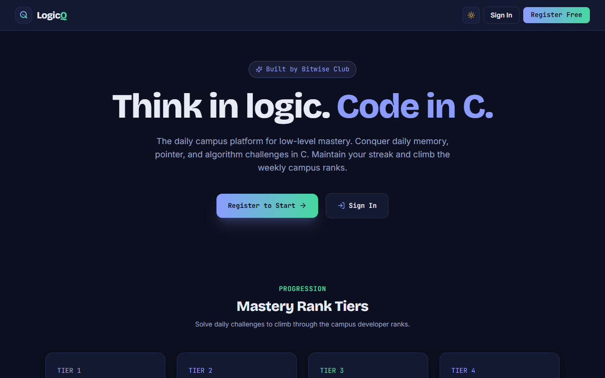
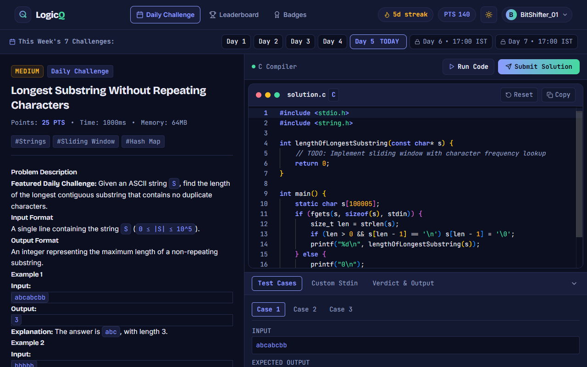
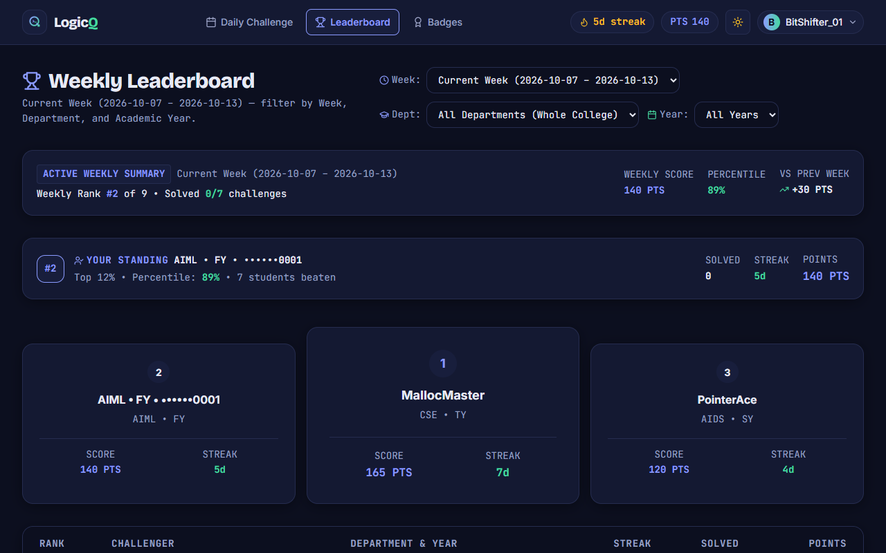
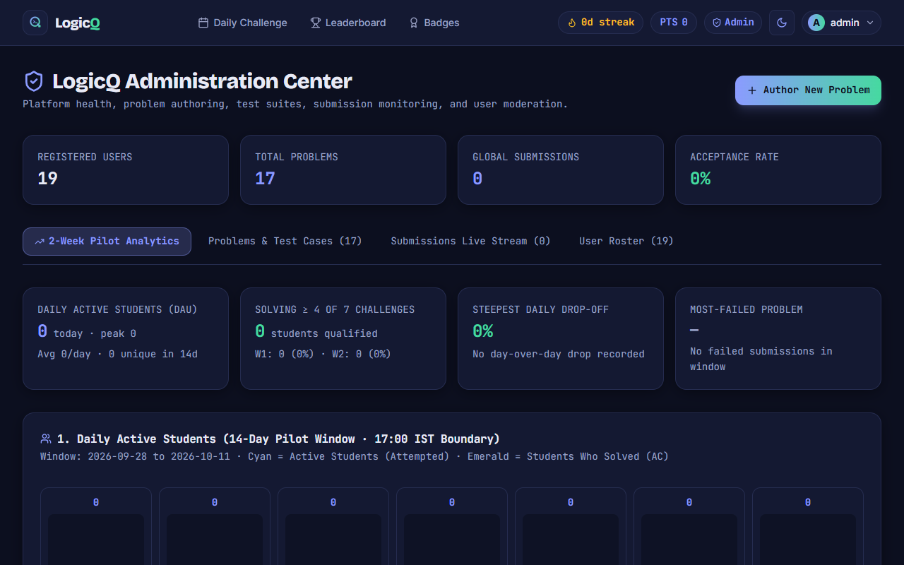
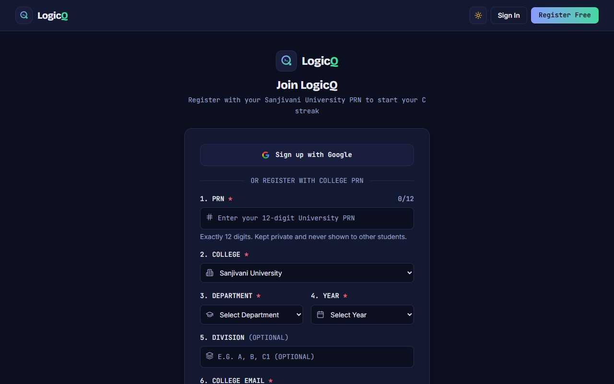
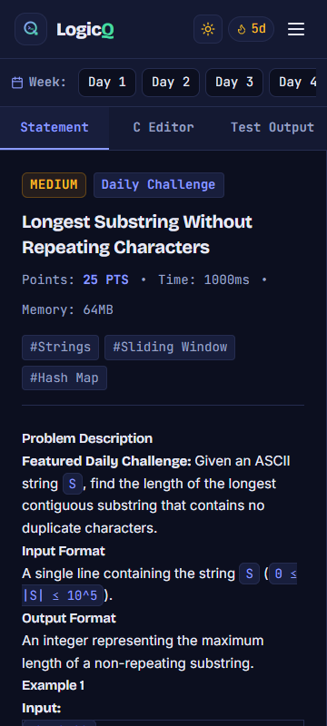

<p align="center">
  
</p>

<h1 align="center">LogicQ</h1>

<p align="center">
  <strong>Daily C Language Challenge & Weekly Competitive Arena for Engineering Students</strong>
</p>

<p align="center">
  <a href="https://logicq-clanguage.web.app"></a>
  <a href="LICENSE"></a>
  
  
  
</p>

---

## 1. Overview

**LogicQ** is a campus competitive programming and algorithmic thinking platform designed specifically for undergraduate engineering students mastering the C programming language (developed for Sanjivani University).

Instead of overwhelming students with hundreds of open practice questions, LogicQ enforces deliberate daily practice: **students see exactly ONE challenge at a time** — today's challenge. At 17:00 IST every day, a new problem unlocks and yesterday's problem disappears. Students can write, compile, and run code against a sandboxed C11 judge or submit handwritten/drawn solutions for manual blind evaluation.

---

## 2. Screenshots

| Landing Page | Daily Challenge & Editor |
| :---: | :---: |
|  |  |

| Weekly Leaderboard | Admin & Moderation Center |
| :---: | :---: |
|  |  |

| Profile Registration & PRN | Mobile Viewport (360px) |
| :---: | :---: |
|  |  |

---

## 3. Key Features

- **Single Visible Question Window**: Exactly one challenge visible per day (from 17:00 IST to 17:00 IST). Past problems and future problems return `404 Not Found` to students.
- **Sandboxed C11 Execution**: Automated judging supporting all standard verdicts: `ACCEPTED`, `WRONG_ANSWER`, `TIME_LIMIT_EXCEEDED`, `RUNTIME_ERROR`, `COMPILE_ERROR`, `MEMORY_LIMIT_EXCEEDED`.
- **Uploaded Solution Workflow**: Students can upload solution flowcharts or handwritten code (JPG, PNG, PDF) with EXIF metadata stripping and magic-byte validation.
- **Checker Blind Review Portal (`/checker/reviews`)**: Dedicated portal for solution checkers. Zero student PII is exposed (anonymized `SUB-XXXX` token). Points are calculated via a mathematical rubric formula (Correct Logic 50%, Flowchart 30%, Clarity 20%).
- **Weekly Competition & Rankings**: Competition runs Monday 17:00 to Monday 17:00 IST with automated result generation at 17:05 IST.
- **Streaks & Freezes**: Daily solving streak with one automatic freeze per week and admin-declared exam pause windows.
- **PWA & Offline Shell**: Installable on Android, iOS, and desktop browsers with custom quick-symbol mobile keyboard toolbar.
- **Dual WCAG AA Themes**: Deep dark theme (`#0C0F1F`) and crisp light theme (`#F4F6FB`) with custom Monaco editor styling.

---

## 4. How It Works

### Daily & Weekly Cycle
1. **17:00 IST Daily Flip**: Cloud Scheduler triggers the daily problem activation. The previous question is locked and archived from student view.
2. **Student Journey**: The student opens the challenge, reviews the statement and sample test cases, tests code using custom stdin, and submits.
3. **Double Verification**: A student can submit code (auto-judged) or an uploaded flowchart/PDF (checker-reviewed). Whichever yields points first awards credit; duplicate solves award zero additional points.
4. **Monday 17:00 IST Weekly Cutoff**: Weekly ranks freeze. At 17:05 IST, weekly summary badges and percentile statistics are finalized.

### Roles & Responsibilities
- **`admin`**: Full access to all 12 administration modules (problem authoring, test suites, submission inspection, checker management, weekly result freezes, audited PRN changes, and audit logs).
- **`checker`**: Restricted access to the `/checker/reviews` queue. Cannot access admin pages, student profiles, code submissions, or reference solutions.
- **`student`**: Student workspace, daily challenge, leaderboard, and personal submission history.

---

## 5. System Architecture

```mermaid
flowchart TD
    Client["Browser / PWA (React + Vite)"]
    Hosting["Firebase Hosting (CDN)"]
    Auth["Firebase Auth (Google & Email)"]
    Firestore["Cloud Firestore (App Data)"]
    Storage["Cloud Storage (Solution Uploads)"]
    Server["LogicQ Backend API (Node.js/Express)"]
    Judge["C11 Execution Judge (GCC 13.2)"]

    Client -->|Static Assets| Hosting
    Client -->|User Authentication| Auth
    Client -->|Direct Read (Rules Guarded)| Firestore
    Client -->|API Calls & Judging Requests| Server
    Server -->|Admin Transactions| Firestore
    Server -->|Stores Uploads| Storage
    Server -->|Runs Code Safely| Judge
```

---

## 6. Tech Stack & Dependencies

| Layer | Technologies | Version |
| :--- | :--- | :--- |
| **Frontend UI** | React, TypeScript, Tailwind CSS, Framer Motion | React 18.3, TS 5.6 |
| **Code Editor** | Monaco Editor (`@monaco-editor/react`) | 0.57.0 |
| **Data Fetching** | TanStack React Query | 5.56.2 |
| **Backend API** | Node.js, Express, TypeScript | Node 20+, Express 4.21 |
| **Database ORM** | Prisma Client (SQLite local / PostgreSQL cloud) | 5.22.0 |
| **Cloud Services** | Firebase Hosting, Firebase Auth, Cloud Firestore | Firebase 13.0 |
| **Test Framework** | Vitest, Supertest | Vitest 2.1.9 |

---

## 7. Security Overview

LogicQ employs defense-in-depth principles:
- **Deny-by-Default Perimeter**: All Firestore and Storage rules reject access unless explicit permission rules match (`rules_version = '2';`).
- **Student Privacy & PII Protection**: University PRNs and emails are restricted to the document owner and verified administrators. Checkers see strictly blind submission tokens.
- **Sandboxed Execution**: Submissions run under strict CPU, memory, and output quotas with fork-bomb and infinite-loop termination.
- **Server-Managed Integrity**: Points, streaks, weekly leaderboards, and verdict states can never be created or updated by clients directly.
- **Audit Trails**: All administrative role updates, PRN edits, bans, and reviews are recorded in an append-only audit ledger.

*See [SECURITY.md](SECURITY.md) for vulnerability reporting guidelines.*

---

## 8. Project Structure

```
LogicQ/
├── client/                     # Vite React TypeScript frontend
│   ├── public/                 # Static assets, PWA manifest, service worker
│   └── src/                    # Components, pages, contexts, hooks, and types
├── server/                     # Node.js Express backend API
│   ├── prisma/                 # Database schema and seed scripts
│   ├── src/                    # API controllers, middleware, queue, and services
│   └── tests/                  # Automated integration and regression test suites
├── docs/                       # Project specifications, designs, and audit reports
├── scripts/                    # Deployment verification and bundle audit utilities
├── firestore.rules             # Cloud Firestore security rules
├── storage.rules               # Cloud Storage security rules
├── firebase.json               # Firebase Hosting and service configuration
└── package.json                # Workspace root package manifest
```

---

## 9. Getting Started

### Prerequisites
- Node.js `20.x` or later
- npm `10.x` or later
- GCC (MinGW on Windows, native GCC on Linux/macOS) for local code execution

### Installation
```bash
# 1. Clone repository
git clone https://github.com/pratikpt1304/LogicQ.git
cd LogicQ

# 2. Install dependencies across workspaces
npm install

# 3. Configure environment
cp .env.example .env

# 4. Synchronize database schema and seed problems
npm run db:push
npm run db:seed

# 5. Start development servers
npm run dev
```

The frontend will be available at `http://localhost:5173` and the backend at `http://localhost:5000`.

---

## 10. Scripts & Verification

```bash
# Run full server test suite (18 test suites, 107 tests)
npm --prefix server test

# Verify database ledger and points integrity
npm --prefix server run verify-integrity

# Build client production bundle
npm --prefix client run build

# Run bundle security and URL audit
node scripts/check-bundle.mjs
```

---

## 11. Documentation Index

- [MASTER_SPEC.md](docs/MASTER_SPEC.md) — Authoritative requirements and business logic specification.
- [ADMIN_DESIGN.md](docs/ADMIN_DESIGN.md) — Technical design for the Admin and Checker portals.
- [DEPLOY_PLAN.md](docs/DEPLOY_PLAN.md) — Deployment plan, environment matrix, and pre-deploy checks.
- [ROLLBACK.md](docs/ROLLBACK.md) — Emergency rollback procedures for Hosting and Firestore rules.
- [STATUS.md](docs/STATUS.md) — Live implementation and audit status.
- [SECURITY.md](SECURITY.md) — Security policy and responsible disclosure instructions.

---

## 12. Known Limitations & Blocked Items

- **Cloud Run C11 Judge**: Live production judging currently requires the project owner to activate Firebase Blaze billing.
- **Cloud Storage Bucket**: Student upload storage bucket deployment is blocked pending Blaze plan activation.
- **Book Import Pipeline**: Automated extraction from textbook PDF is ready and awaits book file mounting.

---

## 13. Author & License

- **Author**: LogicQ Team / Sanjivani University
- **License**: All Rights Reserved (see [LICENSE](LICENSE)).
