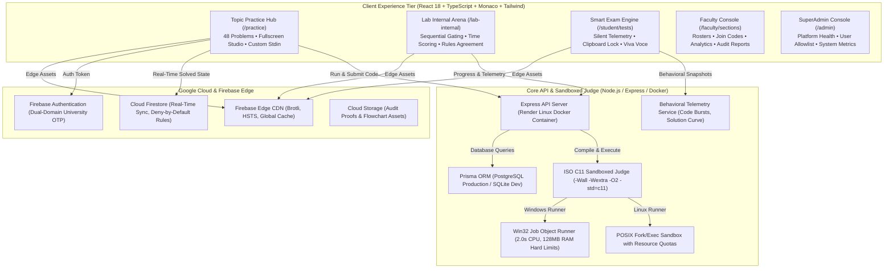

<p align="center">
  
</p>

<h1 align="center">LogicQ</h1>

<p align="center">
  <strong>Institutional-Grade C Programming Mastery, Sandboxed GCC Judge & Continuous Assessment Platform</strong><br>
  <em>Engineered for Higher Education • ISO C11 Sandboxed Evaluation • Copy-Resistant Telemetry • Sanjivani University</em>
</p>

<p align="center">
  <a href="https://logicq-clanguage.web.app"></a>
  <a href="https://logicq-bitwiseclub.onrender.com/api/health"></a>
  <a href="https://github.com/pratikpt1304/LogicQ"></a>
  <a href="docs/SECURITY_RULES.md"></a>
  <a href="docs/assessment/GAP_ANALYSIS.md"></a>
  <a href="SECURITY.md"></a>
</p>

---

## 📌 Executive Overview

**LogicQ** is an enterprise-grade competitive programming, coursework mastery, and institutional continuous evaluation platform designed from the ground up for university computer science and undergraduate engineering departments.

It bridges the critical gap between **stress-free conceptual mastery** and **strict, copy-resistant examination integrity** through a deliberate architectural split:

```
┌───────────────────────────────────────────────────────────────────────────────────┐
│                                LOGICQ ECOSYSTEM                                   │
├─────────────────────────────────────────┬─────────────────────────────────────────┤
│    📘 TARGETED TOPIC PRACTICE ARENA     │    🛡️ PROCTORED LAB INTERNAL & EXAMS   │
│       (/practice & /challenge)          │       (/lab-internal & /student/tests)  │
├─────────────────────────────────────────┼─────────────────────────────────────────┤
│ • 48 Hand-Curated Progressive Problems  │ • Strict Sequential 4-Module Coursework │
│ • Multi-Tier: Easy, Medium, Hard        │ • 100-Mark Continuous Assessment Model  │
│ • Interactive Syntax Tip Reference Box  │ • Deterministic Reference Time Scoring  │
│ • Custom Stdin & Real-Time Verdicts     │ • Fullscreen Lockdown & Focus Tracking  │
│ • Portal-Powered True Fullscreen Studio │ • 2 Visible + 1 Server Hidden Test Case │
│ • Zero Penalty, Unlimited Reattempts    │ • AI Viva Voce Verification Trigger     │
│ • Daily 17:00 IST Streak Arena (🔥)     │ • Dual-Score: Academic X/100, Trust Y%  │
└─────────────────────────────────────────┴─────────────────────────────────────────┘
```

---

## 🏛️ System Architecture



---

## 🚀 Key Feature Modules

### 1. 📘 Targeted Topic Practice Arena (`/practice`)
- **48 Curated Core Problems**: Categorized into four fundamental foundational tracks:
  - **Module 1: Control Flow (12 Problems)**:
    - *Easy*: `if-else` Odd/Even, Temperature Conversion, `switch-case` Calculator, Leap Year.
    - *Medium*: `while` Digit Sum, `for` Factorial, Nested Loop Star Pattern, `break/continue` Skip Evens, Ternary Operator, Menu-driven CLI.
    - *Hard*: Prime Factorization Engine, Collatz Conjecture Trajectory Analysis.
  - **Module 2: Pointers & Functions (12 Problems)**:
    - *Easy*: Pass-by-value Cube, Pointer Dereferencing, Array Traversal via Pointer, String Length Pointer.
    - *Medium*: Pass-by-reference Swap, Pointer Arithmetic Offsets, Recursive Fibonacci, Function Pointers Callback, Double Pointer Indirection, Bitwise Flag Toggling.
    - *Hard*: Generic Memory Swap via `void*`, Fast Euclidean Iterative GCD, Recursive Tower of Hanoi.
  - **Module 3: Arrays & Strings (12 Problems)**:
    - *Easy*: Linear Search, Max Element Search, In-Place Array Reversal, String Vowel Counter.
    - *Medium*: String Palindrome Checker, Substring Search (`strstr`), Matrix Addition, 2D Matrix Transpose, Array Frequency Counter, Run-Length Encoding (RLE).
    - *Hard*: Matrix Spiral Traversal, Kadane's Maximum Contiguous Subarray Algorithm.
  - **Module 4: Structs & Dynamic Memory (12 Problems)**:
    - *Easy*: Basic `struct Point` Distance, Array of Student Structs, Dynamic Int Allocation (`malloc`/`free`), Dynamic String Duplication.
    - *Medium*: Nested Struct Employee Payroll, Dynamic 2D Array Matrix, Singly Linked List Node Append, Circular Buffer Queue, Student Grade Book Ranking.
    - *Hard*: Singly Linked List In-Place Reversal, Compressed Sparse Matrix Representation, Dynamic Vector Allocation Engine.
- **Difficulty Multi-Filter**: Instantly toggle between `All Diff`, `Easy`, `Medium`, and `🔥 Hard`.
- **Topic Reference Tip Box**: Clean tabbed reference with syntax definitions, practical application notes, and canonical C examples.
- **True Fullscreen Studio**: Powered by React Portals (`createPortal(..., document.body)`), completely isolating the workspace from parent container padding and scroll offsets.
- **Live Compiler Feedback**: Test against visible test cases with standard input support, or run full hidden test case evaluations.

### 2. 🛡️ Lab Internal Sequential Mastery Arena (`/lab-internal`)
- **Strict Sequential Gate**: In each module, Question $N+1$ unlocks strictly after Question $N$ is verified and solved.
- **Proctored Examination Mode**:
  - Full JEE-Style Problem Grid with Status Indicators (Not Visited, Marked for Review, Answered).
  - Browser Fullscreen Enforcement with automatic entry and exit monitoring.
  - Unsolicited tab switch detection with instant security toasts and faculty telemetry logging.
  - Automated auto-save draft synchronizer with conflict resolution.

### 3. ⚖️ Sandboxed ISO C11 Judge Engine
- **Strict Compiler Diagnostics**: Compiles with `-Wall -Wextra -O2 -std=c11` to catch syntax ambiguities, uninitialized memory, and format specifier bugs.
- **OS Resource Quotas**:
  - **Hard Execution Timeout**: 2.0 seconds maximum wall-clock runtime.
  - **Memory Ceiling**: 128 MB RAM maximum process heap.
  - **Infinite Loop & Leak Guard**: Traps fork bombs, runaway loops, and buffer overruns safely.
- **Hidden Test Case Suite**: Submissions must pass both open sample checks and encrypted server-side hidden checks.

### 4. 👥 Faculty Section & Roster Management
- **Instant Enrollment**: Shareable 6-character Join Codes (`LQ-IMTC`), direct join links, and auto-generated QR codes for classroom projectors.
- **Student Roster Telemetry**: Monitor student enrollments, active solve counts, streak counters, and code submission timestamps in real time.
- **Dual-Layer Auto-Healing**: Resilient state persistence syncing PostgreSQL and Cloud Firestore to prevent data loss across container sleep cycles.

### 5. 🔐 Dual-Domain OTP Identity Security
- **Domain Restriction**: Enforces verified student accounts using official institutional email domains (`@sanjivani.edu.in` and `@sanjivani.org.in`).
- **1:1:1 Binding**: Exactly one Permanent Registration Number (PRN) maps to one student account.
- **Cryptographic OTP Dispatch**: 6-digit one-time passcodes delivered via transactional email dispatchers with rate-limiting and replay protection.

---

## 🛠️ Technology Stack

| Component | Technology | Version | Purpose |
| :--- | :--- | :---: | :--- |
| **Frontend Framework** | React | `18.3.1` | Reactive component architecture |
| **Type System** | TypeScript | `5.6.2` | Complete end-to-end type safety |
| **Build System** | Vite | `5.4.21` | Optimized bundle splitting and fast HMR |
| **Styling** | Tailwind CSS | `3.4.11` | Custom WCAG AA compliant theme variables |
| **Code Editor** | Monaco Editor | `0.57.0` | Browser-based ISO C11 IDE with intellisense |
| **Backend Framework** | Node.js / Express | `20.x` / `4.21.0` | High-throughput REST API and judge runner |
| **ORM & Database** | Prisma ORM | `5.22.0` | PostgreSQL (Production) / SQLite (Dev) |
| **Cloud Database** | Cloud Firestore | `v2` | Real-time state store with 52 security rules |
| **Cloud Hosting** | Firebase Hosting | `v15.x` | Global CDN, HTTP/2, custom security headers |
| **Compiler Toolchain** | GCC / MinGW-w64 | `13.2+` | Native ISO C11 compiler sandbox |
| **Testing Harness** | Vitest | `2.1.9` | Automated unit, E2E, and security tests |

---

## 📁 Repository Directory Structure

```
LogicQ/
├── client/                                 # Frontend Vite + React 18 Application
│   ├── public/                             # PWA Manifest, Brand Icons, Favicons
│   ├── src/
│   │   ├── api/                            # Axios client, token deduplication, offline fallback
│   │   ├── components/
│   │   │   ├── common/                     # RaiseIssueModal, StatementMarkdown, Navbar
│   │   │   ├── editor/                     # Monaco CodeEditor, DraftConflictModal
│   │   │   └── practice/                   # JeeSubmitModal, QuestionGrid, Timer
│   │   ├── data/
│   │   │   ├── topic-practice.data.ts      # Merged 48-problem curriculum data
│   │   │   ├── topic-practice-part2.data.ts# Intermediate level topic data
│   │   │   └── topic-practice-hard.data.ts # Placement hard topic data
│   │   ├── pages/
│   │   │   ├── TopicPracticeHubPage.tsx    # Practice Hub & Fullscreen Studio
│   │   │   ├── PracticeWorkspacePage.tsx   # Lab Internal Sequential Workspace
│   │   │   ├── PracticeModulesPage.tsx     # Lab Internal Modules List
│   │   │   ├── DashboardPage.tsx           # Student Progress Overview
│   │   │   └── faculty/                    # Faculty Analytics & Rosters
│   │   └── services/                       # FirestoreDataService & RealtimeSync
│   └── vite.config.ts                      # Client bundler configuration
├── server/                                 # Backend Express API & Sandbox Judge
│   ├── prisma/                             # Database schema & migrations
│   ├── src/
│   │   ├── controllers/                    # Auth, Practice, Exam, Section, Viva
│   │   ├── judge/                          # Sandboxed GCC compilation runners
│   │   ├── middleware/                     # JWT authentication, RBAC guards
│   │   └── routes/                         # REST endpoints
│   └── tests/                              # Automated Vitest test suites
├── docs/                                   # Specifications & Gap Analysis
├── firestore.rules                         # 52 Deny-by-default Firestore rules
├── storage.rules                           # Cloud Storage security rules
├── firebase.json                           # Firebase Hosting & Firestore configs
└── package.json                            # Monorepo workspace configuration
```

---

## ⚡ Quickstart (Local Development)

### Prerequisites
- **Node.js**: `v20.x` or higher ([Download Node.js](https://nodejs.org/))
- **GCC / MinGW-w64**: Installed and available on `PATH` (`gcc --version`)
- **Git**: Version control CLI

### Setup Instructions

1. **Clone the Repository**:
   ```bash
   git clone https://github.com/pratikpt1304/LogicQ.git
   cd LogicQ
   ```

2. **Install Root & Sub-package Dependencies**:
   ```bash
   npm install
   npm --prefix server install
   npm --prefix client install
   ```

3. **Configure Environment Variables**:
   ```bash
   cp .env.example .env
   cp .env.example server/.env
   ```

4. **Initialize Database & Seed Curated Problems**:
   ```bash
   npm run db:push
   npm run db:seed
   ```

5. **Start Development Servers**:
   ```bash
   npm run dev
   ```
   Open **[http://localhost:5173](http://localhost:5173)** in your browser.

---

## 🧪 Verification & Test Suites

Run the automated verification suites covering security rules, sandbox integrity, and platform life cycles:

```bash
# 1. Verify Firestore Security Rules (52 passing tests)
npm --prefix server test tests/firestore-security-rules.test.ts

# 2. Verify End-to-End Institutional Life Cycle
npm --prefix server test tests/e2e-institutional-lifecycle.test.ts

# 3. Verify Sandboxed Exam Engine & Scoring Calculations
npm --prefix server test tests/smart-exam-engine.test.ts

# 4. Verify Sequential Practice Gating Logic
npm --prefix server test tests/practice-modules.test.ts

# 5. Build Guard Verification (Zero LocalStorage PII leakage check)
npm --prefix client run build
```

---

## 🌐 Production Deployments

- **Frontend Application**: Deployed on **Firebase Hosting** with global edge CDN caching.
  - **Live URL**: [https://logicq-clanguage.web.app](https://logicq-clanguage.web.app)
  - **Practice Hub**: [https://logicq-clanguage.web.app/practice](https://logicq-clanguage.web.app/practice)
  - **Lab Internal**: [https://logicq-clanguage.web.app/lab-internal](https://logicq-clanguage.web.app/lab-internal)
- **Backend API & Judge Runtime**: Deployed on **Render.com** via Docker.
  - **Healthcheck Endpoint**: [https://logicq-bitwiseclub.onrender.com/api/health](https://logicq-bitwiseclub.onrender.com/api/health)

---

## 📄 License & Maintainers

- **Copyright**: © 2026 LogicQ / Sanjivani University. All rights reserved.
- **Lead Architect & Developer**: Pratik Thorat ([@pratikpt1304](https://github.com/pratikpt1304))
- **Institutional Partner**: Sanjivani University Department of Computer Engineering
