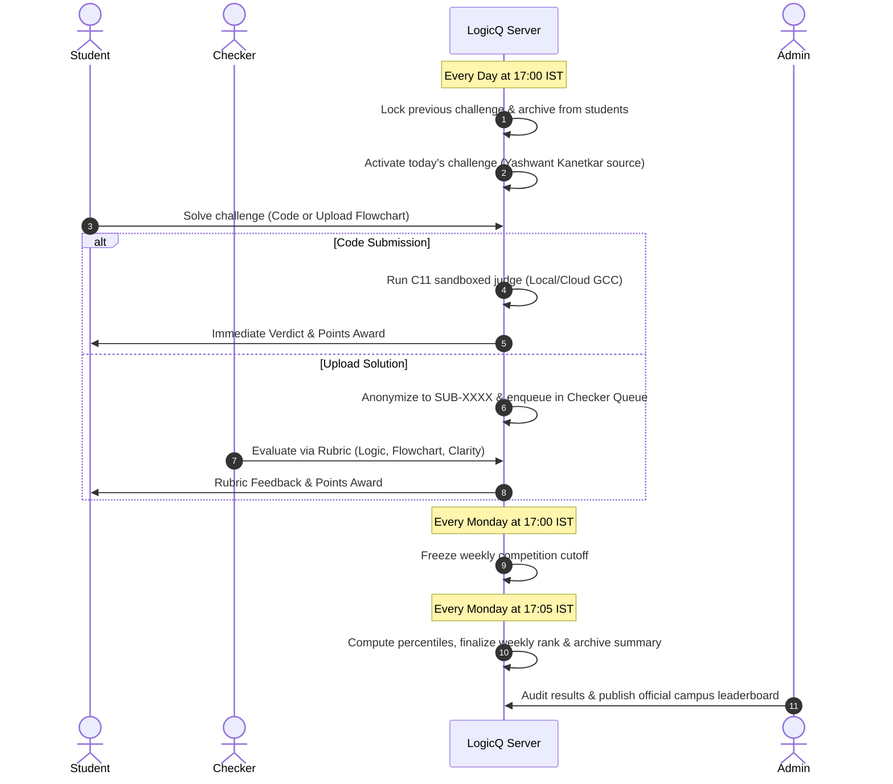
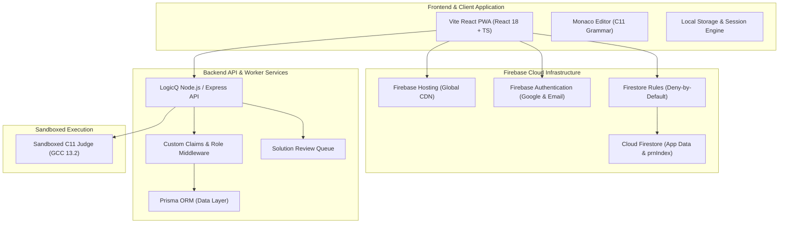

<p align="center">
  
</p>

<h1 align="center">LogicQ</h1>

<p align="center">
  <strong>Daily C Language Challenge & Weekly Competitive Arena for Engineering Students</strong><br />
  <em>Engineered for Sanjivani University Undergraduate Engineering Programs</em>
</p>

<p align="center">
  <a href="https://logicq-clanguage.web.app"></a>
  <a href="https://github.com/pratikpt1304/LogicQ/releases/tag/v1.0.0-pilot"></a>
  
  
  
  
  
  
  <a href="LICENSE"></a>
</p>

---

## 📌 Table of Contents

- [1. Overview & Philosophy](#1-overview--philosophy)
- [2. Screenshot Gallery](#2-screenshot-gallery)
- [3. Key Architectural Pillars](#3-key-architectural-pillars)
- [4. Role & Access Control Matrix](#4-role--access-control-matrix)
- [5. Daily & Weekly Operational Timeline](#5-daily--weekly-operational-timeline)
- [6. Textbook Content Governance](#6-textbook-content-governance)
- [7. System Architecture](#7-system-architecture)
- [8. Repository Structure](#8-repository-structure)
- [9. Getting Started & Local Development](#9-getting-started--local-development)
- [10. Automated Testing & Verification Gates](#10-automated-testing--verification-gates)
- [11. Production Deployment & Rollback](#11-production-deployment--rollback)
- [12. Security Policy & Privacy Compliance](#12-security-policy--privacy-compliance)
- [13. License & Attribution](#13-license--attribution)

---

## 1. Overview & Philosophy

**LogicQ** is a campus competitive programming platform designed specifically for first- and second-year undergraduate engineering students mastering the **C programming language** (ISO C11).

### The Pedagogical Problem
Traditional competitive programming platforms overwhelm beginners with backlogs of hundreds of unstructured problems, confusing difficulty tags, and distracting gamification (contests, badges, forums). Students often suffer from analysis paralysis or copy solutions without mastering foundational algorithmic thinking.

### The LogicQ Approach
1. **Single Question Focus**: Students see **exactly ONE question at a time** — today's challenge. There is no problem list, archive, or practice backlog.
2. **Strict Daily Rhythm**: A new problem unlocks every day at **17:00 IST (Asia/Kolkata)** and locks at the next 17:00 IST. The previous problem disappears from student view immediately.
3. **Dual Problem-Solving Tracks**:
   - **Track A (Auto-Judged Code)**: Write C code directly in Monaco Editor and submit for instant sandboxed C11 compilation and test-case execution.
   - **Track B (Uploaded Solution)**: Upload a flowchart, pseudocode diagram, or handwritten solution (PDF/image) for manual review by trained checkers.
4. **Authoritative Content Source**: Every problem is strictly sourced from Yashwant Kanetkar's acclaimed book ***Test Your C Skills***. No arbitrary third-party questions or generic web scrapes.

---

## 2. Screenshot Gallery

| Landing Page | Authentication & PRN Validation |
| :---: | :---: |
|  |  |

| Daily Challenge & Dual Workspace | Weekly Leaderboard & Rankings |
| :---: | :---: |
|  |  |

| Administrative Operations Command | Mobile PWA & Custom C Keyboard Bar |
| :---: | :---: |
|  |  |

---

## 3. Key Architectural Pillars

### 🕒 1. Single Visible Question Window (17:00 IST to 17:00 IST)
- Server-clock enforced challenge lifecycle: problem turns active at **17:00:00 IST** and locks at **16:59:59 IST** next day.
- Direct access to past or future problems returns `404 Not Found` (or `410 Gone`) for students.
- Catch-up strips, "this week's questions" carousels, archives, and arena routes have been completely removed from client and server.

### 🛡️ 2. Strict 3-Role Security Model
To eliminate administrative confusion and prevent privilege escalation, LogicQ implements exactly three roles:
- **`admin`**: Full access to all administrative modules (problem management, test cases, submissions, students, weekly cycle, reports, audit logs, checker assignment, and system settings).
- **`checker`**: Dedicated access strictly to the `/checker/reviews` queue. Zero access to student data, other admin screens, or API endpoints.
- **`student`**: Student workspace, single active daily challenge, personal submission history, and weekly leaderboard.
- *Owner, Content Admin, Reviewer, Viewer, Faculty, and Moderator roles have been eliminated.*

### 🔍 3. Blind Checker Review Portal (`/checker/reviews`)
- **Zero Student PII**: Checkers evaluate submissions labeled only with an anonymous token (e.g. `SUB-9021`). Student names, PRNs, emails, avatars, departments, and years are stripped server-side.
- **Mathematical Rubric Formula**:
  $$\text{Points} = \text{BasePoints} \times \left(0.50 \times \text{Logic} + 0.30 \times \text{Flowchart} + 0.20 \times \text{Clarity}\right)$$
- **Integrity Safeguards**:
  - Checkers cannot receive or review their own uploaded solutions (conflict of interest blocked).
  - 30-minute decision edit window with immutable versioning in `UploadReview`.
  - 48-hour SLA deadline returning stale assigned uploads to the unassigned queue.

### 🔒 4. PRN Academic Identity & Rolling 30-Day Self-Service
- 12-digit university PRN validation enforced across frontend and backend schemas.
- Unique PRN enforcement via atomic transaction on private collection `prnIndex/{prn}`.
- Rolling 30-day self-service change cooldown: students may fix or update their own PRN at most once in any rolling 30-day window with password confirmation, while college remains locked to Sanjivani University. All points, streaks, submissions, and ranks permanently adhere to the student UID.
- Deny-by-default Cloud Firestore Security Rules (`rules_version = '2';`).

### 📊 5. Transparent Metrics & Content Shield
- Unranked students with 0 points display "Not ranked yet" rather than misleading default #1 ranks or 100% percentiles.
- Percentile calculation strictly requires $\ge 10$ ranked students (`Top X% = ceil(rank / N * 100)`), gracefully showing "Needs 10 ranked students" otherwise.
- Accuracy displays "—" and "No submissions yet" on 0 submissions to prevent divide-by-zero artifacts.
- Zero question pool leak: problem counts display active progress ("This week: Y of 7 solved") without leaking total question backlog.
- Book citation isolation: problem descriptions are original algorithmic rewordings with formal input/output specs, blocking author names or book references from student-visible payloads while retaining book references in admin-only metadata (`sourceRefJson`).

### ⚡ 6. Session Persistence & F5 Refresh Bug Fix
- Seamless session restoration across full-page refresh (F5), new tabs, browser restarts, and installed PWA launches.
- Eliminates the flash of login/landing screen with a branded pre-auth loading shell.
- Enforces strict inactivity timeouts: **7 days** for students, **8 hours** for checkers, and **30 minutes** for admins.

### 📱 7. Progressive Web App (PWA) & Mobile C Bar
- Fully installable PWA on Android, iOS, Windows, and macOS with service worker offline fallback (`/offline.html`).
- Specialized mobile C programming keypad toolbar:
  `{ } ( ) [ ] ; # " * & -> = == != < > \n Tab`
- Dual WCAG AA compliant themes: Dark (`#0C0F1F`) and Light (`#F4F6FB`) with custom Monaco editor styling (`>= 4.5:1` contrast).

---

## 4. Role & Access Control Matrix

| Feature / Resource | `student` | `checker` | `admin` |
| :--- | :---: | :---: | :---: |
| View Active Daily Challenge | ✅ (Current only) | ❌ | ✅ (All challenges) |
| Submit Code & Run C11 Judge | ✅ | ❌ | ✅ |
| Upload Solution (Image/PDF) | ✅ | ❌ | ✅ |
| View Weekly Leaderboard | ✅ | ❌ | ✅ |
| Access Checker Review Queue (`/checker/reviews`) | ❌ | ✅ | ✅ |
| Grade Uploads & Apply Rubric | ❌ | ✅ | ✅ |
| Access Admin Dashboard & Reports | ❌ | ❌ | ✅ |
| Manage Challenges & Test Suites | ❌ | ❌ | ✅ |
| Manage User Roles & Checkers | ❌ | ❌ | ✅ (Audited, $\ge 2$ admins) |
| Audit Logs & Integrity Ledger | ❌ | ❌ | ✅ |

---

## 5. Daily & Weekly Operational Timeline



---

## 6. Textbook Content Governance

All coding questions and logic challenges in LogicQ are sourced exclusively from:
> **Book Title:** *Test Your C Skills*  
> **Author:** Yashwant Kanetkar  
> **Pipeline Document:** [`/docs/CONTENT_PIPELINE.md`](docs/CONTENT_PIPELINE.md)

### Content Rules:
1. **Zero External Scraping**: No problems from LeetCode, HackerRank, CodeChef, or generic internet repos.
2. **Metadata Integrity**: Each problem stores book metadata (`bookId`, `chapterNumber`, `chapterTitle`, `topicTag`, `difficultyBand`, `sourceRefJson`).
3. **Student Privacy from Book Hints**: The `sourceRefJson` (which holds textbook page and exercise numbers) is stripped from all student-facing API responses to encourage independent problem-solving.

---

## 7. System Architecture



---

## 8. Repository Structure

```
LogicQ/
├── client/                     # Vite React TypeScript frontend
│   ├── public/                 # Static assets, PWA manifest, service worker
│   │   ├── brand/              # SVG brand icons and logos
│   │   ├── icons/              # PWA app icons (192px, 512px, maskable)
│   │   ├── manifest.webmanifest# Web app manifest
│   │   ├── offline.html        # Offline shell
│   │   └── sw.js               # Service worker
│   └── src/                    # Components, pages, contexts, hooks, and types
│       ├── components/         # Reusable UI widgets, Navbar, Monaco editor
│       ├── contexts/           # AuthContext (session persistence), ThemeContext
│       ├── pages/              # Dashboard, Challenge, Leaderboard, Admin, Checker
│       └── services/           # API clients and Firestore integration
├── server/                     # Node.js Express backend API
│   ├── prisma/                 # Prisma database schema and migrations
│   ├── src/                    # API controllers, middleware, queue, and services
│   │   ├── config/             # Roles configuration, features, and constants
│   │   ├── controllers/        # Admin, Checker, Problem, Submission controllers
│   │   ├── middleware/         # Role guards, session validators, rate limiters
│   │   └── services/           # C11 judge engine, review assigner, PRN manager
│   └── tests/                  # Automated Vitest integration and security tests
├── docs/                       # Authoritative engineering documentation
│   ├── MASTER_SPEC.md          # Master functional specification
│   ├── ADMIN_DESIGN.md         # Admin and checker design blueprint
│   ├── DEPLOY_PLAN.md          # Production deploy plan and verification
│   ├── ROLLBACK.md             # Emergency rollback runbook
│   ├── STATUS.md               # Honest implementation status
│   └── screenshots/readme/     # Verified UI screenshots
├── scripts/                    # Integrity audits, bundle security, book importer
├── firestore.rules             # Cloud Firestore security perimeter
├── storage.rules               # Cloud Storage security perimeter
├── firebase.json               # Firebase Hosting and service routing
├── README.md                   # Project documentation
├── SECURITY.md                 # Vulnerability disclosure policy
└── package.json                # Monorepo root manifest
```

---

## 9. Getting Started & Local Development

### Prerequisites
- **Node.js**: `>= 20.10.0 LTS`
- **npm**: `>= 10.2.0`
- **GCC**: `gcc >= 11.0` (MinGW-w64 on Windows, native GCC on Linux/macOS)
- **Git**: Installed and configured

### Step-by-Step Setup

```bash
# 1. Clone repository
git clone https://github.com/pratikpt1304/LogicQ.git
cd LogicQ

# 2. Install workspace dependencies
npm install

# 3. Setup environment variables
cp .env.example .env

# 4. Push database schema and seed canonical problems
npm run db:push
npm run db:seed

# 5. Launch development servers concurrently
npm run dev
```

The application will be live at:
- **Client (Frontend)**: `http://localhost:5173`
- **Server (API)**: `http://localhost:5000`

---

## 10. Automated Testing & Verification Gates

LogicQ enforces strict quality gates before any code is approved for release:

```bash
# 1. Execute full backend test suite (20 test files, 117 tests)
npm --prefix server test

# 2. Verify database ledger points and transaction integrity
npm --prefix server run verify-integrity

# 3. Compile client TypeScript and build production bundle
npm --prefix client run build

# 4. Execute client bundle security audit (zero leak check)
node scripts/check-bundle.mjs
```

### Test Suite Coverage Summary:
- **117 of 117 unit, integration, and security tests pass** across 20 test files (`vitest`).
- **100% database integrity verified** (`verify-integrity.ts`).
- **0 bundle security violations**: verified zero development URLs, mock endpoints, or non-sandboxed connections in compiled client assets.

---

## 11. Production Deployment & Rollback

### Current Production Environment
- **Hosting URL**: [https://logicq-clanguage.web.app](https://logicq-clanguage.web.app)
- **Firebase Project ID**: `logicq-clanguage`
- **Release Tag**: `v1.0.0-pilot`

### Deployment Sequence
```bash
# 1. Deploy Firestore Security Rules
npx firebase-tools deploy --only firestore:rules --project logicq-clanguage

# 2. Build Client Production Bundle
npm --prefix client run build

# 3. Deploy Firebase Hosting
npx firebase-tools deploy --only hosting --project logicq-clanguage
```

### Emergency Rollback Runbook
If any production anomaly is detected:
```bash
# 1. Instantly roll back Firebase Hosting
firebase hosting:rollback --project logicq-clanguage

# 2. Roll back Firestore Rules to pre-deploy tag
git checkout v0.9.0-pre-pilot -- firestore.rules
firebase deploy --only firestore:rules --project logicq-clanguage

# 3. Reset Git branch
git checkout main
git reset --hard v0.9.0-pre-pilot
git push origin main --force
```
*Full rollback details are documented in [`docs/ROLLBACK.md`](docs/ROLLBACK.md).*

---

## 12. Security Policy & Privacy Compliance

- **Deny-by-Default Rule Set**: Every Firestore path defaults to `allow read, write: if false;` unless explicitly authorized.
- **PII Segregation**: Student PRNs, emails, and full names are isolated to authenticated owners and admins. Checkers receive strictly blinded review tokens (`SUB-XXXX`).
- **Sandboxed Compilation**: The C judge enforces memory caps (64MB), execution timeouts (2000ms), and output size limits (64KB) to mitigate resource exhaustion or malicious code execution.
- **Audit Trails**: All administrative role promotions/demotions, PRN edits, bans, and rubric decisions are written to an append-only audit ledger.

For vulnerability reports, please refer to [`SECURITY.md`](SECURITY.md).

---

## 13. License & Attribution

- **License**: All Rights Reserved © 2026 LogicQ / Sanjivani University.
- **Content Reference**: Problem statements and questions adapted from *Test Your C Skills* by Yashwant Kanetkar.
- **Maintainers**: Pratik & LogicQ Core Engineering Team.
