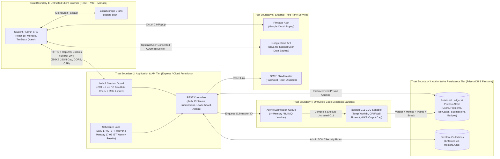

# LogicQ — Application & Security Audit Inventory (Phase 1)

> **Audit Scope & Safety Notice**: All inventory, functional testing, and adversarial proofs-of-concept were executed strictly against the local development / test environment (`localhost:5000` / SQLite test DB / Firestore emulator rule evaluator) using synthetic test identities. Zero production student data or external college infrastructure was touched.

---

## 1. System Architecture & Data-Flow Diagram

---

## 2. Trust Boundaries

| Boundary ID | Boundary Name | Source $\rightarrow$ Destination | Controls Enforced at Boundary |
| :--- | :--- | :--- | :--- |
| **TB-01** | **Browser $\rightarrow$ API / Functions** | Untrusted User Browser $\rightarrow$ Express API (`/api/*`) | CORS origin allowlist, `256kb` JSON/urlencoded body cap, `helmet` + explicit `X-Frame-Options: DENY`, `X-Content-Type-Options: nosniff`, `Referrer-Policy`, `Permissions-Policy`, Zod schema validation, endpoint rate limiters (`authLimiter`, `submissionLimiter`, `apiLimiter`). |
| **TB-02** | **Authentication & Role Boundary** | Anonymous / Student $\rightarrow$ Authenticated / Admin Routes | `authenticate` middleware verifies JWT signature **and** queries live DB state (`isBanned`, `role`) on every request; `requireAdmin` enforces `role === 'ADMIN'`; institutional domain filter (`ALLOWED_EMAIL_DOMAINS`) enforced on both `/api/auth/google` and `/api/auth/register` when `AUTH_MODE=DOMAIN_RESTRICTED`. |
| **TB-03** | **API / Client $\rightarrow$ Database / Firestore** | API Server / Browser SDK $\rightarrow$ Prisma DB & Cloud Firestore | Prisma parameterized queries prevent SQL injection; `firestore.rules` blocks direct client writes to authoritative fields (`role`, `totalPoints`, `currentStreak`, `submissions`, `problems/*/private/hiddenTests`, `weeklyResults`, `auditLogs`). |
| **TB-04** | **API Worker $\rightarrow$ C11 Judge Sandbox** | Queue Worker $\rightarrow$ Local GCC / Isolated Container Process | Per-job random UUID scratch directory (`os.tmpdir()/logicq-judge-<uuid>`), `64KB` source & `stdin` size limit, `-O2 -std=c11 -Wall` compilation with `10s` compile timeout, child process `timeout` (`timeLimitMs`, max `10s`), `64KB` `stdout`/`stderr` buffer truncation, and `finally` block directory wipe. |
| **TB-05** | **Browser $\rightarrow$ Google Drive API** | Student Browser $\rightarrow$ Google Drive (`drive.file`) | Strictly opt-in; narrowest OAuth scope (`https://www.googleapis.com/auth/drive.file`); never stores Google tokens in Firestore/DB; automatic fallback to `localStorage` if revoked or offline. |
| **TB-06** | **Cloud Scheduler $\rightarrow$ Weekly / Daily Jobs** | Cron Trigger $\rightarrow$ Daily Rollover (`17:00 IST`) & Weekly Results (`17:05 IST`) | Server-authoritative UTC/IST clock (`server/src/utils/ist.ts`); idempotent execution keyed by `weekId` / `challengeDayIST`; audit log creation on fallback problem selection. |

---

## 3. Frontend Routes (`client/src/App.tsx`)

| Path | Component | Access Guard | Purpose |
| :--- | :--- | :--- | :--- |
| `/` | `LandingPage` / Redirect | Public (redirects to `/dashboard` if logged in) | Institutional landing page & entry point |
| `/landing` | `LandingPage` | Public | Explicit landing page route |
| `/login` | `LoginPage` | Public | Email/password & Google Sign-In |
| `/register` | `RegisterPage` | Public | Student account registration |
| `/forgot-password` | `ForgotPasswordPage` | Public | Request password reset link |
| `/reset-password` | `ResetPasswordPage` | Public | Complete password reset with token |
| `/dashboard` | `DashboardPage` | `<ProtectedRoute>` | Student streak, points, rank, heatmap, recent activity |
| `/challenge` | `ChallengePage` | `<ProtectedRoute>` | Active daily C challenge workspace & Monaco editor |
| `/challenge/:slug` | `ChallengePage` | `<ProtectedRoute>` | Problem workspace by slug |
| `/archive` | `ArchivePage` | Public / Optional Auth | Problem catalog with difficulty/category filters |
| `/arena` | `ArenaPage` | Public / Optional Auth | Weekly & special contests listing |
| `/arena/:slug` | `ContestDetailPage` | Public / Optional Auth | Contest problems & live standings |
| `/leaderboard` | `LeaderboardPage` | Public / Optional Auth | Weekly rankings, countdowns, tie-break rules |
| `/achievements` | `AchievementsPage` | Public / Optional Auth | Earned & locked badges catalog |
| `/history` | `HistoryPage` | `<ProtectedRoute>` | Student's personal submission history & code viewer |
| `/profile` | `ProfilePage` | `<ProtectedRoute>` | Authenticated student's profile & settings |
| `/profile/:username` | `ProfilePage` | Public | Public student portfolio view |
| `/admin/*` | `AdminDashboardPage` | `<AdminRoute>` | Admin overview, 2-week pilot analytics, problem authoring, submissions, users |

---

## 4. Backend API Endpoints & Functions (`server/src/routes/*`)

| Method & Route | Middleware Chain | Controller Handler | Description |
| :--- | :--- | :--- | :--- |
| `GET /api/health` | `apiLimiter` | Inline (`app.ts`) | Health & IST clock probe |
| `POST /api/auth/google` | `authLimiter`, `validate(googleAuthSchema)` | `googleAuth` | Google Sign-In & institutional domain check |
| `POST /api/auth/register` | `authLimiter`, `validate(registerSchema)` | `register` | Email/password signup & domain check |
| `POST /api/auth/login` | `authLimiter`, `validate(loginSchema)` | `login` | Authenticate & issue access/refresh tokens |
| `POST /api/auth/refresh` | `apiLimiter` | `refresh` | Rotate access token from non-revoked refresh token |
| `POST /api/auth/logout` | `apiLimiter` | `logout` | Revoke current refresh token & clear cookies |
| `POST /api/auth/logout-all` | `authenticate` | `logoutAll` | Revoke all refresh tokens for user across devices |
| `GET /api/auth/me` | `authenticate` | `getMe` | Return current live user profile & badges |
| `POST /api/auth/forgot-password` | `authLimiter`, `validate(forgotPasswordSchema)` | `forgotPassword` | Generate SHA-256 hashed reset token & send email |
| `POST /api/auth/reset-password` | `authLimiter`, `validate(resetPasswordSchema)` | `resetPassword` | Verify SHA-256 token, update password, revoke sessions |
| `GET /api/problems/daily` | `optionalAuthenticate` | `getDailyChallenge` | Fetch active `17:00 IST` daily challenge (visible tests only) |
| `GET /api/problems` | `optionalAuthenticate` | `getProblems` | Paginated (`limit <= 50`) published problems list |
| `GET /api/problems/:identifier` | `optionalAuthenticate` | `getProblemBySlugOrId` | Published problem details (never returns `isHidden: true`) |
| `POST /api/submissions/run` | `authenticate`, `submissionLimiter`, `validate(runCodeSchema)` | `runCode` | Compile & run C code (`<= 64KB`) against custom/sample input |
| `POST /api/submissions/submit` | `authenticate`, `submissionLimiter`, `validate(submitSolutionSchema)` | `submitSolution` | Enqueue official submission (`PUBLISHED` & unlocked problems only) |
| `GET /api/submissions/my` | `authenticate` | `getUserSubmissions` | Paginated (`limit <= 50`) personal submission history |
| `GET /api/submissions/:id` | `authenticate` | `getSubmissionById` | Fetch submission verdict/details (**Owner or Admin only**) |
| `GET /api/leaderboard` | `optionalAuthenticate` | `getLeaderboard` | Weekly / global rankings & user rank summary |
| `GET /api/users/dashboard` | `authenticate` | `getDashboardStats` | Student dashboard metrics, 90-day heatmap, recent submissions |
| `GET /api/users/badges` | `optionalAuthenticate` | `getAllBadges` | Badge catalog with unlock status |
| `PUT /api/users/profile` | `authenticate`, `validate(updateProfileSchema)` | `updateProfile` | Sanitized profile update (`fullName`, `bio`, `college`, `avatarUrl`) |
| `GET /api/users/profile/:username` | `apiLimiter` | `getPublicProfile` | Public profile without private email exposure |
| `GET /api/contests` | `optionalAuthenticate` | `getContests` | List active/upcoming/past contests |
| `GET /api/contests/:slug` | `optionalAuthenticate` | `getContestBySlug` | Contest details, problems, and leaderboard |
| `POST /api/contests/:id/register` | `authenticate` | `registerForContest` | Register student for contest |
| `POST /api/contests` | `authenticate`, `requireAdmin`, `validate(createContestSchema)` | `createContest` | Admin contest creation |
| `GET /api/admin/analytics` | `authenticate`, `requireAdmin` | `getAnalytics` | Platform overview + 2-week pilot analytics (`dailyActiveStudents`, `fourOfSevenCohort`, `dropOffByDay`, `mostFailedProblems`) |
| `GET /api/admin/problems` | `authenticate`, `requireAdmin` | `getAdminProblems` | Full problem list including hidden test cases |
| `POST /api/admin/problems` | `authenticate`, `requireAdmin`, `validate(problemAdminSchema)` | `createProblem` | Author new problem & test cases |
| `PUT /api/admin/problems/:id` | `authenticate`, `requireAdmin` | `updateProblem` | Edit problem & test cases |
| `DELETE /api/admin/problems/:id` | `authenticate`, `requireAdmin` | `deleteProblem` | Soft-retire problem if submissions exist; delete if 0 submissions |
| `PATCH /api/admin/problems/schedule-daily` | `authenticate`, `requireAdmin` | `scheduleDaily` | Schedule daily challenge date |
| `GET /api/admin/submissions` | `authenticate`, `requireAdmin` | `getAdminSubmissions` | Paginated (`limit <= 100`) platform-wide submissions |
| `POST /api/admin/submissions/:id/rejudge` | `authenticate`, `requireAdmin` | `rejudgeSubmission` | Re-queue submission for evaluation |
| `GET /api/admin/users` | `authenticate`, `requireAdmin` | `getAdminUsers` | Paginated (`limit <= 100`) user directory |
| `PATCH /api/admin/users/:id/role` | `authenticate`, `requireAdmin` | `updateUserRole` | Change user role (blocks self-demotion; revokes refresh tokens) |
| `PATCH /api/admin/users/:id/ban` | `authenticate`, `requireAdmin` | `updateUserBan` | Ban/unban user (blocks self-ban; revokes refresh tokens) |

---

## 5. Database Models (`server/prisma/schema.prisma`) & Firestore Collections (`firestore.rules`)

| Prisma Model / Firestore Collection | Key Fields | Client Read Access | Client Write Access | Security Invariant |
| :--- | :--- | :--- | :--- | :--- |
| `User` / `users/{uid}` | `id`, `username`, `email`, `passwordHash`, `role`, `totalPoints`, `currentStreak`, `isBanned`, `resetPasswordToken` | Public profile fields only (`passwordHash` & `resetPasswordToken` never selected) | Only `fullName`, `bio`, `college`, `avatarUrl` via validated API / Firestore rule | Clients can never modify `role`, `totalPoints`, `currentStreak`, `isBanned`. |
| `RefreshToken` | `id`, `token`, `userId`, `expiresAt`, `revokedAt` | None (Server only) | None (Server only) | Revoked on logout, password reset, ban, or role change. |
| `Problem` / `problems/{id}` | `id`, `slug`, `title`, `difficulty`, `status`, `isDaily`, `scheduledDate`, `starterCode`, `solutionCode` | `PUBLISHED` problems only (students); all (admins) | Admin only | Soft-retired (`status: 'RETIRED'`) when student submissions exist. |
| `TestCase` / `problems/{id}/private/hiddenTests` | `id`, `problemId`, `input`, `expectedOutput`, `isHidden`, `orderIndex` | `isHidden: false` only (students); all (admins) | Admin only | Hidden test cases are never serialized to student endpoints. |
| `Submission` / `submissions/{id}` | `id`, `userId`, `problemId`, `code`, `verdict`, `runtimeMs`, `memoryKb`, `pointsAwarded`, `createdAt` | Owner (`userId == req.user.userId`) or Admin only | Create via `/api/submissions/submit`; verdict updated exclusively by Judge Worker | Immutable by students; append-only submission ledger. |
| `SubmissionTestCaseResult` | `id`, `submissionId`, `testCaseId`, `passed`, `runtimeMs`, `actualOutput` | Owner (`isHidden: false` outputs only) or Admin | Judge Worker only | Hidden test expected/actual outputs are stripped before returning to students. |
| `Badge` & `UserBadge` | `id`, `code`, `name`, `criteriaType`, `criteriaValue` | Public | Server / Admin only | Awarded deterministically by `badge.service.ts`. |
| `Contest` & `ContestParticipant` | `id`, `slug`, `startTime`, `endTime`, `score` | Public | Registration by authenticated student; creation by Admin | Scores updated by server only. |
| `weeklyResults/{weekId}` | `weekId`, `standings`, `publishedAt` | Authenticated college users | Admin / Scheduled Function only | Immutable weekly snapshot once published. |
| `auditLogs/{logId}` | `actorId`, `action`, `targetId`, `createdAt` | Admin only | Server / Admin only | Append-only (`allow update, delete: if false`). |

---

## 6. Environment Variables, Secrets & Dependencies

### Environment Variables (`server/src/config/env.ts`)
- **Secrets (Server-Only, never exposed to `VITE_*`)**:
  - `JWT_ACCESS_SECRET`, `JWT_REFRESH_SECRET` (HMAC signing keys)
  - `DATABASE_URL` (Prisma connection string)
  - `SMTP_USER`, `SMTP_PASS` (Nodemailer credentials)
- **Configuration**:
  - `PORT` (`5000`), `NODE_ENV` (`development` | `production` | `test`), `CLIENT_URL`
  - `AUTH_MODE` (`OPEN` | `DOMAIN_RESTRICTED`), `ALLOWED_EMAIL_DOMAINS` (`sanjivani.org.in`)
  - `JUDGE_PROVIDER` (`local` | `Judge0`), `QUEUE_MODE` (`memory` | `redis`), `REDIS_URL`
- **Public Frontend Config (`client/src/config/firebase.ts`)**:
  - Firebase Web SDK identifiers (`apiKey`, `authDomain`, `projectId`, `appId`) — public identifiers governed by Firebase Auth domain allowlists and `firestore.rules`.

### Dependency & Supply-Chain Inventory
- **Server (`server/package.json`)**: `express`, `cors`, `helmet`, `cookie-parser`, `express-rate-limit`, `bcryptjs`, `jsonwebtoken`, `zod`, `@prisma/client`, `bullmq`, `ioredis`, `nodemailer`, `uuid`.
- **Client (`client/package.json`)**: `react`, `react-dom`, `react-router-dom`, `@monaco-editor/react`, `@tanstack/react-query`, `firebase`, `framer-motion`, `lucide-react`, `recharts`, `tailwindcss`.
