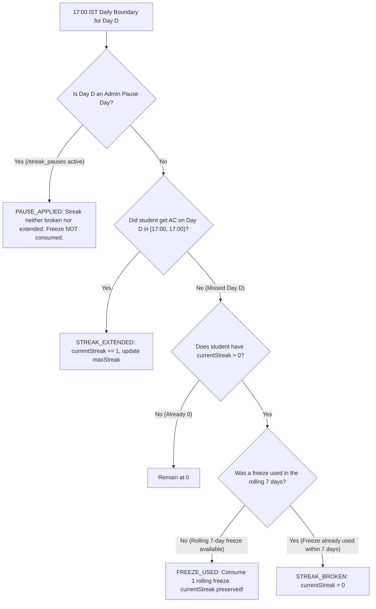

# LogicQ Daily Competition, Schedule, Streak Freeze & Ranking Specification (`/docs/DAILY_SYSTEM.md`)

> **AUTHORITATIVE DIRECTIVE — AMENDED DAILY COMPETITION MODEL**  
> This document defines the official single-question daily competition window (`17:00 IST` to `17:00 IST`), authoritative `submittedAt` cutoff semantics, separated daily switch (`17:00 IST`) vs. daily finalization (`17:05 IST`) moments, deterministic 6-tier daily tie-break order, full-cohort leaderboard metrics, automatic rolling 7-day streak freezes, admin pause days, and post-freeze `DailyCorrection` records for **LogicQ**. It replaces and overrides all earlier weekly competition, weekly leaderboard, weekly points, and weekly summary specifications across the entire project.

---

## Part I — Single Active 24-Hour Challenge Window & Accounting

### 1. One Visible Question at a Time (`17:00:00 IST` to `17:00:00 IST`)

1. **Daily Switch Moment**:
   - Every day at **`17:00:00 IST` (`Asia/Kolkata`)** using the **server clock only**, the new daily challenge unlocks and becomes the **only** visible question for students. The previous challenge disappears immediately.
   - A challenge day runs for exactly **24 hours** from `17:00:00.000 IST` to the next day's `16:59:59.999 IST`.
   - Students can see and solve **ONLY** the current active challenge (`GET /api/problems/daily`, cached only until the next `17:00:00 IST`).
   - Visiting an ended challenge URL or ID returns `410 Gone` (`CHALLENGE_ENDED`) and displays a calm **"This challenge has ended"** page with a link back to today's challenge (`/challenge`), without returning or displaying the problem statement, samples, starter code, or tests.
2. **Authoritative `submittedAt` Timestamp & Cutoff**:
   - Every code submission and file upload records an immutable server-side `submittedAt` timestamp at the exact instant the API receives the request—**before** the code enters the judge queue or upload review queue.
   - A submission or uploaded solution counts for a challenge **if and only if** its server-side `submittedAt` is before that challenge's `17:00:00.000 IST` end time (`getChallengeDayIST(submittedAt) === problem.scheduledDate`).
   - **Pre-Cutoff In-Flight Judging (`16:59:59 IST`)**: Anything submitted before `17:00:00.000 IST` (e.g., at `16:59:59.200 IST`) is judged normally even if judging finishes after `17:00:00.000 IST` (e.g., at `17:00:03 IST`), and the student earns points, streak credit, and daily rank credit for that challenge day.
   - **Post-Cutoff Rejection (`>= 17:00:00 IST`)**: Anything submitted at or after `17:00:00.000 IST` for the ended challenge is rejected by the server (`403 Challenge not available`).
   - **Uploaded Solutions**: An uploaded solution (`PENDING_REVIEW`) submitted before `17:00:00.000 IST` stays in the review queue and can be approved later; if approved after the day freezes, it writes an append-only `DailyCorrection` audit record. Post-17:00 uploads are rejected (`403`).
3. **10-Minute Judge Drain & Grace Period (`17:00` – `17:10 IST`)**:
   - Before finalizing the previous day's rankings at `17:05:00 IST`, the daily finalization generator checks for any submissions where `submittedAt <= dayCutoffAt` and `verdictStatus IN ('PENDING', 'JUDGING')`.
   - The job polls until all pre-cutoff submissions have finished judging, **up to a 10-minute grace deadline (`17:10:00 IST`)**.
   - **Never Silently Dropped**: Any pre-cutoff submission still unjudged after `17:10:00 IST` is **never dropped or ignored**. It is marked `flaggedForAdminReview: true` (`flagReason: 'UNJUDGED_PAST_GRACE_PERIOD'`), written to `/system_alerts` and `/daily_corrections` so an admin can inspect and trigger a 1-click rejudge.

---

## Part II — Daily Finalization Job (`17:05 IST` Daily)

```
Daily Switch & Finalization Timeline (IST - Asia/Kolkata):
──────────────────────────────────────────────────────────────────────────────────────────
16:59:59.999 IST   17:00:00.000 IST                  17:05:00.000 IST       17:10:00.000 IST
       │                  │                                 │                      │
  [Day D Cutoff]     [Daily Switch]                    [Daily Finalization]   [Max Grace Deadline]
  Last valid         - Day D ends                      - Waits for pre-17:00  - Flags any stuck
  submittedAt        - Day D+1 unlocks & becomes the     in-flight judge jobs   submissions for
  for Day D            ONLY visible question           - Computes final ranks   admin review
                     - Open browser tabs show:           for Day D            - Freezes Day D board
                       "A new challenge is live.       - Writes per-student   - Publishes top 20 &
                       Refresh to see it." (old          daily summaries        student snapshot
                       editor becomes read-only)       - Freezes Day D
```

1. **Daily Switch (`0 17 * * *` `Asia/Kolkata` — `17:00:00 IST`)**:
   - Switches the active challenge to today's scheduled problem.
   - **Missing-Question Auto-Fallback**: If no problem is scheduled for today at `17:00:00 IST`, the server automatically picks the next `PUBLISHED`, unscheduled problem from the syllabus book pool in `(chapterOrder, exerciseOrder)` order, assigns it to today's `scheduledDate`, and logs an admin alert (`AUTO_FALLBACK_CHALLENGE_ASSIGNED`).
   - **Season Complete**: If no approved unscheduled problems remain in the pool, the app displays a calm **"Season complete"** page to students and alerts admins.
2. **Daily Finalization Job (`5 17 * * *` `Asia/Kolkata` — `17:05:00 IST`)**:
   - Scheduled function running at `17:05 IST` every day.
   - Waits up to 10 minutes (`17:10 IST`) for submissions made before `17:00:00` to be judged.
   - Finalizes yesterday's board, freezes the day, writes each student's read-only daily result summary, and persists top 20 and student standing in `daily_rank_snapshots`.
   - **Idempotent, Resumable & Checkpointed**:
     - Safe to re-run; repeat runs for an already frozen day no-op safely.
     - Chunked in batches of 250 with checkpointing in `daily_job_checkpoints/{dayId}`.
     - Can be manually re-run by an admin from `/admin/daily-results`.
     - Alerts on failure via `/system_alerts` and admin notifications.
   - **Post-Freeze Corrections**: Rejudges, late upload approvals, and corrections after finalization create an admin-approved `DailyCorrection` record and an audit entry; they never silently alter a frozen day.
3. **Daily Result Summary per Student ("Yesterday's result")**:
   - Read-only card displayed on the student dashboard:
     - Challenge title and date
     - Verdict (`ACCEPTED`, `WRONG_ANSWER`, `MISSED`, etc.)
     - Difficulty points earned (`100`, `200`, `300`, or `0`)
     - Daily rank (e.g. `#7 of 42`, or `"Not solved"`)
     - Number of attempts before solve
     - Current streak
     - One constructive improvement hint (e.g., *"Focus on pointer boundary conditions to reduce initial wrong attempts"*).
   - **No Problem Statements**: Summaries display metadata and code stats only, never problem statements, samples, or tests.
   - **Append-Only Archive**: Final daily boards (top 20 solvers and each student's own place) are retained for a configurable 90 days (`ARCHIVE_RETENTION_DAYS = 90`) for the "Past days" view.

---

## Part III — Daily Rank Architecture & Leaderboard Views

### 1. Leaderboard Tabs (`/leaderboard`)

The Leaderboard features 3 tabs:
1. **"Today" (Default)**:
   - Live daily rank for the CURRENT challenge day (`17:00:00 IST` to `16:59:59.999 IST`).
   - Only students whose submission or approved upload for today's challenge was **Accepted** before cutoff are ranked.
   - Students who have not solved today's challenge show `"Not solved yet"` with a motivating hint: *"Solve today's challenge to enter the board"*. They are never ranked.
   - Zero solvers shows an empty state (*"No solvers yet for today's challenge. Be the first!"*). One solver is `#1`.
2. **"Yesterday"**:
   - Frozen final leaderboard from yesterday's challenge day finalized at `17:05 IST`.
3. **"Past days"**:
   - Date picker/selector displaying frozen daily final rankings from the past 90 days.
- **Filters**: Academic Department (`AIML`, `AIDS`, `Integrated M.Tech`, `Mechanical`, `CSE`, `Integrated B.Tech`) and Year (`FY`, `SY`, `TY`) filters remain available on all tabs.
- **Removed**: The "This week" tab and "Past weeks" selector are completely removed.

### 2. 6-Tier Deterministic Tie-Break Order

To prevent rank flickering and reward speed and clean code, daily ranks are ordered strictly by:
1. **Earlier Accepted Submission Time (`submittedAt` ASC)**:
   - Server-side `submittedAt` timestamp of the student's first accepted solve. Judge execution time has zero effect on rank.
2. **Fewer Wrong Attempts before Accepted (`wrongAttempts` ASC)**:
   - Count of unaccepted submissions prior to the first accepted solve.
3. **Higher Current Streak (`currentStreak` DESC)**:
   - Consecutive daily solve streak.
4. **Higher Total Points (`totalPoints` DESC)**:
   - Cumulative all-time points. (Replaces the old "points this week" tie-breaker).
5. **Higher Total Solved Count (`totalSolved` DESC)**:
   - All-time accepted problem count.
6. **Deterministic Final Tie-Breaker (`createdAt` ASC, then `uid` ASC)**:
   - Earlier account registration timestamp, followed by lexicographical user ID sort. Guarantees that ranks never flicker.

### 3. Solvers Count, Percentile & Points Today

- **"Points today"**: The difficulty points of today's challenge when solved (`100` for Easy, `200` for Medium, `300` for Hard), otherwise `0`.
- **Cumulative Stats**: Total points, total solved, best daily rank, and longest streak are cumulative statistics shown on the student's profile and dashboard cards, not as an all-time leaderboard.
- **Percentile Gate**:
  - Show `"#R of N solvers today"` and `"Top X%"` **only when $N \ge 10$** (`MIN_RANKED_STUDENTS_FOR_PERCENTILE = 10`).
  - When $N < 10$, display `"Needs 10 solvers"` or `"—"`.
  - Calculated as: $\text{topPercent} = \max\left(1, \left\lceil \frac{\text{rank}}{N} \times 100 \right\rceil\right)$.
- **Dashboard Cards**:
  - `Daily rank`: `"#7 of 42"` or `"Not solved yet"`
  - `Points today`: `"200 PTS"` or `"0 PTS"`
  - `Percentile`: `"Top 17%"` or `"—"`
  - `vs yesterday`: Points or rank delta compared to yesterday (displays `"—"` when yesterday does not exist or student did not participate).
  - Plus `Current streak`, `Total solved`, `Total points`.
  - Zero cards mention "weekly".

---

## Part IV — Streak Freeze (1 per Rolling 7 Days) & Pause Days

Streaks are tracked across consecutive **17:00 IST to 17:00 IST** challenge days:



1. **Daily Extension**:
   - Solving today's challenge inside its 24-hour window extends the student's daily streak (`currentStreak += 1`).
2. **Rolling 7-Day Freeze Protection**:
   - Replace "one automatic freeze per week" with **one automatic freeze per rolling 7 days** (`STREAK_FREEZE_ROLLING_DAYS = 7`).
   - If a student with an active streak misses a day, the system checks whether a freeze was consumed in the 7 days prior to the missed day (`[dayStr - 6, dayStr]`).
   - If no freeze was consumed in that rolling window, the freeze is consumed (`FREEZE_USED` event logged), `lastSolvedDate` is updated, and `currentStreak` is preserved.
   - If a freeze was already consumed in that rolling 7-day window, the streak breaks (`currentStreak = 0`).
3. **Admin Pause Days**:
   - Institutional pause days (`/streak_pauses`, e.g. semester exams, public holidays) declared by administrators protect all students' streaks without consuming their rolling freeze. Streaks neither break nor extend on pause days.

---

## Part V — Post-Freeze Corrections & Admin Architecture

### 1. `DailyCorrection` Audit Trail
- Uploaded solutions submitted before cutoff but approved after daily finalization do not destructively alter the frozen historical leaderboard.
- The server credits the student's points and streak and writes an append-only `DailyCorrection` record (`action: 'DAILY_CORRECTION_CREATED'`) with admin identity, rationale, and score adjustment.
- Rejudges that flip a verdict after finalization similarly record an admin-approved correction and audit log entry.

### 2. Admin Portal: Daily Results (`/admin/daily-results`)
- Renames the old "Weekly" admin page to **"Daily results"**:
  - Live today's board with solver counts and attempts breakdown.
  - Finalization job status, last run timestamp, and historical run logs.
  - Idempotent manual re-run and publish controls.
  - Correction records log with status.
  - Streak pause day calendar and rolling freeze usage metrics.
  - Deterministic tie-break explanation panel.
  - Archive of past daily boards.
- **Overview Page Alerts**:
  - Alert banner if `daily job failed`.
  - Alert banner if `yesterday not finalized`.
- **System Page**:
  - Displays scheduled `dailyFinalizationJob` (`5 17 * * *` `Asia/Kolkata`).
- **Reports & CSV Exports**:
  - Daily active students, solved today, drop-off by day, and most-failed challenges.
  - One-click CSV export: **Daily Results CSV** grouped by department and academic year.

---

## Part VI — Deprecations & Removals

The following concepts are permanently removed from LogicQ:
- Themed weeks and weekly topic insights
- Weekly top-3 podium recognition
- Weekly push reminders
- Week-based late-catch-up rules and 70% point penalties
- "This week" leaderboard tab and "Past weeks" dropdown
- Collections `weeks` and `weekly_summaries` (maintained as read-only legacy archives hidden from the student UI).

---

## Part VII — Security Rules & Data Quotas

### 1. Security Rules Invariants
- Direct client writes to daily boards, daily results, daily summaries, daily corrections, daily snapshots, and streak ledgers are **strictly denied**:
  - `/daily_boards/{dayId}/**`: `allow write: if false;`
  - `/daily_results/{resultId}`: `allow read: if isOwner(resource.data.userId) || isAdmin(); allow write: if false;`
  - `/daily_summaries/{summaryId}`: `allow read: if isOwner(resource.data.userId) || isAdmin(); allow write: if false;`
  - `/daily_corrections/{id}`: `allow read: if isAdmin(); allow write: if false;`
  - `/daily_rank_snapshots/{id}`: `allow read: if isAuthenticated(); allow write: if false;`

### 2. Cost Estimate for Scheduled Functions (500 Active Students)

| Scheduled Function | Cron Schedule (`Asia/Kolkata`) | Purpose | Monthly Reads | Monthly Writes | Cost |
| :--- | :--- | :--- | :---: | :---: | :---: |
| **`dailyUnlockAndStreakJob`** | `0 17 * * *` (Daily `17:00 IST`) | Challenge flip, auto-fallback, rolling freeze check | ~4,800 | ~1,800 | **$0.00** |
| **`dailyFinalizationJob`** | `5 17 * * *` (Daily `17:05 IST`) | 10-min grace wait, computes daily ranks, writes daily summaries, snapshots top 20 | ~15,000 | ~15,000 | **$0.00** |
| **Cloud Scheduler** | 2 schedules (`60 runs/mo`) | Daily cron triggers | — | — | **$0.00** |

*All scheduled jobs operate comfortably within Firebase and Google Cloud perpetual free tiers ($0.00/month).*
