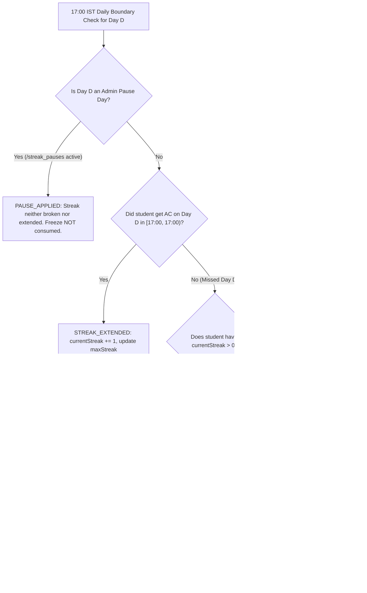

# LogicQ Weekly Competition, Schedule, Streak Freeze & Ranking Specification (`/docs/WEEKLY_SYSTEM.md`)

> **AUTHORITATIVE SPECIFICATION (AMENDED — SINGLE VISIBLE QUESTION AT A TIME)**  
> This document defines the official single-question daily window (`17:00 IST` to `17:00 IST`), `submittedAt` cutoff semantics, separated week-close (`17:05 IST`) vs. unlock (`17:00 IST`) jobs, simple tie-breaks (strictly by difficulty points, then earlier last accepted `submittedAt`), full-cohort leaderboard metrics, automatic weekly streak freezes, admin pause days, and post-freeze `WeeklyCorrection` records for **LogicQ**. It overrides all earlier schedule, catch-up, 7-day strip, same-day bonus, and late catch-up specifications where they conflict.

---

## Part I — Release 1 Specification (Required Core)

### 1. Single Active 24-Hour Challenge Window & Submission-Time Accounting (`submittedAt` vs. `judgedAt`)

1. **One Visible Question at a Time (`17:00:00 IST` to `17:00:00 IST`)**:
   - Every day at **`17:00:00 IST` (`Asia/Kolkata`)** using the **server clock only**, the new daily challenge becomes the **only** visible question for students, and the previous challenge disappears immediately for students.
   - A challenge day runs for exactly **24 hours** from `17:00:00.000 IST` to the next day's `16:59:59.999 IST`.
   - Students can see and solve **ONLY** the current challenge. There is **no** problem list, archive, practice area, "this week's challenges" 7-day strip, or intra-week catch-up behavior anywhere in the student app.
   - Visiting an ended challenge URL or ID shows a calm **"This challenge has ended"** page with a link back to today's challenge (`/challenge`), without returning or showing the problem statement, samples, starter code, or test cases.
2. **Authoritative `submittedAt` Timestamp & Daily Cutoff**:
   - Every code submission and file upload records an immutable server-side `submittedAt` timestamp at the exact instant the API receives the request—**before** the code enters the judge queue or admin review queue.
   - A submission or uploaded solution counts for a challenge **if and only if** its server-side `submittedAt` is before that challenge's `17:00:00.000 IST` end time (`getChallengeDayIST(submittedAt) === problem.scheduledDate`).
   - **Pre-Cutoff In-Flight Judging (`16:59:59 IST`)**: Anything submitted before `17:00:00.000 IST` (e.g., at `16:59:59.200 IST`) is judged normally even if judging finishes after `17:00:00.000 IST` (e.g., at `17:00:03 IST`), and the student can see that verdict and earns points/streak credit for that challenge's day and week.
   - **Post-Cutoff Rejection (`>= 17:00:00 IST`)**: Anything submitted at or after `17:00:00.000 IST` for the ended challenge is rejected by the server (`403 Challenge not available`).
   - **Uploaded Solutions**: An uploaded solution (`PENDING_REVIEW`) submitted before the challenge's `17:00:00.000 IST` end time stays in the admin review queue and can be approved later; if approved after the week freezes, it writes an append-only `WeeklyCorrection` record. Uploads for an ended challenge after `17:00:00.000 IST` are rejected (`403`).
3. **10-Minute Judge Drain & Grace Period (`17:00` – `17:10 IST`)**:
   - Before finalizing Week $W$'s rankings on Monday at `17:05:00 IST`, the weekly result generator checks for any submissions where `submittedAt <= weekCutoffAt` and `verdictStatus IN ('PENDING', 'JUDGING')`.
   - The job waits/polls until all pre-cutoff submissions have finished judging, **up to a 10-minute grace deadline (`17:10:00 IST`)**.
   - **Never Silently Dropped**: Any pre-cutoff submission still unjudged after `17:10:00 IST` is **never dropped or ignored**. It is marked `flaggedForAdminReview: true` (`flagReason: 'UNJUDGED_PAST_GRACE_PERIOD'`), written to `/system_alerts` and `/weekly_corrections` so an admin can inspect and trigger a 1-click rejudge/revision.

---

### 2. Separated Daily Switch (`17:00 IST`) and Week-Close (`17:05 IST`) Moments

```
Closing Monday Timeline (IST - Asia/Kolkata):
──────────────────────────────────────────────────────────────────────────────────────────
16:59:59.999 IST   17:00:00.000 IST                  17:05:00.000 IST       17:10:00.000 IST
       │                  │                                 │                      │
  [Day 7 Cutoff]     [Daily Switch & Week W Closes]   [Weekly Result Job]    [Max Grace Deadline]
  Last valid         - Previous challenge ends         - Waits for any        - Flags any stuck
  submittedAt        - New challenge becomes the         in-flight pre-17:00    submissions for
  for Day 7 /          ONLY visible question             submissions            admin review
  Week W             - Open browser tabs show:         - Computes ranks,      - Freezes Week W
                       "A new challenge is live.         percentiles, deltas    & publishes final
                       Refresh to see it." (old        - Publishes per-day      summaries
                       editor becomes read-only)         summary rows (no
                                                         statements)
```

1. **Daily Switch & Missing-Question Fallback (`0 17 * * *` `Asia/Kolkata` — `17:00:00 IST`)**:
   - Switches the active challenge to today's scheduled question (and on Mondays, starts Week $W+1$ Day 1 and resets weekly streak freeze tokens to `1`).
   - **Missing-Question Auto-Fallback**: If no question is scheduled for today at `17:00:00 IST`, the server automatically picks the next `APPROVED` (`PUBLISHED`), unscheduled question from the book pool in `(chapterOrder, exerciseOrder)` order (or difficulty order for pre-existing approved problems), assigns it to today's `scheduledDate`, and logs an admin alert (`AUTO_FALLBACK_CHALLENGE_ASSIGNED`).
   - **Season Complete**: If no approved unscheduled questions remain in the pool, the app displays a calm **"Season complete"** message to students and alerts admins.
2. **Weekly Close & Result Publication Job (`5 17 * * 1` `Asia/Kolkata` — `17:05:00 IST`)**:
   - Runs **5 minutes after** the Monday `17:00:00 IST` boundary so normal in-flight submissions from the final challenge of the week have already completed.
   - Waits up to `10 minutes` (`17:10:00 IST`) for any remaining pre-`17:00` in-flight submissions, then freezes the week's leaderboard and writes per-student weekly summaries.
   - **Weekly Summary Rows (No Statements)**: Weekly summaries on the dashboard and leaderboard show per-day results (`date`, `title`, `verdict`, `points`) and the week's rank — never problem statements, samples, or test cases.
   - **Idempotent & Fault-Tolerant**: Safe to run twice (`alreadyFrozen: true` no-op on repeat run) and supports manual admin re-run.

---

### 3. Inclusive Leaderboard for Everyone (Percentile, Beaten Count & Self-Comparison)

The Leaderboard (`/leaderboard`) is designed to motivate **every student**, not only the top podium:

1. **Weekly Rank + All-Time Toggle**:
   - Defaults to the current competition week's standings (plus a frozen past-week selector for up to 3 previous weeks).
2. **Pinned Personal Performance Banner (Top of Leaderboard)**:
   - Always pinned at the top for the logged-in student, displaying 4 key metrics:
     1. **Current Weekly Rank**: `#18 of 120 active challengers` (or `Unranked — Submit a solution to join this week's board`).
     2. **Percentile Pill**: **`Top 15% this week`** — calculated as:
        $$\text{topPercent} = \max\left(1, \left\lceil \frac{\text{rank}}{\text{totalActiveParticipants}} \times 100 \right\rceil\right)$$
     3. **Students Beaten Counter**: **`You beat 102 students this week`** — calculated as:
        $$\text{studentsBeaten} = \max(0, \text{totalActiveParticipants} - \text{rank})$$
     4. **Week-over-Week Self-Comparison (`vs. Last Week`)**:
        - Compares the student's current week stats against the previous week (`solvedDelta`, `pointsDelta`, `rankDelta`).

---

### 4. Streak Freeze (1/Week) & Admin Pause Days

Streaks are tracked across **17:00 IST to 17:00 IST** challenge days, enhanced with automatic weekly freeze protection and institutional pause days:



1. **Daily Streak Rule**:
   - Solving today's challenge before the next `17:00:00 IST` (either via an `ACCEPTED` C code submission or an `APPROVED` uploaded solution submitted before `17:00:00 IST`) continues or increments the student's streak.
   - Missing a day's challenge uses the student's **1 automatic weekly streak freeze** (`freezesRemainingThisWeek: 1 -> 0`) if available; otherwise it resets `currentStreak` to `0`.
   - Admin-declared **Pause Days** (`/streak_pauses`) protect all students' streaks without consuming their weekly freeze.

---

### 5. Simple Points & Tie-Break Rule (Difficulty Points Only → Earlier Last Accepted `submittedAt`)

Because every challenge is solvable only during its single 24-hour window (`17:00 IST` to `17:00 IST`), there is **no same-day bonus** and **no 70% late catch-up point rule**:

1. **Primary — Higher Weekly Points (`weeklyPoints` DESC)**:
   - Points are awarded strictly by difficulty on the student's first accepted solve of the day's challenge:
     - **Easy**: `100` points
     - **Medium**: `200` points
     - **Hard**: `300` points
2. **Secondary (Tie-Break) — Earlier Timestamp of Last Accepted Solve (`lastAcSubmittedAt` ASC)**:
   - Among students with identical `weeklyPoints`, the student whose **most recent point-earning `AC` submission** has the earlier server `submittedAt` timestamp ranks higher (i.e., whoever reached that total score first).
   - Wrong attempts never reduce points or tie-break standing.
3. **Exact Tie**:
   - If two students have identical `weeklyPoints` and identical millisecond `lastAcSubmittedAt` (or both have `0` points), they share the same rank number (`#4 (Tied)`) and are ordered deterministically by `displayName` / `userId` ASC.

---

## Part II — Post-Freeze Uploaded Solution Corrections & Admin Analytics

### 6. Post-Freeze `WeeklyCorrection` for Uploaded Solutions
- Students may submit handwritten/printed work via the **Upload Files** tab (`PENDING_REVIEW`) before the challenge's `17:00:00 IST` cutoff.
- If an admin approves an uploaded solution (`APPROVED`) **before** the week freezes, its difficulty points and solve count are included directly in that week's standings.
- If an admin approves an uploaded solution **after** its competition week has already frozen (`week.isFrozen === true`), the server awards the student's points/streak credit and writes an append-only `WeeklyCorrection` audit record (`action: 'WEEKLY_CORRECTION_CREATED'`) without mutating frozen historical snapshots destructively.

### 7. 2-Week Pilot Admin Analytics View (`/admin` -> `2-Week Pilot Analytics`)
Implemented in [`server/src/controllers/admin.controller.ts`](file:///c:/Users/thora/Documents/My%20Work/Extra/LogicQ/server/src/controllers/admin.controller.ts) (`computeTwoWeekPilotAnalytics`) and [`client/src/pages/admin/AdminDashboardPage.tsx`](file:///c:/Users/thora/Documents/My%20Work/Extra/LogicQ/client/src/pages/admin/AdminDashboardPage.tsx):
1. **Daily Active Students (`dailyActiveStudents`)**:
   - Tracks unique students attempting (`activeStudents`) and solving (`solvingStudents`) across all 14 challenge days (`W1·D1` to `W2·D7`, aligned to the `17:00 IST` challenge-day boundary), plus `todayDau`, `peakDau`, `averageDau`, and `totalActivePilotStudents`.
2. **Students Solving at Least 4 of 7 Challenges (`fourOfSevenCohort`)**:
   - Computes weekly retention cohorts for **Week 1 (Days 1–7)** and **Week 2 (Days 8–14)**: count and `%` of active/registered students solving `>= 4` distinct challenges in a week, solve distribution buckets (`7/7 Perfect`, `4–6/7 Met`, `1–3/7 Partial`, `0/7 Solved`), and per-student progress rows.
3. **Drop-Off by Day (`dropOffByDay`)**:
   - Day-by-day participation funnel from Day 1 to Day 14 showing `activeStudents`, `solvingStudents`, `solveConversionPct`, day-over-day `dropOffCount` and `dropOffRatePct`, `retentionFromBaselinePct`, and automatic detection of `steepestDropOffDay`.
4. **Most-Failed Problems (`mostFailedProblems`)**:
   - Ranks problems by failed submissions and failure rate (`failureRatePct`), reporting unique students (`failed / attempted / solved`), `topFailureVerdict`, and full error breakdown (`WRONG_ANSWER`, `COMPILE_ERROR`, `TIME_LIMIT_EXCEEDED`, `RUNTIME_ERROR`, `MEMORY_LIMIT_EXCEEDED`).

---

## Part III — Simulated-Time Test Suite (`server/tests/single-question-window.test.ts` & `server/tests/weekly-system.test.ts`)

All tests use a deterministic injectable server clock (`setSimulatedServerTime` / `SimulatedClock`) with zero real-time waiting:

| Test ID | Category | Simulated Scenario | Expected Result |
| :--- | :--- | :--- | :--- |
| **SQ-01** | **16:59:59 IST vs 17:00:00 IST Switch** | At `16:59:59 IST`, Day 1 is returned by `GET /api/problems/daily` and accepts submissions. At `17:00:00 IST`, Day 2 is returned and Day 1 rejects submissions (`403 Challenge not available`). | Only 1 active problem is visible/solvable at any instant; Day 1 disappears at `17:00:00 IST`. |
| **SQ-02** | **Pre-Cutoff Submission Judged After 17:00 IST** | Submission received at `16:59:59.200 IST` for Day 1 finishes judging at `17:00:02.500 IST`. | Judged normally, verdict returned to student, and difficulty points + streak credit apply to Day 1. |
| **SQ-03** | **Old, Future & List Endpoints Blocked for Students** | Student requests ended challenge slug (`GET /api/problems/:oldSlug`), tomorrow's slug (`GET /api/problems/:futureSlug`), or week list (`GET /api/problems/current-week`). | Ended slug returns `410 CHALLENGE_ENDED` (zero statement/samples/tests); future slug and week list return `404`. |
| **SQ-04** | **Firestore Security Rules (`/problems`)** | Authenticated student client attempts direct Firestore `get` or `list` on `/problems/{problemId}`. | Denied (`PERMISSION_DENIED`); `/problems` is readable only by admins (`allow read: if isAdmin()`). |
| **SQ-05** | **Submission History Redaction** | Student fetches `GET /api/submissions` after Day 1 ends. | Returns date, title (or hidden title if `HIDE_ENDED_PROBLEM_TITLES=true`), verdict, runtime, points, and student's own code/files — never problem statement or samples. |
| **SQ-06** | **Upload Cutoff & Post-Freeze `WeeklyCorrection`** | Student uploads files before `17:00 IST` (`201`) vs after `17:00 IST` (`403`). Admin approves pre-cutoff upload after the week freezes. | Post-17:00 upload is rejected; late approval of pre-17:00 upload awards points and creates an append-only `WeeklyCorrection` audit record. |
| **SQ-07** | **Missing-Question Auto-Fallback & Season Complete** | At `17:00 IST`, no problem has `scheduledDate == today`. Case A: unscheduled approved book problem exists. Case B: pool is empty. | Case A auto-assigns next problem in book order and logs `AUTO_FALLBACK_CHALLENGE_ASSIGNED`. Case B returns `{ seasonComplete: true, problem: null }`. |
| **T-01..T-08** | **Weekly Freeze, Pause Days, Tie-Break & Pilot Analytics** | Full weekly lifecycle (`17:05 IST` close, 10-min grace drain, 1/week streak freeze, admin pause days, difficulty-only points tie-break, 14-day pilot analytics). | All assertions pass deterministically. |

---

## Part IV — Security Rules, Cost Estimate & Blaze Plan Flag

### 12.1 Firestore Security Rules Invariants
- **Zero Client Writes on Authoritative Weekly & Streak Data**:
  - `/weeks/{weekId}/**`: `allow write: if false;`
  - `/weekly_summaries/{summaryId}`: `allow read: if isOwner(resource.data.userId) || isAdmin(); allow write: if false;`
  - `/streak_events/{eventId}`: `allow read: if isOwner(resource.data.userId) || isAdmin(); allow write: if false;`
  - `/streak_pauses/{pauseId}`: `allow read: if isAuthenticated(); allow write: if isAdmin();`
  - `/weekly_corrections/{id}` & `/integrity_flags/{id}`: `allow read: if isAdmin(); allow write: if false;`

### 12.2 Cost Estimate for Scheduled Functions (500 Active Students)

| Scheduled Function | Cron Schedule (`Asia/Kolkata`) | Purpose | Monthly Firestore Reads | Monthly Firestore Writes | Monthly Cost |
| :--- | :--- | :--- | :---: | :---: | :---: |
| **`dailyUnlockAndStreakJob`** | `0 17 * * *` (Daily `17:00 IST`) | Unlocks today's challenge, runs missing-problem fallback, evaluates daily streak freezes/breaks/pauses | ~4,800 / mo | ~1,800 / mo | **$0.00** |
| **`weeklyCloseAndSummarizeJob`** | `5 17 * * 1` (Mon `17:05 IST`) | Waits for pre-`16:59:59` judge queue (up to `17:10 IST`), computes ranks/percentiles/deltas, writes summaries | ~8,500 / mo | ~2,100 / mo | **$0.00** |
| **Cloud Scheduler + Pub/Sub** | 2 schedules (`35 runs/mo`) | Triggers the 2 Cloud Functions | — | — | **$0.00** (Free tier includes 3 jobs) |

- **Total Daily Quota Impact**: `< 11,100 reads/day` (**22.2%** of 50,000 free daily reads) and `< 6,450 writes/day` (**32.3%** of 20,000 free daily writes).

### 12.3 ⚠️ Mandatory Flag: Firebase Blaze Plan Required for Scheduled Functions
> [!WARNING]
> **Deploying `dailyUnlockAndStreakJob` (`0 17 * * *`) and `weeklyCloseAndSummarizeJob` (`5 17 * * 1`) as Firebase `onSchedule` Cloud Functions requires the Firebase Blaze (Pay-As-You-Go) Plan.**  
> While actual monthly usage for 500 students is **$0.00/month** under Google Cloud's perpetual free tier, Cloud Scheduler cannot be provisioned on the no-card Spark plan. If deploying without a billing card, use the **GitHub Actions Cron + HMAC Webhook fallback** alongside the Admin Dashboard manual trigger.

---

## Part V — Daily Rank System & Today Tab Architecture (`/leaderboard?tab=today`)

### 13. Daily Rank Scope & Eligibility
1. **Window**: The Daily Rank applies strictly to the **CURRENT** daily challenge window (`17:00:00.000 IST` to the next day's `16:59:59.999 IST`, evaluated by server clock).
2. **Eligibility**:
   - Only students whose submission or approved upload for today's challenge was **Accepted** (`verdict === 'ACCEPTED'`) before the `17:00:00 IST` cutoff are ranked on the Today board.
   - Students who have not solved today's challenge show `"Not solved yet"` with a motivating hint: *"Solve today's challenge to enter the board"*. They are never given a default rank or ranked #1.
   - Zero solvers shows an empty state (*"No solvers yet for today's challenge. Be the first!"*). One solver is `#1`.

### 14. 6-Tier Deterministic Tie-Breaker Order
To prevent rank flickering and reward speed and clean code fairly, ties are resolved strictly in this order:
1. **Earlier Accepted Submission Time (`submittedAt` ASC)**:
   - Server-side `submittedAt` timestamp of the **first** accepted submission.
   - **Crucial Invariant**: Judge queue latency or judging completion time (`judgedAt`) has zero impact on rank ordering.
2. **Fewer Wrong Attempts before Accepted (`wrongAttempts` ASC)**:
   - Count of unaccepted submissions (`WRONG_ANSWER`, `TIME_LIMIT_EXCEEDED`, `RUNTIME_ERROR`, `COMPILE_ERROR`) submitted by the student for today's challenge prior to their accepted solve.
3. **Higher Current Streak (`currentStreak` DESC)**:
   - Consecutive active challenge day streak.
4. **Higher Points this Week (`weeklyPoints` DESC)**:
   - Current competition week points total.
5. **Higher Total Solved Count (`totalSolved` DESC)**:
   - All-time accepted problem count.
6. **Deterministic Final Tie-Breaker (`createdAt` ASC, then `uid` ASC)**:
   - Earlier account registration timestamp, followed by lexicographical user ID sort. Guarantees that every rank is distinct and stable.

### 15. Today Tab Columns & Pinned Standing
- **Today Tab Columns**:
  - `Rank` (e.g. `#1`, `#2`, `#3` with podium highlight)
  - `Student` (Public display name fallback e.g. "Student 4F9A", never PRN, email, or M/F gender letter)
  - `Department & Year` (Standardized format: `"AIML • FY"`, never college name)
  - `Solved At` (Relative elapsed time from unlock, e.g. *"14m after unlock"*)
  - `Attempts` (Wrong attempts count before accept)
  - `Streak` (Flame icon + days)
  - `Total Solved`
  - `Points Today`
- **Solvers Count & Percentile Gate**:
  - Show `"#R of N solvers today"` and `"Top X%"` **only when $N \ge 10$** (`MIN_RANKED_STUDENTS_FOR_PERCENTILE = 10`).
  - When $N < 10$, display `"Needs 10 solvers"` or `"—"`.
- **Pinned Standing Card**:
  - Displays logged-in student's personal standing for today: `"Today: #7 of 42"` or `"Not solved yet"`.

### 16. "Yesterday's Final" Frozen Snapshot
1. At the `17:00:00 IST` daily switch, the finalized Today leaderboard is frozen into an append-only collection (`daily_rank_snapshots`).
2. Displays the top 20 solvers and the student's own final rank.
3. Problem statement, test cases, and hidden details are strictly excluded from the frozen snapshot payload.
4. Final daily ranks feed into the weekly summary analytics (*"Best daily rank this week: #4"*).

### 17. Department & Year Display Formatting Invariant
- Every student's academic standing must be formatted as:
  $$\text{department} \bullet \text{year} \quad \text{(e.g., "AIML • FY", "CSE • TY")}$$
- The college name ("Sanjivani University") appears once in the application header / settings card and **never** replaces or clutters the Department & Year column.
- Enforced uniformly across Leaderboard (all tabs), Dashboard, Profile, Admin directories, and CSV exports.

### 18. Prevention of Fake & Test Data in Production
1. **Seed Script Environment Guard**: `prisma/seed.ts` enforces `if (process.env.NODE_ENV === 'production') throw new Error("Seed script cannot run against production database!");`.
2. **Explicit Test Flag**: All test fixtures and seeded test accounts carry `isTest: true`.
3. **Query Filtering**: All leaderboard endpoints and fallback engines strictly filter `role === 'STUDENT'` and exclude accounts where `isTest === true`.
4. **Build-Time Assertion**: Production client build pipeline verifies zero mock leaderboard payloads bundled in `dist/`.


