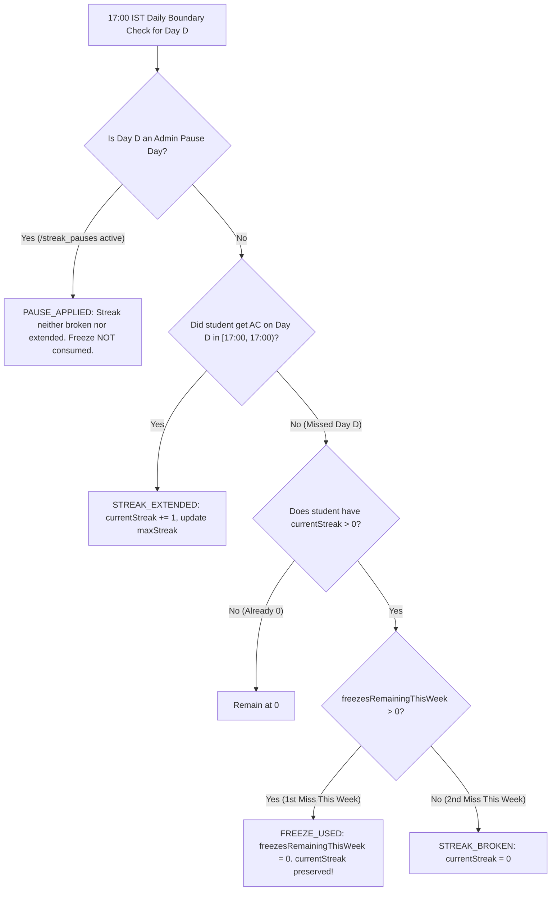

# LogicQ Weekly Competition, Schedule, Streak Freeze & Ranking Specification (`/docs/WEEKLY_SYSTEM.md`)

> **AUTHORITATIVE SPECIFICATION (AMENDED)**  
> This document defines the official scheduling, `submittedAt` cutoff semantics, separated week-close (`17:05 IST`) vs. unlock (`17:00 IST`) jobs, simple tie-breaks, full-cohort leaderboard metrics (percentile, students beaten, week-over-week delta), automatic weekly streak freezes, admin pause days, and Phase 2 roadmap for **LogicQ**. It overrides all earlier schedule, streak, tie-break, and leaderboard specifications where they conflict.

---

## Part I — Release 1 Specification (Required Core)

### 1. Submission-Time Accounting (`submittedAt` vs. `judgedAt`) & Grace Period

1. **Authoritative `submittedAt` Timestamp**:
   - Every submission records an immutable server-side `submittedAt` timestamp (`admin.firestore.Timestamp.now()`) at the exact instant the API receives the request—**before** the code enters the judge queue.
   - When the sandboxed C judge finishes compiling and running test cases, it records a separate `judgedAt` timestamp.
2. **Week Attribution by `submittedAt`**:
   - A submission belongs to Competition Week $W$ if and only if its server `submittedAt` falls within Week $W$'s window:
     $$\text{weekStartAt} \ (\text{Mon } 17:00:00.000\text{ IST}) \le \text{submittedAt} \le \text{weekCutoffAt} \ (\text{Next Mon } 16:59:59.999\text{ IST})$$
   - Even if a submission made at `16:59:58 IST` is judged at `17:01:20 IST` due to container cold-start or queue load, it **counts in full toward Week $W$**, and its tie-break timestamp is its `submittedAt` (`16:59:58 IST`), **never** `judgedAt`.
3. **10-Minute Judge Drain & Grace Period (`17:00` – `17:10 IST`)**:
   - Before finalizing Week $W$'s rankings, the weekly result generator checks for any submissions where `submittedAt <= weekCutoffAt` and `verdictStatus IN ('PENDING', 'JUDGING')`.
   - The job waits/polls until all pre-cutoff submissions have finished judging, **up to a 10-minute grace deadline (`17:10:00 IST`)**.
   - **Never Silently Dropped**: Any pre-cutoff submission still unjudged after `17:10:00 IST` is **never dropped or ignored**. It is marked `flaggedForAdminReview: true` (`flagReason: 'UNJUDGED_PAST_GRACE_PERIOD'`), written to `/system_alerts` and `/weekly_corrections` so an admin can inspect and trigger a 1-click rejudge/revision, and the week's provisional summary notes the pending review.

---

### 2. Separated Unlock (`17:00 IST`) and Week-Close (`17:05 IST`) Moments

```
Closing Monday Timeline (IST - Asia/Kolkata):
──────────────────────────────────────────────────────────────────────────────────────────
16:59:59.999 IST   17:00:00.000 IST                  17:05:00.000 IST       17:10:00.000 IST
       │                  │                                 │                      │
  [Week W Cutoff]    [Week W Closes]                 [Weekly Result Job]    [Max Grace Deadline]
  Last valid         - Week W status -> CLOSING       - Waits for any        - Flags any stuck
  submittedAt        - UI shows: "Week W closed,        in-flight pre-17:00    submissions for
  for Week W           results coming (~17:05 IST)"     submissions            admin review
                     - Week W+1 Day 1 Challenge       - Computes ranks,      - Freezes Week W
                       UNLOCKS IMMEDIATELY              percentiles, hints     & publishes final
                                                      - Publishes results      summaries
```

1. **Daily Unlock Job (`0 17 * * *` `Asia/Kolkata` — `17:00:00 IST`)**:
   - Unlocks the new day's challenge (and on Mondays, initializes Week $W+1$ Day 1 and resets weekly streak freeze tokens to `1`).
   - If no challenge was scheduled by an admin for today, runs the deterministic **Auto-Fallback** (selects an unused `PUBLISHED` problem and logs `AUTO_FALLBACK_CHALLENGE_ASSIGNED` in `/admin_audit_logs`).
2. **Weekly Close & Result Publication Job (`5 17 * * 1` `Asia/Kolkata` — `17:05:00 IST`)**:
   - Runs **5 minutes after** the `16:59:59 IST` cutoff so normal in-flight submissions (`~1–3s` GCC execution) have already completed.
   - If any pre-cutoff submissions are still `PENDING`/`JUDGING` at `17:05 IST`, waits in 30-second increments up to `17:10:00 IST`.
   - **Idempotent & Fault-Tolerant**:
     - Uses a transactional state machine on `/weeks/{weekId}` (`OPEN` → `CLOSING` → `FROZEN`, or `FAILED_RETRYABLE`) and deterministic document IDs (`/weekly_summaries/${weekId}_${userId}`).
     - Safe to run twice (second run on a `FROZEN` week is an immediate no-op).
     - If a crash occurs halfway through writing student summaries, re-running the job resumes and overwrites deterministic keys cleanly without duplicating points, badges, or emails.
     - **Failure Alert & Manual Re-Run**: Any failure writes a critical alert to `/system_alerts/weekly_close_${weekId}` and surfaces a **"Re-Run Weekly Result Job"** button in the Admin Dashboard.
3. **Clear Student UI State (`17:00` to Publication)**:
   - Between `17:00:00 IST` on Monday and the moment `week.status == 'FROZEN'`, `/leaderboard` and `/dashboard` display a prominent status banner:
     > ⏳ **Week `2026-W41` Closed at 16:59:59 IST — Final Results Publishing Around 17:05 IST.**  
     > *In-flight submissions are finishing evaluation. Meanwhile, Week `2026-W42` Day 1 is now unlocked!*

---

### 3. Inclusive Leaderboard for Everyone (Percentile, Beaten Count & Self-Comparison)

The Leaderboard (`/leaderboard`) is designed to motivate **every student**, not only the top podium:

1. **Weekly Rank Only (No All-Time Leaderboard)**:
   - Shows only the current competition week's standings (plus an archive selector `/leaderboard/archive` for frozen past weeks).
   - All-time stats (`totalSolved`, `bestWeeklyRank`, `longestStreak`, `badges`) live exclusively on `/profile`.
2. **Pinned Personal Performance Banner (Top of Leaderboard)**:
   - Always pinned at the top for the logged-in student, displaying 4 key metrics:
     1. **Current Weekly Rank**: `#18 of 120 active challengers` (or `Unranked — Submit a solution to join this week's board`).
     2. **Percentile Pill**: **`Top 15% this week`** — calculated as:
        $$\text{topPercent} = \max\left(1, \left\lceil \frac{\text{rank}}{\text{totalActiveParticipants}} \times 100 \right\rceil\right)$$
     3. **Students Beaten Counter**: **`You beat 102 students this week`** — calculated as:
        $$\text{studentsBeaten} = \max(0, \text{totalActiveParticipants} - \text{rank})$$
        *(If tied at rank $R$, `studentsBeaten` counts active participants strictly below the tied score/time).*
     4. **Week-over-Week Self-Comparison (`vs. Last Week`)**:
        - Compares the student's current week stats against `/weekly_summaries/${prevWeekId}_${userId}`:
          - **Solved Delta**: `5/7 Solved (+2 vs last week)`
          - **Points Delta**: `620 PTS (+150 vs last week)`
          - **Rank Change**: `#18 (▲ +7 places vs last week)` | `(▼ -3 vs last week)` | `(— Same rank)` | `First Week Baseline!` (if new student or 0 submissions last week).

---

### 4. Streak Freeze (1/Week) & Admin Pause Days

Streaks are tracked across **17:00 IST to 17:00 IST** challenge days, enhanced with automatic weekly freeze protection and institutional pause days:



1. **One Automatic Streak Freeze Per Week**:
   - At the start of every competition week (**Monday 17:00:00 IST**), every student's `freezesRemainingThisWeek` is set to **`1`** (non-cumulative; maximum 1 per week).
   - **1st Missed Day in a Week**: If a student with `currentStreak > 0` misses a challenge day window (`17:00` to `17:00 IST`), their `freezesRemainingThisWeek` decrements from `1` → `0`, their `currentStreak` is **preserved intact**, and an explicit audit record is written to `/streak_events/{weekId}_day{D}_{userId}`:
     ```json
     {
       "id": "2026-W41_day3_uid_student_a",
       "userId": "uid_student_a",
       "weekId": "2026-W41",
       "dayNumber": 3,
       "eventType": "FREEZE_USED",
       "streakBefore": 5,
       "streakAfter": 5,
       "freezesRemainingAfter": 0,
       "recordedAt": "2026-10-15T11:30:00.000Z"
     }
     ```
   - **2nd Missed Day in the Same Week**: If the student misses another challenge day in the same week (`freezesRemainingThisWeek == 0`), `currentStreak` resets to **`0`** and a `/streak_events` record with `eventType: 'STREAK_BROKEN'` is stored.
2. **Admin-Declared Pause Days (`/streak_pauses/{pauseId}`)**:
   - Admins can declare single days or multi-day ranges (e.g., `"Mid-Semester Examinations: Oct 20 – Oct 25"`) as **Pause Days**:
     ```json
     {
       "id": "pause_midsem_oct2026",
       "title": "Mid-Semester Exam Week",
       "startAt": "2026-10-20T11:30:00.000Z",
       "endAt": "2026-10-25T11:30:00.000Z",
       "createdBy": "admin_uid",
       "createdAt": "2026-10-18T09:00:00.000Z"
     }
     ```
   - During an active Pause Day:
     - Streaks are **neither broken nor extended** (`streakAfter = streakBefore`).
     - A student's weekly freeze (`freezesRemainingThisWeek`) is **never consumed** on a pause day.
     - An explicit `/streak_events` record (`eventType: 'ADMIN_PAUSE_PROTECTED'`) is logged for traceability.
3. **Explicit UI Indicators**:
   - Navbar & Dashboard Streak Pill displays:
     - Active with freeze available: `🔥 6d streak • 🛡️ 1/1 Freeze Ready`
     - After 1st miss in week: `🔥 6d streak • 🧊 Freeze Used (0/1 left)`
     - During Admin Pause Day: `⏸️ 6d streak • Protected (Exam Pause)`

---

### 5. Simple Tie-Break Rule (Points → Earlier Last Accepted `submittedAt`)

Penalty minutes and wrong-attempt counts are **not used** for ranking. Competitors are ranked by a clean, intuitive rule:

1. **Primary — Higher Weekly Points (`weeklyPoints` DESC)**:
   - Difficulty base points (`Easy: 100`, `Medium: 200`, `Hard: 300`) + Same-Day Solve Bonus (`Easy: +20`, `Medium: +30`, `Hard: +50`) for first `AC` on each of the week's 7 challenges.
2. **Secondary (Tie-Break) — Earlier Timestamp of Last Accepted Solve (`lastAcSubmittedAt` ASC)**:
   - Among students with identical `weeklyPoints`, the student whose **most recent point-earning `AC` submission** has the earlier server `submittedAt` timestamp ranks higher (i.e., whoever reached that total score first).
3. **Exact Tie**:
   - If two students have identical `weeklyPoints` and identical millisecond `lastAcSubmittedAt` (or both have `0` points), they share the same rank number (`#4 (Tied)`) and are ordered deterministically by `displayName` / `userId` ASC.
4. **Displayed on Leaderboard Page**:
   - Shown in a prominent banner above the table:
     > **Ranking Rule:** Ranked by **Weekly Points**, then by **who reached that score first** (earlier submission time of your last accepted solve). Wrong attempts never reduce your points or tie-break standing!

---

## Part II — Phase 2 Architecture (Designed Now; Build Only After Release 1 Approval)

> [!NOTE]
> The schemas, APIs, and rules for items 6–10 below are designed and reserved in the architecture now so Release 1 data structures are forward-compatible. Implementation of Phase 2 code will begin only after Release 1 is reviewed and approved.

### 6. Themed Weeks & Topic Mastery Breakdown
- **Schema Extension on `/weeks/{weekId}`**:
  - `themeTitle`: e.g., `"Week 41: Pointer Arithmetic & Aliasing"`
  - `themeDescription`: Short focus summary shown on the Dashboard & Leaderboard header.
  - `difficultyMix`: `{ easy: 2, medium: 3, hard: 1, bonus: 1 }` (7 challenges total).
- **Topic Strength/Weakness in `/weekly_summaries`**:
  - Each problem carries `tags: string[]` (e.g., `["pointers", "arrays", "memory-allocation"]`).
  - The weekly summary job aggregates attempts and verdicts by tag to populate:
    - `strongTopics`: Tags where the student achieved 1st-try `AC` on all attempted challenges.
    - `weakTopics`: Tags with the highest ratio of non-`AC` attempts (`WA`/`RE`/`TLE`) or unsolved challenges, paired with a targeted C study tip.

### 7. Pre-Publish Integrity Review (Hold Top 3 If Flagged)
- **Automated Similarity Check at Week Close (`17:05 IST`)**:
  - Runs token/AST fingerprinting (normalizing whitespace, variable identifiers, and comments) across all `ACCEPTED` C submissions for each of the week's 7 challenges.
- **Hold Top-3 Podium Rule**:
  - If any submission belonging to a provisional **Top 1, Top 2, or Top 3** student exceeds the similarity threshold ($\ge 88\%$ structural token match with an earlier submission), the system creates a `/integrity_flags/{flagId}` record (`status: 'PENDING_ADMIN_REVIEW'`) and sets `week.podiumStatus = 'HELD_FOR_REVIEW'`.
  - Ranks `#4..N` and individual summaries publish normally at `17:05 IST`, while the Top 3 podium banner shows: *"Top 3 Podium Pending Routine Fair-Play Sign-Off"*.
- **Flag, Never Auto-Ban**:
  - No student is ever automatically banned or penalized by the similarity detector.
  - An admin inspects the side-by-side diff in the Admin Dashboard and selects either **Clear Flag (Publish Top 3)** or **Disqualify Copied Submission**, writing a mandatory entry to `/admin_audit_logs`.

### 8. Configurable Late Catch-Up Points (`70%` Default)
- **Configuration Document (`/system_config/scoring`)**:
  - `lateCatchUpPointPercentage`: `70` (configurable by admin between `50` and `100`).
- **Scoring Formula**:
  - **Same-Day Solve** (`unlockAt <= submittedAt < dayEndAt`):
    $$\text{Points} = \text{basePoints} + \text{sameDayBonus}$$
  - **Late Intra-Week Catch-Up Solve** (`dayEndAt <= submittedAt <= weekCutoffAt`):
    $$\text{Points} = \text{round}\left(\text{basePoints} \times \frac{\text{lateCatchUpPointPercentage}}{100}\right), \quad \text{sameDayBonus} = 0$$
    *(At 70%: Easy = `70 pts`, Medium = `140 pts`, Hard = `210 pts`).*

### 9. Recognition: Top-3 Badges, Hall of Fame & Post-Week Sample Solutions
- **Weekly Podium Badges**: Once the week is finalized (and integrity sign-off completes), the server awards `/users/{uid}/badges` entries for `weekly_gold`, `weekly_silver`, and `weekly_bronze`.
- **Hall of Fame Page (`/hall-of-fame`)**: Displays a chronological gallery of completed themed weeks, their Top 3 champions, and participation totals.
- **Automatic Sample Solution Publication**: Each problem stores an admin-verified `referenceSolutionC` and `editorialMarkdown` in a restricted subdocument `/problems/{id}/editorial/solution`. Once `week.status == 'FROZEN'`, the server marks the week's 7 problems as `editorialPublished = true`, allowing all authenticated students to study the canonical C solution and explanation.

### 10. Optional 17:00 IST Reminders (Off by Default)
- **Browser Push Notification (`17:00 IST`)**:
  - Opt-in toggle on `/profile` (`preferences.dailyPushReminder = false` by default).
  - Uses Web Push / Firebase Cloud Messaging (`FCM`) to send a daily `"🔥 Today's C Challenge is Live (17:00 IST)"` notification only to opted-in subscribers.
- **Email Digest**:
  - Remains behind the pluggable `MailProvider` interface (`ENABLE_WEEKLY_SUMMARY_EMAIL=false` and `user.preferences.emailWeeklySummary = false` by default).

### 11. 2-Week Pilot Admin Analytics View (`/admin` -> `2-Week Pilot Analytics`)
Implemented in [`server/src/controllers/admin.controller.ts`](file:///c:/Users/thora/Documents/My%20Work/Extra/LogicQ/server/src/controllers/admin.controller.ts) (`computeTwoWeekPilotAnalytics`) and [`client/src/pages/admin/AdminDashboardPage.tsx`](file:///c:/Users/thora/Documents/My%20Work/Extra/LogicQ/client/src/pages/admin/AdminDashboardPage.tsx):
1. **Daily Active Students (`dailyActiveStudents`)**:
   - Tracks unique students attempting (`activeStudents`) and solving (`solvingStudents`) across all 14 challenge days (`W1·D1` to `W2·D7`, aligned to the `17:00 IST` challenge-day boundary), plus `todayDau`, `peakDau`, `averageDau`, and `totalActivePilotStudents`.
2. **Students Solving at Least 4 of 7 Challenges (`fourOfSevenCohort`)**:
   - Computes weekly retention cohorts for **Week 1 (Days 1–7)** and **Week 2 (Days 8–14)**: count and `%` of active/registered students solving `>= 4` distinct challenges in a week, solve distribution buckets (`7/7 Perfect`, `4–6/7 Met`, `1–3/7 Partial`, `0/7 Solved`), and per-student progress rows.
3. **Drop-Off by Day (`dropOffByDay`)**:
   - Day-by-day participation funnel from Day 1 to Day 14 showing `activeStudents`, `solvingStudents`, `solveConversionPct`, day-over-day `dropOffCount` and `dropOffRatePct`, `retentionFromBaselinePct`, and automatic detection of `steepestDropOffDay`.
4. **Most-Failed Problems (`mostFailedProblems`)**:
   - Ranks problems by failed submissions and failure rate (`failureRatePct`), reporting unique students (`failed / attempted / solved`), `topFailureVerdict`, and full error breakdown (`WRONG_ANSWER`, `COMPILE_ERROR`, `TIME_LIMIT_EXCEEDED`, `RUNTIME_ERROR`, `MEMORY_LIMIT_EXCEEDED`).

---

## Part III — Required Simulated-Time Test Suite (`server/tests/weekly-system.test.ts` & `server/tests/pilot-analytics.test.ts`)

All tests use a deterministic injectable `Clock` (`SimulatedClock`) with zero real-time waiting:

| Test ID | Category | Simulated Scenario | Expected Result |
| :--- | :--- | :--- | :--- |
| **T-01** | **Cutoff & `submittedAt` vs `judgedAt`** | Closing Monday: Student A submits at `16:59:59.200 IST` (`judgedAt = 17:01:10 IST`). Student B submits at `17:00:00.000 IST`. | Student A's submission counts for closing Week $W$ with tie-break time `16:59:59.200 IST`. Student B's submission is excluded from Week $W$. |
| **T-02** | **Grace Period & Stuck Judge Queue** | Submission made at `16:59:50 IST` remains `PENDING` past `17:10:00 IST` grace deadline. | Weekly job does **not** silently drop it; creates `/system_alerts` and `/weekly_corrections` record (`UNJUDGED_PAST_GRACE_PERIOD`) for admin review. |
| **T-03** | **Weekly Job Idempotency, Crash Recovery & Manual Run** | (a) Run `closeAndSummarizeWeek` twice; (b) simulate failure after writing 2 of 4 summaries, then re-run; (c) trigger via Admin API. | (a) 2nd run is a no-op (`alreadyFrozen: true`). (b) Re-run recovers from `FAILED_RETRYABLE`, writes all 4 summaries cleanly without duplicates. (c) Admin manual endpoint succeeds and logs audit entry. |
| **T-04** | **Streak Freeze, Break, Pause & Reset** | Student with 5-day streak: (a) misses Tue → `FREEZE_USED`, streak stays `5`; (b) misses Thu in same week → `STREAK_BROKEN`, streak = `0`; (c) Admin declares Fri–Sat pause days → missing Fri/Sat neither consumes freeze nor breaks streak; (d) Next Mon `17:00 IST` → `freezesRemainingThisWeek` resets to `1`. | All `/streak_events` records (`FREEZE_USED`, `STREAK_BROKEN`, `ADMIN_PAUSE_PROTECTED`) and streak values match exact specification. |
| **T-05** | **Simple Tie-Break** | Student X (`300 pts`, 5 wrong attempts, `lastAcSubmittedAt = 18:00`) vs Student Y (`300 pts`, 0 wrong attempts, `lastAcSubmittedAt = 18:05`). Student Z also has `300 pts` and `lastAcSubmittedAt = 18:00`. | Student X ranks **above** Student Y (wrong attempts ignored; `18:00 < 18:05`). Student X and Student Z share tied rank `#1` with deterministic secondary ordering. |
| **T-06** | **Leaderboard Percentile & Prev-Week Delta** | Cohort of 4 students: returning Student A (`#1`, `top 25%`, beat `3`, `+2 solved vs W40`), new Student N (no `W40` doc → `"First Week Baseline"`), and Student Z (`0` submissions → `UNRANKED`). | Pinned banner returns exact percentile, beaten count, and previous-week deltas for all 3 student profiles. |
| **T-07** | **Security Rules Adversarial Checks** | Authenticated student client attempts direct Firestore writes to `/weeks`, `/weeks/{id}/leaderboard`, `/streak_events`, `/streak_pauses`, and `/weekly_summaries`. | Every client write attempt is rejected (`PERMISSION_DENIED`) by Firestore Security Rules. |
| **T-08** | **2-Week Pilot Admin Analytics (`pilot-analytics.test.ts`)** | Simulated 14-day pilot submissions across 4 students and 5 problems (`16:59:59 IST` vs `17:00:00 IST` boundary). | Verifies DAU, `>= 4/7` weekly qualified cohort (ignoring duplicate AC resubmissions), day-over-day drop-off funnel, and most-failed problems ranking (**PASSING**). |

---

## Part IV — Security Rules, Cost Estimate & Blaze Plan Flag

### 12.1 Firestore Security Rules Invariants
- **Zero Client Writes on Authoritative Weekly & Streak Data**:
  - `/weeks/{weekId}/**`: `allow write: if false;`
  - `/weekly_summaries/{summaryId}`: `allow read: if isOwner(resource.data.userId) || isAdmin(); allow write: if false;`
  - `/streak_events/{eventId}`: `allow read: if isOwner(resource.data.userId) || isAdmin(); allow write: if false;`
  - `/streak_pauses/{pauseId}`: `allow read: if isAuthenticated(); allow write: if isAdmin();`
  - `/weekly_corrections/{id}` & `/integrity_flags/{id}`: `allow read: if isAdmin(); allow write: if false;`

### 12.2 Cost Estimate for Scheduled Functions (500 Active Students)

| Scheduled Function | Cron Schedule (`Asia/Kolkata`) | Purpose | Monthly Firestore Reads | Monthly Firestore Writes | Monthly Cost |
| :--- | :--- | :--- | :---: | :---: | :---: |
| **`dailyUnlockAndStreakJob`** | `0 17 * * *` (Daily `17:00 IST`) | Unlocks today's challenge, runs missing-problem fallback, evaluates daily streak freezes/breaks/pauses | ~4,800 / mo | ~1,800 / mo | **$0.00** |
| **`weeklyCloseAndSummarizeJob`** | `5 17 * * 1` (Mon `17:05 IST`) | Waits for pre-`16:59:59` judge queue (up to `17:10 IST`), computes ranks/percentiles/deltas, writes summaries | ~8,500 / mo | ~2,100 / mo | **$0.00** |
| **Cloud Scheduler + Pub/Sub** | 2 schedules (`35 runs/mo`) | Triggers the 2 Cloud Functions | — | — | **$0.00** (Free tier includes 3 jobs) |

- **Total Daily Quota Impact**: `< 11,100 reads/day` (**22.2%** of 50,000 free daily reads) and `< 6,450 writes/day` (**32.3%** of 20,000 free daily writes).

### 12.3 ⚠️ Mandatory Flag: Firebase Blaze Plan Required for Scheduled Functions
> [!WARNING]
> **Deploying `dailyUnlockAndStreakJob` (`0 17 * * *`) and `weeklyCloseAndSummarizeJob` (`5 17 * * 1`) as Firebase `onSchedule` Cloud Functions requires the Firebase Blaze (Pay-As-You-Go) Plan.**  
> While actual monthly usage for 500 students is **$0.00/month** under Google Cloud's perpetual free tier, Cloud Scheduler cannot be provisioned on the no-card Spark plan. If deploying without a billing card, use the **GitHub Actions Cron + HMAC Webhook fallback** alongside the Admin Dashboard manual trigger.

